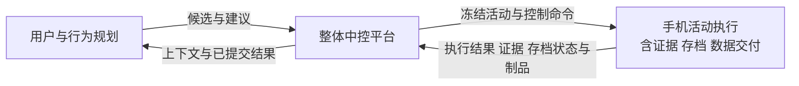
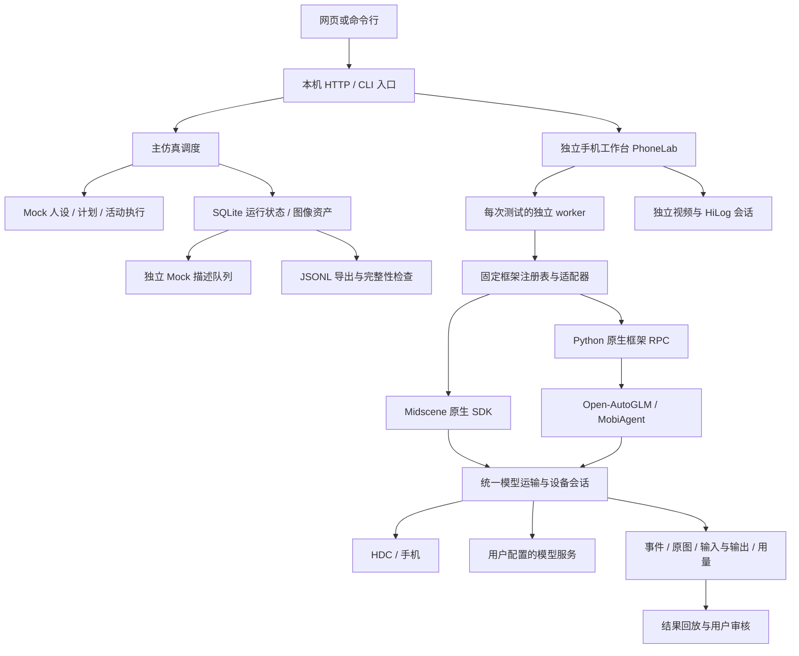
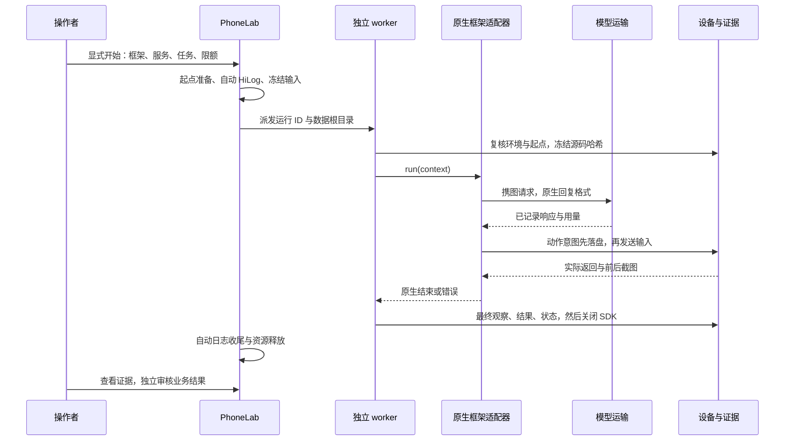

# v0.4 实际架构

核对基线：`v0.4.0-preview.14`，源码 `4da6336`；发布记录提交 `07e18d9`。本页面向内部维护与接入开发，现状部分描述已有代码；2026-10-30补充已确认的三大模块组织边界，详细契约见[分工 Spec](COLLABORATION_MODULES.md)。组织方向已确认，源码尚未据此完成重构，不能把逻辑契约当作现成API。

## 已确认的三大模块组织边界

| 一级模块 | 包含的内部职责 | 当前代码对应 |
|---|---|---|
| 用户与行为规划 | 用户／人设、日计划、实际结果后的调整建议 | 用户库与人设输入、内容／规划适配；当前内容仍Mock |
| 手机活动执行 | 活动执行、实时视觉与动作、证据采集与记录、独立存档处理、数据交付 | PhoneLab、worker、原生框架／设备、证据、描述队列与数据导出 |
| 整体中控平台 | 工作台、仿真运行与编排、公共基础、契约与集成、软件交付 | 网页／HTTP／CLI、调度与运行状态、通用存储／模型／租约／进程、诊断与打包 |

图为模块协作方向，下面的执行路径图为当前实现。中控先提交执行结果再请求规划反馈；手机模块内部的执行、存档和导出分别推进。公共调用与存储工具由中控提供，业务字段由所属功能模块定义；数据交付归手机模块，软件安装与升级归中控。

## 两条执行路径

主路径的调度、状态、存储和导出实际运行，但人设、计划、手机动作与描述内容是 Mock。独立工作台运行过真实框架、模型和手机循环；这条真实链没有被 v0.4 主调度自动调用。模型配置页的角色绑定也不会把 Mock 主流程自动切成真实执行。

## 目录与职责

| 区域 | 入口 | 职责与限制 |
|---|---|---|
| HTTP 装配 | `src/web-server.mjs` | 本机路由、服务对象、后台任务及关闭；不提供多人鉴权服务 |
| 主调度 | `src/scheduler.mjs`、`runner.mjs` | 用户／日／活动顺序、虚拟时间、先保存结果再做反馈 |
| 主运行数据 | `src/store.mjs`、`contracts.mjs` | schema 2、事务、计划、活动、步骤、结果、描述与调用追踪 |
| 可替换内容 | `src/adapters/` | 当前 Mock 与日内容生成入口，来源须显式保留 |
| 用户与配置 | `user-library.mjs`、`model-settings.mjs` | 工作空间用户库、配置修订与密钥分离 |
| 手机应用服务 | `phone-lab.mjs`、`phone-tasks.mjs` | 任务、起点、单项／批次生命周期、审核、档案读取与导出 |
| 起点与伴随态 | `phone-startpoints.mjs`、`phone-companion-start.mjs` | 显式复位、设备／系统／屏幕条件和通用机型资料 |
| 测试执行 | `scripts/phone-lab-worker.mjs` | 冻结输入、起点复核、模型与动作约束、最终截图、结果落盘及清理 |
| 框架接入 | `phone-framework-registry.mjs`、`integrations/adapters/` | 固定白名单、上游版本、原生 SDK／循环桥；不是任意模块热加载 |
| 模型边界 | `gui-trial-transport.mjs`、`phone-model-network.mjs` | 请求检查、调用记录、用量和网络取消；无隐式模型回退 |
| 设备边界 | `phone-device.mjs`、`hdc-environment.mjs` | HDC、屏幕尺寸、截图、布局、物理动作与效果未知状态 |
| 证据与保护 | `phone-evidence.mjs`、`phone-action-effects.mjs`、`phone-grounding-recovery.mjs` | 追加日志、图像哈希、前置校验与有限定位恢复 |
| 观察与日志 | `phone-video*.mjs`、`phone-hilog.mjs` | 可选 HOScrcpy／H.264 投屏与两路 HiLog；不决定业务成功 |
| 网页 | `web/` | 主工作台、任务、测试、过程、结果与对比；展示事实及显式命令 |
| 验证与交付 | `tests/`、`scripts/*package*`、`build-portable.mjs` | 临时夹具、依赖诊断、源码清单、部署包和已审阅档案 |

## 一次真机任务的调用顺序

模型坐标异常在交给框架前被识别时，定位恢复层可重新截图并新增请求；并不撤销或重放设备输入。自动日志从起点准备前开始，手动日志另有生命周期。框架结束不自动写成业务通过。

## 数据所有权与恢复

| 数据 | 写入方 | 使用边界 |
|---|---|---|
| 用户库、人设快照 | `UserLibrary` / 主运行初始化 | 任务快照与可编辑用户库分开 |
| 计划、实际结果、反馈、虚拟时间 | 主调度与 `Store` | 实际结果先提交；缺反馈只补反馈，不重新采集已成功活动 |
| 任务与起点选择 | `PhoneTasks` / `PhoneLab` | 修订检查；已开始运行使用冻结副本 |
| 原始调用、动作、图像 | worker / 设备会话 / `PhoneEvidence` | 单运行写入者应串行，保留失败；原文不是用户判定 |
| 助手初判与用户复核 | `PhoneLab.review` | 分开保存，用户结论优先 |
| 描述与补跑 | 描述队列 | 只消费已有图像，不重新驱动手机 |
| 模型凭据 | `ModelSettings` / 密钥保护 | 不从公共读接口返回；Windows 新写入使用当前账户 DPAPI |

工作台每次开始创建独立运行；没有通用的原生框架会话自动续接。未知动作效果进入 `needs_attention`，不能按原 prompt 无条件重放。输入锁的崩溃窗口仍有已复现缺口，见审查 R01；不能仅因存在 `device-lease.mjs` 就宣称所有输入入口已接上它。

## 运行目录与接口边界

| PRD需求 | 主要模块／数据责任 | 验证入口 |
|---|---|---|
| Q01–Q02 | 任务修订／起点，PhoneTasks 与 PhoneLab | PRD A01；workbench／bundled-tasks／startpoints 测试 |
| Q03–Q04 | 注册表、PhoneLab、固定 adapter、测试组合 | PRD A01/A03；registry／evaluation 测试 |
| Q05、Q08 | 证据、过程查询、视频与 HiLog、网页回放 | PRD A02/A07；trace／process／image-time／hilog 测试 |
| Q06–Q07、N03 | worker 门禁、设备会话、未知效果与定位恢复 | PRD A03/A04；action-effects／grounding-recovery；R01 仍待修复 |
| Q09、N02/N06 | 只读历史、审核、资产哈希、密钥与导出 | PRD A05/A08；bundled-history／privacy；R02 仍待修复 |
| Q10 | scheduler／Store／独立描述与导出 | PRD A06；pipeline 测试和 Mock 教程 |

- `.data`：用户库、模型设置、主运行库、手机任务／起点／新运行；属于操作者数据。
- `.runtime`：项目局部依赖、设备工具配置、锁、启动器控制和诊断；不能整体当作源码提交。
- `test-archive`：发布包已审阅的只读历史，由发布导出工具生成，不含可用模型凭据。
- `.build`、`output`：隔离验证和生成物；不参与日常源码分工。
- HTTP 只监听本机，校验 Host 与写请求来源；不因此获得跨机器部署或多人权限能力。

现有代码仍有5处 `src` 到 `scripts`／`web` 工具的静态依赖，图像尺寸读取和共用消息格式未全部放在独立公共目录。当前图示是责任解释，不是已经满足严格依赖反转的证明。应通过[审查清单](CODE_REVIEW_V04_20261030.md)分步整理。
