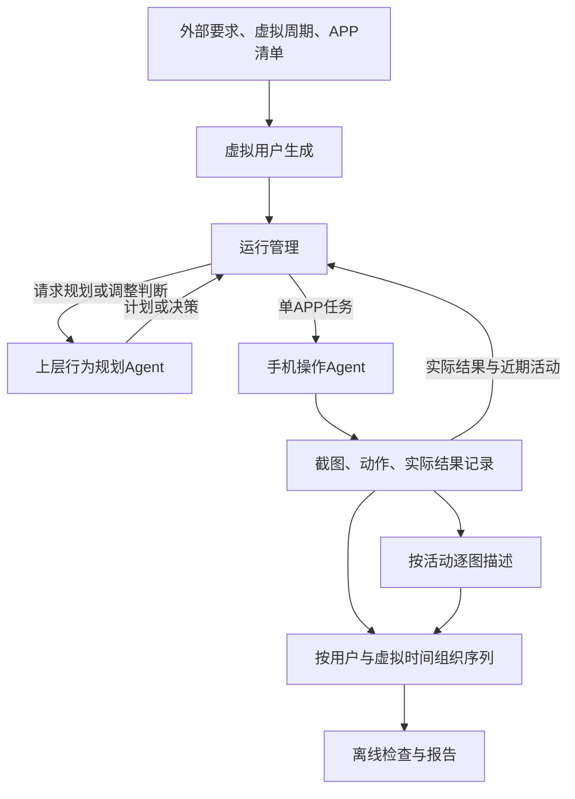

# 用户行为序列仿真系统：Codex 项目交接文档

版本：v0.1｜整理日期：2026-10-18

本文整合本轮提供的架构讨论与相关项目背景，作为开始工程实现的上下文。不是逐字聊天记录，也不是已经完成技术评审的详细设计。标注为“已确认”的内容应保持；“暂定”可后续调整；“建议”是为启动工程补充的方案，不代表用户已经选择技术栈。

## 1. 项目目标与研究背景

建设一个用户行为序列仿真生成系统，为终端端侧智能体记忆系统的长期记忆演化研究提供输入数据。最终希望批量生成多个虚拟用户、每人月级至一年的行为序列。

当前用户数量预计只有几个。首版优先跑通少量用户、短周期真实采集，再逐步验证长周期生成能力。架构从开始就应支持多用户、独立进度和可恢复运行，但不必直接建设分布式平台。

研究第一阶段重点是“稳定信息逐步积累＋偶然行为干扰”。用户偏好随时间变化属于后续研究方向，本轮人设保持固定。固定人设不意味着每天活动相同。

本项目只生成记忆系统的上游行为数据，不实现记忆提取、融合、更新、检索或完整的用户记忆引擎。上层只使用简单人设、有限近期实际活动和当前执行结果，不重建另一套复杂记忆系统。

## 2. 已确认需求与边界

| 主题 | 当前结论 | 状态 |
|---|---|---|
| 用户来源 | 外部提供要求，系统补全多个简单人设 | 已确认 |
| 人设使用 | 上下层Agent共享；本轮固定；用户上下文独立 | 已确认 |
| 行为决策 | Agent参考人设自主决定每日/时段活动，保留自然变化与偶然行为 | 已确认 |
| 行为参数 | 不以一套手工概率、扰动参数配置替代Agent自主选择 | 已确认 |
| 两层Agent | 上层行为规划；下层页面理解与逐步手机操作决策 | 已确认 |
| 每日计划 | 只由上层Agent生成，运行管理只负责请求、保存、推进 | 已确认 |
| 活动反馈 | 每项活动结束都判断是否调整；每日计划作为基线，优先局部修改 | 已确认 |
| 数据来源 | 尽量通过真实手机操作获得真实截图，不建设复杂APP状态控制系统 | 已确认 |
| 长周期模拟 | 短时间连续浏览不同真实对象，映射到长周期虚拟活动 | 已确认 |
| 不足兜底 | 实在无法满足时允许必要文字改编，由上层判断；具体规则暂不展开 | 已确认，细则未定 |
| 手机接口 | 已有hipyum一类模拟手机操作接口；具体接口文档尚未提供 | 已知条件 |
| 工作量表达 | 使用对象数、操作目标与结束条件，不以模拟人类投入分钟数作为主要任务量 | 已确认 |
| 活动关系 | 活动间可以无关，如上午看新闻、中午找餐厅 | 已确认 |
| 可用APP | 运行前提供指定APP与基本能力，在范围内规划 | 已确认 |
| 单次活动 | 暂限一个APP；不同活动可使用不同APP | 暂定 |
| APP账号 | 不同虚拟用户首版共用账号，保留环境互相影响问题 | 暂定 |
| 执行顺序 | 优先连续生成一个用户较长周期，再处理其他用户 | 已确认 |
| 截图 | 采集过程中每张截图都记录；最终消费数据未必需要携带截图字节 | 已确认 |
| 图文描述 | 当前基线为活动结束后按顺序逐图生成描述；早期曾说明不必把这一时机做成不可变硬约束 | 当前设计基线 |
| 异步推进 | 下一活动执行可与上一活动描述重叠；执行进度与描述进度分别维护 | 已确认 |
| 上层反馈依据 | 操作结果摘要足以支撑大多数判断，不默认等待全部VLM描述 | 已认可的假设，需实测 |
| 生成质量 | 先生成，再离线检查；检查报告不自动触发本轮重规划 | 已确认 |

APP具体名单、硬件系统、设备数量、模型服务、代码仓库、语言与部署环境均未确定。不要把“新闻、种草、常用APP”等方向性举例当成已经给出的APP清单。

## 3. 整体架构与职责

各模块是职责划分，首版可在同一程序中实现，不要求各自独立服务。

| 模块 | 输入 | 核心职责与输出 | 边界 |
|---|---|---|---|
| 虚拟用户生成 | 外部用户要求 | 补全简单人设，保留输入要求与对应关系 | 不预编全年经历 |
| 运行管理 | 配置、人设、已保存进度 | 维护当前用户/日期/活动、调度设备、调用模块、持久化与恢复 | 不决定每日活动和行为调整 |
| 上层行为规划Agent | 人设、虚拟日期、APP能力、有限近期实际活动、必要执行结果 | 每日计划、活动任务、采集需求、活动后调整决定 | 不编造真实页面中的具体对象和执行成功 |
| 手机操作Agent | 人设、当前活动、页面、活动内进度 | 理解页面、逐步决策、调用hipyum、保存步骤、返回实际结果 | 内部技术方案另行细化；只有操作接口并不等于已有完整Agent |
| 行为记录 | 计划关联、截图、动作、实际结果 | 事实记录与有限近期实际活动清单 | 不提取偏好、不更新人设 |
| 逐图描述 | 某活动的有序截图 | 每张截图对应的原始VLM描述、失败信息、处理进度 | 不因描述晚完成而改变事件顺序 |
| 序列组织与输出 | 原始记录、描述、必要加工决定 | 各用户的有序事件与可追溯来源 | 不把计划直接写成已发生事实 |
| 离线检查 | 已生成序列与来源 | 完整性问题、行为效果问题及证据报告 | 不自动驱动本轮规划 |

用户生成与逐图描述可以调用模型，但不因此增加一层用户行为决策Agent。

## 4. 运行流程

1. 外部提交仿真周期、用户要求及指定APP能力清单。
2. 系统补全简单人设，为每个用户建立独立上下文。
3. 运行管理读取当前用户的虚拟日期和进度；若当天尚无有效计划，向上层请求每日规划。
4. 上层生成当天活动：虚拟时间、APP、目标、可量化任务量、结束条件与必要执行约束。可以有不使用手机的时间段，无需填满全天。
5. 运行管理保存计划，并派发下一活动给手机操作Agent。
6. 下层在真实页面上逐步选择具体对象和动作，过程中保留截图、动作与关联。每次活动使用独立操作上下文，避免上一任务目标串入下一任务。
7. 活动完成、部分完成或受阻时，先保存真实结果，再请求上层判断。
8. 上层决定继续、补充/收尾当前活动、修改受影响的剩余活动，或在特殊情况下更大范围调整。不要每次反馈都重新生成全天计划。
9. 活动截图进入描述阶段，同一活动内部按顺序逐张处理；设备可继续下一活动。
10. 运行管理分别推进执行与描述进度，按需恢复局部失败。
11. 序列按用户、虚拟时间和活动内顺序组织。未完成描述的数据应明确标状态，不冒充完整数据。
12. 生成后进行离线检查，输出问题及来源证据。

对上层的常规输入保持有界：简单人设、当天计划、本次结果、有限近期实际活动。全年原始数据由系统存储，不每次全部塞入提示词。近期清单的长度/时间窗口尚未确定。

## 5. 时间与真实性

必须区分三组信息：

- 计划与实际：计划查看3家餐厅，实际查看2家，只记录真实完成2家；近期清单来自实际结果。
- 虚拟时间与真实时间：虚拟时间决定最终行为顺序；真实采集时间保留用于溯源，描述生成时间另记。
- 原始数据与加工文本：截图、动作、原始VLM描述独立保留；加工文本与加工理由另行关联，不覆盖原文。

长周期主要靠真实内容对象和活动变化模拟。例如短期内多次浏览不同商品，对应多个虚拟日的浏览活动。不要求真实等待数月，也不建设按虚拟日期回拨APP状态的系统。

文字改编的真实性规则未最终讨论确认。此前关于仅改时间表述、禁止新增对象等建议，不应被实现成用户已经确认的固定策略。工程上先保留原始/加工分离、来源关联与上层决定的接口。

## 6. 数据契约建议（待实现时定稿）

以下为保证模块可衔接的工程建议，不是既有接口。ID、枚举和字段名可以调整，但语义与关联应保留。

| 实体 | 建议字段 |
|---|---|
| Run | run_id、schema_version、虚拟起止日期、虚拟时区、外部要求、APP能力清单、运行配置、状态 |
| User | user_id、run_id、人设、原始要求、当前虚拟日期、执行进度 |
| DailyPlan | plan_id、user_id、虚拟日期、版本、活动列表、生成依据、有效状态 |
| ActivityTask | activity_id、plan_id、user_id、虚拟开始时间、app_id、目标、量化任务量、结束条件 |
| ExecutionResult | activity_id、attempt_id、完成状态、实际结果摘要、完成量、结束原因、失败信息、真实起止时间 |
| Step | step_id、activity_id、attempt_id、step_index、APP、截图引用、动作、动作参数、真实采集时间、虚拟事件时间/顺序 |
| Description | screenshot_id、描述状态、原始描述、模型/提示版本、处理时间、错误、重试记录 |
| AdjustmentDecision | activity_id、决策类型、原因、修改范围、计划新版本或补采任务关联 |
| Event | event_id、user_id、虚拟时间、顺序键、activity_id、来源步骤/截图引用、原始文本、加工文本、加工依据、完整状态 |
| CheckReport | 检查范围、规则/模型版本、问题类型、证据ID、判断与不确定性 |

“截图→动作”的先后语义尚未明确：可能同时需要动作前/动作后截图。接入时必须明确并写入契约，不能仅靠数组位置猜测。一次动作也可能产生多张截图，关联设计应允许这种情况。

虚拟时间细化到步骤的规则尚未确定。首版至少确保活动时间与活动内顺序稳定，不擅自赋予精确到秒的真实含义。

建议导出JSONL事件并附运行元数据；截图可作为可选资产包或路径/ID引用。具体导出格式和最终截图保留策略待定。采集阶段不丢弃截图，不把“最终无需携带截图”理解成“无需采集”。

## 7. 持久化、异步与恢复建议

首版重点是可靠的单机流水线。数据库、队列产品尚未选择；可评估SQLite＋文件资产＋持久化任务表，避免为了几个用户引入过多基础设施。

- 执行状态与描述状态分开保存，不能用一个“完成”表示全部阶段完成。
- 活动结果可靠落盘后，才能作为上层反馈和后续调度依据。
- 保存计划版本和局部调整，保留原计划与执行事实。
- 描述任务按截图记录状态，失败只补缺失项，不重采已经成功的活动。
- 导出和检查可从已保存记录重建。
- 手机活动执行中断后，需要重新观察当前页面并结合已记录步骤判断继续、终止或重试；不能保证直接重放安全。
- 恢复时尤其避免重复产生收藏、提交等有副作用的动作。恢复策略须结合hipyum能力与任务性质确认。
- 同一用户上下文不得混入其他用户记录；共用APP账号造成的环境影响仍需保留。
- 设备忙闲与描述待处理量需要可观察。具体并发度、队列上限、重试次数后续实测决定。

## 8. 首版实施顺序建议

### 阶段A：工程骨架与契约

明确领域实体、模块接口、配置、持久化及命令行入口。使用明确标注的Mock规划器/执行器/描述器验证流程，不把Mock数据称为真实采集。先保证可运行、可查看状态、可中断恢复。

### 阶段B：最小真实闭环

接入一个明确指定APP、真实模型规划和真实手机执行，先做一个用户一天的少量活动。页面理解与逐步决策技术先对齐方案再实现，不擅自假设hipyum自带这些能力。验证逐步记录、活动反馈、后台描述和导出均可追溯。

### 阶段C：少量多用户与跨日

连续执行数天，验证用户上下文隔离、计划版本、活动局部调整、部分失败与描述补跑。离线检查用户差异、稳定倾向、偶然行为和重复。

### 阶段D：长周期验证

先扩到周/月，再根据实际产能评估一年规模。用户固定人设是否能支撑自然长期行为，需要实验，不能只靠代码跑通就宣布成立。

以上阶段是启动建议，非已确认工期。不要未经讨论一次性交付完整年级系统。

## 9. 最小验收建议

1. 能从外部要求生成人设，运行进度按用户独立保存。
2. 每日计划实际由规划Agent生成，运行管理没有另一套每日行为生成逻辑。
3. 单活动只在指定APP内执行；真实步骤、截图与动作可关联查询。
4. 部分完成与主动结束、执行受阻可以区分；计划目标不覆盖实际结果。
5. 每次活动后有调整判断记录；正常反馈继续原计划，局部调整不误删已完成记录。
6. 允许描述与下一活动重叠，同一活动描述按序；描述失败后仅补跑缺项。
7. 中断恢复不混淆两个用户，不默认重采已经完成的活动。
8. 导出按虚拟时间和顺序稳定排列，真实采集时间、原文与加工文本可溯源。
9. 离线检查输出报告，不自动触发本轮重规划；完整性检查可在链路中阻止不完整数据被标记为完整。
10. 模拟适配器与真实适配器在结果中可辨别，日志不混淆两者。

测试优先覆盖状态恢复、用户隔离、顺序、部分失败、局部调整和数据来源等关键行为。行为自然性由真实生成实验与离线报告验证，不能用固定模板的单元测试替代。

## 10. 评估与规模估算

离线行为效果检查至少关注：不同用户是否有差异；同一用户跨日是否有稳定倾向；是否存在偶然行为；是否机械重复；是否过度刻意展示人设。自动判断的可靠性也待验证，报告应给证据而非只给总分。

工程实测记录：活动耗时、步骤/截图数量、任务完成率、模型调用量/费用、描述吞吐、失败与重试率、积压量、恢复耗时。

历史讨论中的量级示例：若每用户每天6次活动、每次20张截图、真机执行3分钟，则3个用户各365天约6570次活动、131400张截图、328.5个设备小时，约13.7个连续设备日。该值只是示例，不是配置要求或性能承诺，未计入故障、等待及描述资源开销。虚拟时间压缩省掉活动之间的等待，不能省掉真实操作和逐图处理成本。

## 11. 启动前待对齐事项

优先级高、影响真实接入：

1. hipyum接口文档、连接方式、支持的设备/系统、截图和操作返回值。
2. 首个指定APP及允许的基本能力；测试设备、账号条件。
3. 下层页面理解与逐步决策方案的已有技术材料或可复用代码。
4. 文本模型/VLM服务接入方式、可用端点与配置方式。密钥使用环境变量，不写入文档或代码。
5. 现有仓库和运行环境、技术栈偏好；如已有项目，先检查再选择。

可在骨架阶段使用可替换默认值：简单人设字段、近期活动窗口、导出格式、虚拟步骤时间规则、有限重试与并发参数。应在文档明确默认值及理由。

暂不展开：文字改编详细真实性规则；下层内部算法比较；长期偏好演变；跨APP活动；账号隔离；分布式规模化。为后续扩展保留接口，不提前建设完整子系统。

## 12. 与用户协作的工作方式

- 设计中遇到影响目标、架构和行为效果的不确定点，先给专业分析和可实现选项，再与用户逐步讨论。
- 用户明确要求不要一次性完成所有设计；实现分阶段推进，每阶段提供可运行结果、验证证据和剩余问题。
- 不重复询问本文已确认的结论，也不要反复重规划。
- 先复用通用组件；用户差异、共享APP环境等后续注意点明确记录。
- 避免只给抽象逻辑：需要具体模块、输入输出、实现结果与验收依据。
- 常规可逆工程细节可自行推进；缺少真实接口资料时先做独立骨架，不伪造集成完成。

## 13. 可直接给Codex的启动指令

> 请先完整阅读本文件，作为本项目的业务需求与架构基线。目标是构建为长期记忆研究提供数据的用户行为序列仿真系统。
>
> 先检查已有仓库、AGENTS.md、代码与运行环境，不要直接重新搭建已有组件。区分已确认需求、暂定约束和工程建议，不擅自把建议升级为用户要求。
>
> 第一轮完成工程骨架、模块契约、持久化进度和可替换适配器，跑通明确标注的Mock闭环并验证恢复、顺序和用户隔离。技术栈未给定时，提出适合本环境的轻量方案，并说明理由；常规可逆实现可以继续推进。
>
> 保持程序管理进度、上层生成每日计划与调整决定、下层执行真实操作的边界。执行与逐图描述分别推进，计划与实际、虚拟与真实时间、原文与加工文本分开保存。
>
> 真实接入前集中列出最少的缺失信息，尤其是hipyum接口、首个APP、模型服务和下层决策方案。不要把只有手机操作API描述成已有完整手机Agent，不要把Mock输出称为真实数据。
>
> 每阶段报告做成了什么、如何运行、验证结果、仍受哪些条件限制。涉及架构和行为效果的关键不确定点与我逐步讨论，不要一次性建设完整长期系统。
