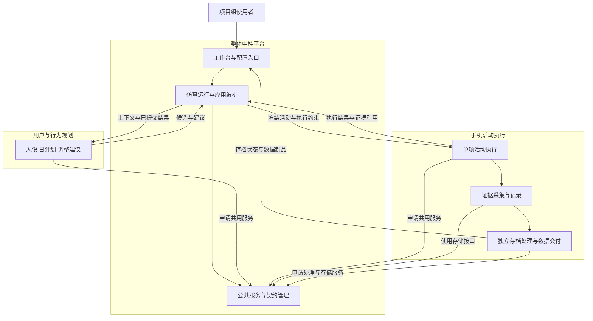

# v0.4 三大模块分工与协作 Spec

| 文档项 | 内容 |
|---|---|
| 标识／修订 | COLLAB-V04 / R3，2026-10-30 |
| 已确认方向 | 用户与行为规划、手机活动执行、整体中控平台三个一级模块 |
| 适用范围 | v0.4 当前代码的协作组织与后续维护，面向项目组内部开发 |
| 当前状态 | 本轮按用户确认方向整理职责、契约、数据归属与维护任务；尚未按此方案重构源码 |
| 执行边界 | 只改文档，正式发布继续暂停，不启动真实模型、手机或旧队列 |

## 1. 三个模块分别负责什么

| 一级模块 | 主要问题 | 职责 | 主要交付 |
|---|---|---|---|
| **M1 用户与行为规划功能模块** | 给定用户和条件，应安排什么活动？ | 用户条件、人设候选、日计划、根据实际结果提出调整；保留生成输入、原稿与来源 | 可审核的人设与计划、调整建议及生成记录 |
| **M2 手机活动执行功能模块** | 当前活动怎样在手机上完成，实际采集到了什么？ | 单项活动执行、框架适配、HDC操作、证据采集、原始记录、存档处理与数据交付 | 执行状态与实际结果、原图和轨迹、存档数据及完整性清单 |
| **M3 整体中控平台** | 怎样配置、组织、控制和观察整个过程？ | 平台／工作台设计、仿真运行、虚拟时间、任务调度、暂停恢复、公共基础能力、各模块契约与集成 | 可操作的统一平台、运行状态、模块调度、共用服务、部署与维护工具 |

M2 的“交付”指**行为数据交付**，包括事件、原图、描述及导出清单。软件安装包、部署、升级、备份与回退归 M3。三大模块是开发职责，不代表新增三类业务使用者，也不要求恰好三个人。

## 2. 每个模块内部怎样保持清楚

### M1 用户与行为规划

- **用户与人设**：根据条件形成候选，保留原始输入和审核后的快照。
- **行为规划**：根据用户快照、虚拟时间和已发生的实际结果提出活动安排。
- **反馈调整**：针对已提交的执行结果，建议保持计划或调整尚未完成的部分。

M1 输出建议，由中控检查版本与约束后应用。M1 不直接调用 M2，不操作设备，也不覆盖已经发生的执行事实。模型调用复用 M3 的统一调用服务，不能自行增加隐藏重试或切换模型。

v0.4 这些内容当前仍为 Mock；这里确定其职责与独立接入位置，不将真实规划计为本版已实现能力。

### M2 手机活动执行、证据与存档

M2 内部保留三个子职责，方便独立测试和补跑，但不再升为三个一级协作模块：

| 内部部分 | 负责什么 | 状态与恢复边界 |
|---|---|---|
| 活动执行 | 起点准备与核对、框架循环、实时观察与动作、当前活动停止和结果核对 | 决定当前活动能否安全继续；未知动作不能盲目重放 |
| 证据采集与记录 | 输入／环境／调用／动作／图像的关联、原文、哈希、完整性、查询与回放数据 | 保存执行事实与异常；损坏或缺失必须说明，不用摘要补造事实 |
| 存档处理与数据交付 | 消费已落盘原图、逐图描述、失败补跑、数据导出与制品清单 | 描述只补已有图，导出只使用已保存事实；不重新驱动手机 |

执行结果可以先提交给中控，存档队列独立推进。**执行结束、存档完成、导出完成分别记录**；描述失败不能导致手机活动重采，执行结束也不能掩盖存档缺口。执行时用于决策的视觉观察与事后存档描述承担不同职责。

M2 不安排下一项用户活动、不推进虚拟日期。当前独立工作台主要提供执行状态和证据，最终业务判定由使用者审核；通用数量／条件核验、真实存档描述不能因归入模块就被写成已有能力。

### M3 整体中控平台

M3 内部分为三个子部分，分别维护，避免形成一个承担全部业务的大文件：

| 内部部分 | 负责什么 | 边界 |
|---|---|---|
| 平台／工作台 | 用户与任务配置入口、模型配置、过程与结果展示、审核、查询和下载入口 | 展示状态、发送显式命令，不在网页另写业务计数或恢复规则 |
| 仿真运行与应用编排 | 用户／日／活动顺序、虚拟时间、调度、运行控制、结果提交后触发规划反馈 | 运行内核只管顺序与状态；薄应用编排负责调用 M1/M2，不编写用户偏好或手机操作策略 |
| 公共基础与模块集成 | 契约、存储事务、模型配置／密钥／运输、通用资源租约、进程管理、追踪、诊断、打包、备份与回退 | 提供共用技术能力，不替 M1 生成行为，不替 M2 判断活动完成 |

平台维护契约的统一版本与校验方式；M1/M2 负责各自业务字段的含义，影响生产方和消费方的变化由相关模块共同核对。不能由平台单方面猜测所有业务规则，也不能由各模块绕过平台各自建立一套密钥、计量或设备锁。

## 3. 模块怎样协作

图为已确认的组织方向，**不是当前三模块已经联通真实闭环的实现图**。v0.4 的主仿真 Mock 与独立真实手机工作台仍是两条执行路径，实际情况见[架构说明](ARCHITECTURE.md)。

正常业务顺序：

1. 使用者在中控配置任务、用户、框架／模型与约束，中控冻结运行输入。
2. 中控向 M1 取得人设或计划建议，校验后确定当前活动。
3. 中控将一项冻结活动交给 M2；M2 在活动内观察、操作并采集证据。
4. 中控提交 M2 返回的执行结果和引用，再向 M1 请求后续调整。
5. 中控应用有效建议后继续；M2 内的存档队列独立消费已保存原图。
6. 使用者在中控查看执行、存档和导出各阶段状态，审核或取得 M2 生成的数据制品。

当前独立测试可以不启动 M1，由中控直接派发使用者输入的单项任务。各模块能用替身独立验证，不以真实模型或手机作为日常开发的前提。

## 4. 交换哪些信息

以下是模块职责契约，不是新建完成的 API 或已导出的类。现有原生框架适配入口仍是 `run(context)`，见[接入 Spec](FRAMEWORK_ADAPTER_GUIDE.md)。

| 逻辑契约 | 生产与消费 | 最少内容 | 限制 |
|---|---|---|---|
| 用户／运行上下文 | M3 → M1 | 用户条件与快照修订、虚拟时间、已提交实际结果、允许能力 | 不传可变内部对象或其他用户上下文 |
| 人设／计划／调整建议 | M1 → M3 | 候选或活动、建议依据的修订、原始生成引用 | 只提出建议，不直接更新运行进度或已完成事实 |
| 活动输入 | M3 → M2 | 任务ID／修订、APP、目标、判定与禁止要求、起点、框架／模型来源、限额 | 开始后使用冻结输入，不静默套用可编辑任务的新值 |
| 执行事件与结果 | M2 → M3 | 运行／活动／步骤ID、调用与动作引用、原图、执行状态、证据、原因与未决项 | 实际量有证据才给；框架结束、模型声称完成与人工通过分开 |
| 存档状态与数据制品 | M2 → M3 | 图像ID／哈希、描述原文与来源、处理状态、缺失、导出清单 | 不把描述改写为执行事实，不因缺描述重新采集 |
| 运行控制 | M3 → M1/M2 | 命令ID、作用对象、停止／取消／继续意图、预期修订 | 中控发出继续不等于 M2 已证明可以安全续接 |
| 共用服务调用 | M1/M2 → M3 | 角色／服务修订、请求、调用ID、资源归属 | 密钥不写进模块业务输出；失败、未知用量和额度可追溯 |

模块消息携带协议版本、运行与活动标识、来源和单位。兼容新增可演进；破坏性变化同步生产方／消费方与旧记录样例，不能让 UI、执行与导出分别解释同一字段。

## 5. 谁拥有数据与决定权

| 事项 | 业务负责方 | 中控的责任 |
|---|---|---|
| 用户／人设／计划的内容与建议原稿 | M1 | 提供配置和审核入口，保存引用与冻结修订；正式应用由编排执行 |
| 当前活动的设备操作与实际观察 | M2 | 提供允许的配置与资源占用服务，不下达具体点击策略 |
| 原始调用、动作、图像与存档语义 | M2 | 提供共用存储／事务／密钥工具、查询入口和备份，不补造事实 |
| 运行进度、虚拟时间、下一活动与阶段状态 | M3 | 保存可靠位置，按已提交结果推进，展示未决和失败 |
| 使用者审核意见 | 使用者决定，M3保存 | 与自动初判分开，关联证据，不能覆盖原始执行记录 |
| 模型计量、资源租约和进程状态 | M3公共基础 | 各模块统一使用；不得用新的运行ID绕过同一设备的占用 |
| 软件安装包、升级与回退 | M3 | 生成独立新包与清单，保留旧版，验证发布范围 |

业务归属与通用存储实现分开：M2定义证据和数据交付格式，M3提供通用保存、事务与备份工具；不因此建立两套原图仓库或两个事件写入者。现有源码尚未全部通过独立端口访问，这是重构前需要保留的事实。

## 6. 异常与恢复由谁处理

| 情况 | 负责方 | 应保持的行为 |
|---|---|---|
| 人设／规划生成失败 | M1报告，M3保存阶段 | 不重做已经完成的手机活动，不隐式切 Mock |
| 手机动作错误或效果未知 | M2 | 核对当前活动能否继续，无法确认时保留待处理；中控不能强行重放 |
| 服务退出但 worker 仍活着 | M3资源工具与M2执行链共同检查，M2牵头修复 | 未确认旧输入退出前不允许新输入；对应审查R01，当前尚未修复 |
| 轨迹损坏或缺图 | M2给出完整性状态，M3展示与限制审核 | 不静默丢弃关键证据；对应R02，当前尚未修复 |
| 存档描述失败 | M2存档子部分 | 只补已有图，保留处理历史，不触发执行重采 |
| 执行结果已提交，反馈尚未完成 | M3定位，M1补反馈建议 | 只补缺失阶段，不重新执行已确认活动 |
| 存档或导出尚未完成 | M2报告，M3分别展示 | 执行完成不等于全部阶段完成，不能隐藏数据缺口 |

## 7. 当前文件怎样认领

这是现有文件的主要维护责任，不表示本轮已搬目录或拆文件。共享文件只设一个主要提交方，其他模块提供接口、样例与针对性变更。

| 模块 | 当前主要落点 | 容易交叉的地方与规则 |
|---|---|---|
| M1 用户与行为规划 | `user-library.mjs`、`persona-input.mjs`、`adapters/daily-content.mjs`及规划适配内容 | 用户内容与规则由M1维护；页面入口和通用数据库变化由M3配合核对 |
| M2 手机活动执行 | `phone-lab.mjs`、`phone-tasks.mjs`、worker、框架注册与adapter、起点、设备、视频、HiLog | `phone-lab.mjs`虽含查询和审核接线，当前由M2维护；M3通过约定接口接入，不同时重写 |
| M2 证据／存档／数据交付（内部子职责） | `phone-evidence.mjs`、`descriptions.mjs`、`output.mjs`、过程与资产查询逻辑 | 格式、完整性和数据制品归M2；描述和执行子任务可以内部认领，统一字段语义 |
| M3 平台／工作台 | `web/`、`web-server.mjs`、`cli.mjs` | 只负责输入、控制和展示；涉及模块装配由M3统一提交并与M1/M2核对 |
| M3 仿真运行 | `scheduler.mjs`、`runner.mjs`、当前集中装配的`adapters/mock.mjs` | 维护顺序、阶段与装配；M1/M2贡献适配实现，不各自修改调度和运行数据库 |
| M3 公共基础与软件交付 | `contracts.mjs`、`store.mjs`、模型配置／运输／密钥、`device-lease.mjs`、追踪、诊断、打包与部署说明 | 表结构、公共协议和资源政策由M3维护；业务字段含义与相关模块共同确定 |

`store.mjs` 当前仍包含多类业务记录，`adapters/mock.mjs`仍集中多种替身，部分运行逻辑直接查 SQL；这些是现状耦合点。先明确写入和装配责任，逐步提取稳定接口，再增加同时开发的人数，不能按模块名称直接假定已经解耦。

## 8. 后续维护任务怎样分配

每个任务一个牵头模块，必要配合单列。以下为已审查问题的修复建议，尚未实施：

| 具体任务 | 牵头与配合 | 要交付什么 | 完成条件 |
|---|---|---|---|
| 服务异常退出后，旧测试没停完时拒绝新测试 | M2牵头；M3配合公共租约／进程工具 | worker登记、输入占用与释放确认、异常状态和测试 | 活worker不得重新占用；退出、停止、竞争与旧锁分别验证，不靠删锁继续 |
| 轨迹损坏时明确提示不完整 | M2牵头解析与证据规则；M3配合页面、API和审核入口 | 损坏位置、完整性字段、页面提示与导出说明 | 区分内部坏行、未完成尾行、不可读文件及缺图，不静默跳过 |
| 长轨迹只读新增部分 | M2牵头事件／资产查询；M3配合查询接口与页面 | 增量／分页读取、图片索引、旧记录兼容与规模报告 | 边追加边查看不丢、不重、不乱序，给出明确规模下的耗时与内存 |

建议先修第一项；第二项先确定异常字段，M3可用样例并行做页面。第二项解析规则稳定后再推进第三项，避免两人分别重写同一查询。M1可以独立维护用户／规划契约和Mock夹具，不需要参与每个手机修复。

## 9. 分工与解耦怎样验收

- 不启动M2，M1可用给定上下文独立生成合法建议；不读设备或执行模块私有文件。
- 不启动M1，M2可由人工计划输入独立调试单项活动，输出证据和执行状态。
- M3可替换M1/M2的实现而不重写运行顺序；平台不包含具体用户偏好和手机点击策略。
- M2执行、存档与数据交付可分别测试、停止与补跑；描述失败不新增手机动作。
- 三模块共用模型计量、设备占用和通用存储；每类业务事实和每个公共文件有明确维护责任。
- 模块提交时先用统一合成样例联调，再按明确范围验证真实能力；代码可并行，同一设备的物理输入仍排他。

三大模块方向已确认，本页完成其工程展开。具体人员和任务认领按项目安排；业务修复、源码重构与正式发布仍需明确实施范围，不由本轮文档改写自动开始。
