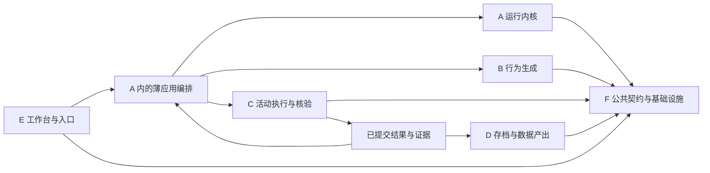

# v0.4 后续协作模块划分

日期：2026-10-30。状态：**供项目组核对的分工建议，不是已完成的源码拆分或后续实施授权。** 本页只整理 v0.4 当前基座及后续职责，不涉及更换开发语言，也不纳入其他本地开发版本的实现。

参考《查找项目开发技术栈》中对运行内核、行为生成、环境执行、存档、工作台及共同基础的讨论，保留其职责原则，按当前代码给出落点。不能把运行内核扩大成全部平台，也不能把手机框架当作整套仿真引擎。

## 六个主要协作模块

| 模块 | 负责与拥有的内容 | 输入／输出 | v0.4 现状与首先可做的工作 |
|---|---|---|---|
| A 运行内核与应用编排 | 时间、用户／日／活动顺序、运行状态、结果后反馈的提交顺序；薄应用编排连接 B/C | 用户和计划快照、活动结果 → 当前活动、状态转换、反馈请求 | `scheduler.mjs`、`runner.mjs`；先把运行机制与内容决策的调用边界说明清楚 |
| B 用户与行为生成 | 人设候选、日计划、根据已提交实际结果提出调整；拥有建议与模型原稿 | 用户条件、虚拟时间、近期实际 → 人设／计划／调整建议 | `user-library.mjs`、`persona-input.mjs`、`adapters/mock.mjs`；当前内容为 Mock，可先做独立夹具与接口校验 |
| C 活动执行与核验 | 单活动内观察、框架适配、动作、条件核验、实际结果与活动内安全恢复 | 冻结目标、约束、执行来源 → 事件、证据、实际结果、未决项 | `phone-lab.mjs`、worker、`integrations/adapters/`；优先补输入锁、证据读取缺口，新增框架不改调度规则 |
| D 存档与数据产出 | 消费已有原图做描述、描述补跑、图文关联、导出格式及质量检查 | 资产引用与处理配置 → 描述原文、处理历史、导出制品 | `descriptions.mjs`、`output.mjs`；描述仍 Mock，先保持只补描述而不采集手机的边界 |
| E 工作台与配置入口 | 网页／HTTP／CLI、用户和任务配置、过程回放、审核与调试入口 | 显式操作命令、查询条件 → 可理解的状态与证据 | `web-server.mjs`、`web/`、`cli.mjs`；拆分路由与视图职责，保持四页签与版本兼容 |
| F 公共基础与交付 | 稳定契约、存储事务、模型网关与密钥、设备／进程资源、证据索引、诊断、部署 | 各模块的明确端口请求 → 受控资源、持久事实、调用与交付记录 | `contracts.mjs`、`store.mjs`、transport、device、evidence、lease、打包脚本；指定公共接口与迁移负责人 |

F 不是把所有剩余代码放进去的目录。至少指定“契约／存储”“模型／设备资源”“验证／交付”三个子责任；谁修改公共协议和表结构须可追溯。C 决定单项活动怎样执行、完成多少；F 负责把允许的调用和设备输入可靠送出并记录，不负责替 C 判断完成。

这些是逻辑模块，可在同一仓库和服务中实现；不要求先拆微服务或新建空目录。后续其他引擎通过独立运行输入和制品接入平台能力，不要求所有引擎都伪装成手机活动；当前不预设其算法。

## 依赖与唯一写入责任

1. A 的内核只处理时间、顺序、状态转换；薄应用编排负责调用 B、C，不能在内核写商品、应用或提示词规则。
2. B 不直接调用 C，不写已经发生的结果；只提交候选，由编排校验并应用。
3. C 不修改用户日计划、不推进下一天；框架 `finish` 只产生执行事实，独立核验和用户审核继续保留。
4. D 只消费落盘资产；描述失败不得触发手机重采，也不把任务意图补成可见事实。
5. E 不在网页另写一套调度、计数、预算或恢复政策。接口返回的业务状态、进程状态、审核状态分别展示。
6. F 统一模型计量、设备所有权和事务；各模块不得自建绕过公共边界的客户端、锁或私有 SQL 通道。

## 首先一起核对的契约

下表是待核对的逻辑契约名称，并非当前已导出的类或完整接口。v0.4 原生适配的现成入口仍为 `run(context)`，见[适配指南](FRAMEWORK_ADAPTER_GUIDE.md)。

| 契约 | 最少字段／语义 | 所有权 |
|---|---|---|
| 用户与运行快照 | 用户 ID、输入修订、来源、虚拟时区与日期、允许能力 | A/B/F |
| 计划建议 | 活动列表、基于的快照版本、原始调用引用；不能覆盖已完成事实 | B 产出，编排应用 |
| 活动输入 | 活动 ID、APP、目标、判定要求、禁止操作、起点、框架／模型来源、限额 | 编排冻结，C 消费 |
| 执行事件 | 运行／活动／步骤 ID、序号、请求／动作引用、时间、来源、结果与不确定性 | C/F 追加 |
| 活动结果 | completed/partial/blocked 或对应实际语义、实际量、证据、结束原因、未决项 | C 核验；A 只按契约推进 |
| 反馈建议 | 明确引用已提交结果、保持或局部修改、建议修订 | B 产出，编排应用 |
| 存档任务 | 图像 ID、哈希、用户归属、处理配置、原稿与失败历史 | D |
| 制品清单 | 格式版本、源版本、文件哈希、缺失与审核状态、覆盖范围 | D/F，E 只展示与下载 |

跨进程消息须携带协议版本和调用 ID。破坏性变化先核对生产方／消费方，升级协议并提供兼容测试；不靠共享可变全局对象或直接读取对方的内部文件传状态。

## 适合不同人的首批工作包

| 工作包 | 主要修改范围 | 独立验证 | 集成条件 |
|---|---|---|---|
| C/F 输入所有权加固 | PhoneLab 输入锁、worker 所有权、异常退出 | 活父／死父、活 worker、锁竞争、停止与重启夹具 | 未确认释放前不能送出新输入；不改变观察会话的独立锁 |
| F/C 证据完整性 | 日志读取、资产索引、损坏行报告 | 截断行、损坏 JSON、缺图与哈希不符 | 页面／导出／审核对损坏状态口径一致 |
| E/F 长轨迹查询 | 后端增量读取、分页接口、网页游标 | 长合成日志、不丢／重事件、并发追加 | UI 不再通过全量读实现“增量” |
| C 框架适配维护 | 单个固定注册项、adapter、原生夹具 | 合成图与固定回复、取消、非法动作 | 所有调用仍走统一运输、意图和用量记录 |
| B 行为生成边界 | 独立输入输出与 Mock 替身 | 不启动设备即可运行、建议不改事实 | 与 A 的计划／反馈顺序契约核对 |
| D 描述与导出 | 已有图处理、补跑与来源格式 | 描述失败只补已有图、原图哈希不变 | 数据消费者能分辨观察、描述、计划与事实 |
| E/F 工程规范与交付 | 路由拆分、工具归位、格式与检查命令 | 旧 API／旧资产只读、离线教程和构建检查 | 不把正在使用的数据混进源码或包 |

先确定契约与公共文件负责人，再并行编码；不是六个人同时修改 `phone-lab.mjs`、`store.mjs` 和 `web-server.mjs`。各人使用独立分支／工作目录；公共契约、表结构和装配入口由集成人协调。代码可以并行，同一手机仍排他操作，模型预算不由分工数量自动扩大。

## 解耦验收

- 替换 B 的人工计划／Mock，不改 C 的动作执行；B 能独立产出合法建议。
- 替换 C 的真实设备／合成环境，不改 B 的用户行为决策；C 能独立调试一项活动。
- 不启动 B/C，A 能用夹具验证顺序、暂停、恢复和结果后反馈。
- 不连接手机，D 能补跑保存的图并导出；不会生成新的动作或模型执行请求。
- 不启用视频／HiLog，核心测试仍能执行；观察服务异常不被隐藏成业务通过。
- 新框架只扩注册、适配、协议测试与部署资源；不会在多个 UI／worker 分支复制业务循环。

唯一下一步：项目组核对六模块边界与审查 R01/R02 的优先级，再明确下一轮修复／拆分范围。本轮没有启动该方案的业务重构或正式发布。
