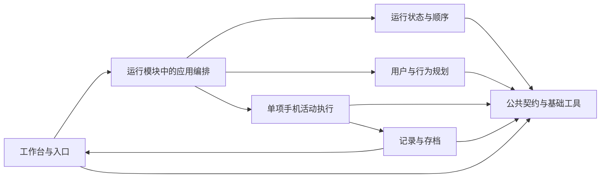

# v0.4 协作分工与后续维护任务

| 文档项 | 内容 |
|---|---|
| 标识／修订 | COLLAB-V04 / R2，2026-10-30 |
| 范围 | v0.4 当前代码及后续维护；项目组内部开发 |
| 状态 | 已按调用链、数据写入与公共文件完成技术复核；分工可据此认领，代码尚未按该方案重构 |
| 不包含 | 其他本地开发版本、更换开发语言、正式发布或自动开始真实测试 |

## 1. 复核结论：职责可以这样分，现有代码还不能直接分给六个人各自改

六个模块用于职责划分，**不等于人员数量，也不是已经隔离好的六套代码**。实际认领任务时，每项确定一个主负责人，并写清其他人的配合、允许修改的文件和完成条件。不能只列模块名，就让多人同时修改同一个公共文件。

现有开发过程暴露了三处必须处理的交叉：

| 当前交叉 | 如果直接分开开发会怎样 | 本版分工规则 |
|---|---|---|
| `phone-lab.mjs` 同时包含测试启动、资源收尾、记录查询与审核 | 执行、记录和网页开发者都来改它，容易覆盖或破坏生命周期 | 手机执行负责人维护这个文件；记录或接口需求先定义字段，由该负责人接入，或先提取独立模块 |
| `store.mjs` 同时保存计划、步骤、结果与描述；调度和描述还会直接查 SQL | 各模块分别改表或事务，运行顺序与恢复规则可能不一致 | 公共数据负责人维护表结构和事务入口；业务模块定义事实含义，不各自新增同名状态或写入规则 |
| `web-server.mjs` 负责路由和启动装配，`adapters/mock.mjs` 集中装配多种 Mock | 独立完成的功能可能在接线时互相影响，或把 Mock 误接成真实执行 | 工作台负责人维护 HTTP／CLI 入口，运行负责人维护 Mock 装配；接入新模块须由集成人一起核对 |

因此，当前可以并行做独立模块、适配器、页面和测试；涉及上述共享文件的改动要集中提交。仅把文件搬到不同目录，不足以解决这些问题。

## 2. 六个职责模块：每个模块只回答一个主要问题

| 模块 | 要回答的问题 | 负责的内容 | 明确不负责 |
|---|---|---|---|
| A 仿真运行 | 现在运行到哪里，何时可以继续？ | 用户／日／活动顺序、虚拟时间、暂停与恢复位置；应用编排按结果调用下一阶段 | 不决定用户偏好，不写手机点击规则 |
| B 用户与行为规划 | 按给定用户与条件，应安排什么？ | 用户条件、人设候选、日计划和调整建议；保留原始输入与来源 | 不直接操作手机，不覆盖已经发生的事实 |
| C 手机活动执行 | 怎样操作当前手机完成这一项任务？ | 任务与起点、原生框架、HDC、动作门禁、当前活动的停止与异常处理；提供执行状态和证据 | 不推进下一天，不把框架结束直接判为业务通过 |
| D 记录与存档 | 采集到了什么，怎样完整保存和交付？ | 事件／图像关联、完整性、记录查询、已有图的描述补跑、导出格式 | 不重新驱动手机，不把描述或任务目标补写成事实 |
| E 工作台与入口 | 使用者怎样配置、操作和查看？ | 网页、HTTP／CLI 接口、配置编辑、过程回放、筛选、审核与下载入口 | 不在页面再实现一套预算、计数或恢复政策 |
| F 公共基础与交付 | 各模块怎样共用存储、模型和运行资源？ | 数据契约与事务、模型配置／密钥／运输、通用租约与进程工具、诊断、打包与回退 | 不产生用户计划，不决定业务完成与否 |

A 内再分运行机制与应用编排：运行机制只管理时间、顺序和状态；编排负责调用 B/C、先保存结果再请求反馈。两部分可以先由同一个人维护，避免把全部内容都塞进调度内核。

D 定义事件和资产的格式、完整性与导出规则，C 在执行过程中通过记录接口提交事实；F 提供通用存储与事务工具。这样“谁产生事实”“谁维护记录规则”“谁实现存储”有明确区别，不由三个模块分别写一套证据代码。

F 的范围较广，应按文件进一步认领三类责任：契约／存储、模型与运行资源、诊断与交付。不要求一个人永远负责全部，也不允许把不好归类的业务都放进去。

这些是后续维护边界。当前 B 的生成、D 的描述以及主仿真动作内容仍为 Mock；当前独立手机测试主要返回执行状态和证据，由使用者审核业务结果，不因此宣称已实现通用数量／条件核验。

该图是协作边界，实际调用仍以[现有架构](ARCHITECTURE.md)为准；当前独立手机工作台与主仿真没有自动形成真实闭环。

## 3. 重要文件由谁维护

下表是建议的主要提交责任。其他人可以提出改动和评审，但不同时在自己的分支重写同一个公共文件。具体姓名在认领时填写。

| 文件或区域 | 主要维护责任 | 配合规则 |
|---|---|---|
| `scheduler.mjs`、`runner.mjs`、`adapters/mock.mjs` | 仿真运行负责人 | 行为规划、执行或描述增加能力时提供接口与夹具，由运行负责人完成装配 |
| `user-library.mjs`、`persona-input.mjs`、行为内容生成文件 | 用户与行为规划负责人 | 保存计划建议由运行模块接收，不直接修改活动执行事实 |
| `phone-lab.mjs`、`phone-tasks.mjs`、worker、起点、框架适配、设备／视频／HiLog | 手机执行负责人 | 新增框架可认领单独 adapter；公共 worker、注册表和资源生命周期由执行负责人核对合入 |
| `phone-evidence.mjs`、`descriptions.mjs`、`output.mjs`、后续提取的记录查询模块 | 记录与存档负责人 | 修改事件／资产格式前与执行和工作台负责人核对；现有 `PhoneLab` 内的查询由其文件负责人接入 |
| `web/`、`web-server.mjs`、`cli.mjs` | 工作台负责人 | 先约定请求、响应和错误样例；不直接访问私人数据库，也不在前端重算业务结论 |
| `contracts.mjs`、`store.mjs`、模型配置／运输／密钥、通用租约与追踪 | 公共基础对应子项负责人 | 表、状态、调用计量与资源语义变更要与受影响模块核对 |
| 构建、依赖诊断、发布校验和部署说明 | 交付负责人 | 可以由集成人兼任；不改变业务协议或替业务模块宣告验收通过 |

测试随功能模块一起认领，不能全部留给最后一位同事补。集成人负责公共契约与端到端核对，可由上表中的一人兼任；不是新增一个产品使用者角色。

## 4. 当前怎样安排人，更容易落地

如果团队人数不多，建议先按三条开发线认领，不必为了六模块凑六个人：

| 开发线 | 当前重点 | 可以独立完成的工作 |
|---|---|---|
| 运行与数据 | 运行顺序、公共契约、记录完整性、存档与导出 | 用 Mock 和保存的合成记录测试状态、描述补跑与导出，不需要手机 |
| 手机执行与框架 | 测试生命周期、原生适配、设备与异常收尾 | 用固定模型回复和注入设备验证执行链；真实手机验证单独安排 |
| 工作台与接口 | 配置、任务、过程、结果与异常提示 | 按约定接口样例开发页面和查询，不等待真实模型或手机 |

公共基础的存储／契约可以由“运行与数据”兼任，模型／资源工具可由“手机执行与框架”兼任，交付由集成人兼任；仍按上一节逐文件确定责任。团队扩大后再把行为规划、存档、公共基础等分给独立人员，业务边界不必重做。

这是人员安排建议，不限制团队必须有三人。重点是每个任务有人牵头，每个公共文件有人负责，其他人能用明确的输入输出独立开发。

## 5. 近期具体维护任务：做什么、交什么、怎样算完成

这些任务是从本次[代码审查](CODE_REVIEW_V04_20261030.md)提出的后续建议，尚未启动修复。每项只有一个牵头人；配合人员完成自己的接口或文件改动，不能以“大家都负责”代替责任。

### 任务一：服务异常退出后，旧测试没停完时不能开始新测试

- **要解决什么**：现在输入锁只检查父进程。服务退出后，旧 worker 仍可能活着；此时不能直接让另一个测试占用手机。对应 R01。
- **谁牵头**：手机执行负责人；通用租约文件由公共基础中负责运行资源的人配合修改，可以是同一人。
- **主要改哪里**：`PhoneLab.acquire/start`、worker 启停与设备发送边界、`device-lease.mjs`。
- **要交什么**：统一的输入占用检查、worker 登记与退出确认、失败后的明确状态，以及离线测试与说明。
- **怎样算完成**：旧 worker 活着时新测试被拒绝；确认退出后才可释放；停止、崩溃、旧锁格式和竞争场景分别有证据，不靠手动删锁继续。

### 任务二：轨迹文件损坏时，明确告诉使用者哪里不完整

- **要解决什么**：现在损坏的 JSON 行会被跳过，页面没有提示。对应 R02。
- **谁牵头**：记录与存档负责人；手机执行负责人接入 `PhoneLab`，工作台负责人展示错误。
- **主要改哪里**：共用的轨迹解析与查询模块、`PhoneLab.snapshot/processSnapshot`、结果和审核页面。
- **要交什么**：损坏记录的文件／行号与完整性状态，统一的接口字段、页面提示及导出行为。
- **怎样算完成**：内部坏行、追加中的未写完尾行、不可读文件、缺图能够区分；不会静默丢失，也不会在关键证据损坏时直接审核为通过。

### 任务三：长轨迹只读取新增部分，避免每次重读全部历史

- **要解决什么**：现在虽有游标，后端仍先读取并解析整个轨迹，查看图片也可能重读全文件。对应 R03。
- **谁牵头**：记录与存档负责人；工作台负责人按新查询接口配合。
- **主要改哪里**：后端事件／资产查询、游标接口、过程页与结果页的数据加载。
- **要交什么**：真正的增量或分页读取、独立的图片索引、兼容旧记录的查询方式及规模测试报告。
- **怎样算完成**：边追加边查看不丢事件、不重复、不乱序；在明确规模下测出读取耗时和内存，不能只因为界面能打开就判定完成。

**建议顺序**：先完成任务一；同时约定任务二的异常字段，工作台可据样例并行做提示。任务二的解析与完整性规则稳定后，再在同一查询接口下推进任务三，避免两个人分别重写轨迹读取。任务一与任务二都会涉及 `phone-lab.mjs`，由该文件负责人集中接入。

新增框架、上层生成或真实存档能力属于另行认领的功能任务，不与上述三项可靠性维护混成同一个提交。

## 6. 共同约定的输入输出与状态

为防止后续反复返工，开工前至少写出以下字段样例；不要求先造一套大型接口框架：

1. **活动输入**：任务 ID 与修订、APP、目标、判定要求、禁止操作、起点、框架／模型来源、限额。
2. **执行输出**：运行／步骤 ID、原始观察和动作引用、执行状态、结束原因、未决动作与证据；通用数量核验尚未实现时不能补造实际量。
3. **记录查询**：游标、事件、图像引用、是否还有下一页、账本是否完整、损坏位置和可重试条件。
4. **规划与反馈**：基于哪份用户／运行快照、建议修订、引用哪个已提交结果；生成建议不能覆盖实际结果。
5. **描述与导出**：原图 ID／哈希、处理来源、原文、失败与缺失、制品清单。
6. **取消与恢复**：谁停止新输入、谁确认 worker 退出、哪些事实已经提交、未知效果怎样显示；进程结束与业务通过分别表示。

业务事实由产生它的模块定义；持久化经负责该记录的接口。破坏性变化先核对生产方和消费方，必要时升级协议，不让 UI／执行／导出各自解释同一个字段。

## 7. 后续最容易出现的问题与防止办法

| 风险 | 需要保持的约束 |
|---|---|
| 运行、规划、执行互相调用，重新耦合 | 由应用编排连接；规划不调用手机，执行不推进下一日；模块能用替身单独测试 |
| 记录与执行都改同一事件格式 | 记录负责人维护格式，执行方提交事实；字段变化须带旧记录样例验证 |
| 页面自行判断成功或自动恢复 | 页面展示后端状态与证据，只发送显式命令；业务结果、执行状态与审核意见分开 |
| 两个人同时修改核心文件 | 每个文件一个主要维护责任，跨模块任务一个牵头人；新增独立文件后再逐步分开 |
| 公共基础成为所有业务的集中地 | 按存储、模型／资源、交付分子责任；事实含义留在业务模块 |
| 最后才联调，才发现接口不一致 | 先约定合成请求／响应与异常样例，任务完成时立即做端到端核对 |
| 独立开发被误解为可以同时操作同一台手机 | 代码和离线验证可并行；真实设备仍排他，真实模型预算与执行范围另行明确 |

本轮已完成上述技术复核与文档调整，不保证所有未来需求永不改变，也不表示现有代码已经完全解耦。下一步应明确先处理的维护任务及验证范围；正式发布仍暂停，修复尚未实施。
