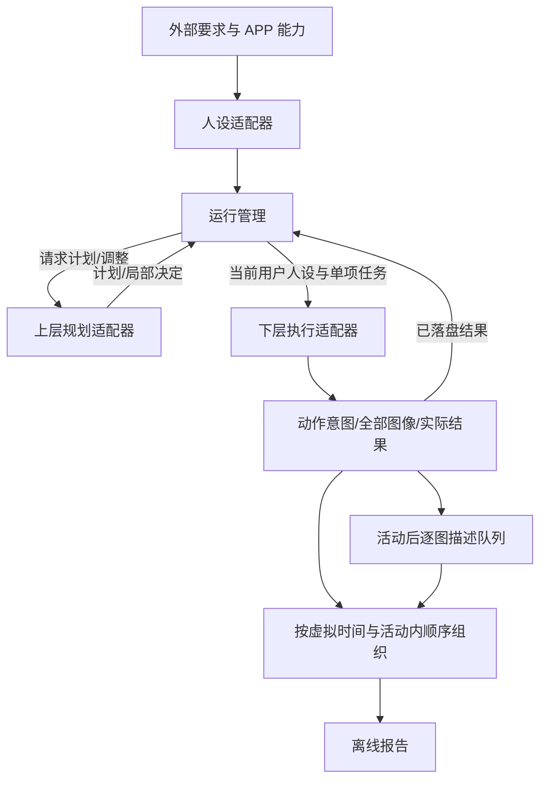

# 模块与持久化契约 v1

> v0.2 增量扩展：schema 已升级到 2，增加用户库、人设快照来源、用户日检查点、虚拟时钟、暂停控制和父子调用记录。原有记录与适配器职责保留；新增契约见 [WORKSPACE_V02.md](WORKSPACE_V02.md)。

这是本轮工程契约，不是 hipyum 或模型服务的现有接口。具体校验见 `src/contracts.mjs`；SQL 结构见 `src/store.mjs`。所有适配器带 `provenance={mode,adapter,version,...}`；Mock 一律 `mode=mock,synthetic=true`。CLI 当前只允许 Mock，真实适配器没有实现或注册。

## 调用关系

运行管理仅按已保存计划推进；固定 Mock 时段与目标只存在于 Mock 规划适配器。人设生成和描述器不增加行为决策层级。

## 适配器方法

| 方法 | 输入 | 输出/约束 |
|---|---|---|
| `personas.generate` | 当前用户原始要求 | 简单固定人设；原始要求独立保存 |
| `planner.plan` | user_id、人设、日期/时区、指定 APP 能力、有限近期实际、当前计划 | `{tasks,basis}`，允许空活动日；任务按虚拟时间排列 |
| `planner.adjust` | 上述上下文 + 当前任务、实际结果、待执行任务 | `{kind,reason,...}`；每个终态结果恰有一条已提交决定 |
| `executor.execute` | 当前任务/人设、attempt_id、已记录步骤、真实开始时间、recorder | 实际结果，禁止用计划数量替代实际完成量 |
| `executor.recover` | 同一尝试的日志与 recorder | `{kind:'resume'|'needs_attention',reason}`；真实实现必须重新观察并评估不确定动作 |
| `describer.describe` | 单张图像元数据/字节、尝试编号、当前任务 | `{raw_text,model,prompt_version}`，或者抛错；不得跳过失败前序图像 |

上层任务最小字段：`activity_id,user_id,virtual_date,virtual_start,app_id,goal,workload.object_count,end_condition`。`virtual_start` 是虚拟时区内的 `YYYY-MM-DDTHH:mm` 活动锚点，不是实际发生时刻。管理程序校验 ID、用户、日期、APP、任务量和顺序，不生成行为。

调整当前支持 `continue` 或 `replace_remaining`。后者提交完整的剩余任务列表，可以保留、替换、补充或取消待执行项。已执行任务强制保留；更改任务内容必须用新 ID；旧任务标为 superseded，旧计划版本不覆盖。补采/收尾可由上层返回新任务，首轮只用 Mock 局部替换验证该通道。没有程序自行重排全天计划的逻辑。

`text_processing_authorizations` 是可选的上层决定字段；每项须有截图 ID、加工文本和理由。`recordProcessedText` 验证用户和该明确授权，再插入独立记录。本轮默认不生成或应用文字加工政策。

## 下层记录与恢复

1. `recorder.beginStep({step_index,app_id,action,...})` 在任何外部动作之前持久化意图。
2. `recorder.capture(stepId,{capture_index,phase,bytes,media_type,captured_at,metadata})` 保存每次观察图像。索引连续；phase 明确为 before/after/observation；一个动作允许多张图像。真实适配器还需明确 API 是否附带隐式截图，不能丢弃它们。
3. `recorder.finishStep(stepId,outcome)` 保存实际动作结果，独立记录真实起止时间。
4. 活动终态结果 `{status,completed_count,summary,end_reason,failure,real_started_at,real_finished_at}` 可靠落盘后才可反馈。

执行终态为 completed/partial/blocked；主动提前结束可使用 partial + 清晰 end_reason，受阻使用 blocked。中断停在 executing；存在未闭合动作意图时不能保存最终结果。恢复需要执行器授权，拒绝时转为 needs_attention 并停止后续执行。CLI 不提供绕过该判断的自动重放命令。真实恢复可能需要“确认动作已发生后关闭意图”“终止并报告部分结果”等能力，需与 hipyum 和下层方案共同定稿；当前只验证安全停止与 Mock 续跑。

每次活动新建执行上下文，不传入上一活动任务。已完成活动恢复时不再执行；结果后、决定前中断时仅重新请求决定。模型请求响应在提交前丢失可能再次调用模型；无法宣称外部请求 exactly-once。

## 进度与事务

| 实体 | 保存内容 |
|---|---|
| runs/users | 原始配置、外部要求、固定人设、适配器来源、用户顺序 |
| plans/activities | 每日版本链、原始任务、生成输入、待执行/执行/替代状态 |
| attempts/steps | 活动尝试、动作意图与结果、活动内连续序号 |
| screenshots | 全部资产路径、哈希、显式动作时序、真实采集时间和用户关联 |
| results/decisions | 独立实际结果、反馈输入、上层决定和局部版本 |
| descriptions/description_history | 每张待处理状态、原始文本、错误、模型/提示版本与每次尝试历史 |
| processed_texts | 独立加工文本、理由与上层授权来源 |
| leases/audit | 执行和描述 worker 所有权、步骤/截图/结果/反馈/恢复的审计顺序 |

复合外键在 activity→attempt→step→screenshot 和用户之间约束来源。SQLite WAL、事务和外键启用；schema_version 不兼容时拒绝打开，尚无迁移工具。执行进度由当前用户/日期的最新计划、活动状态、是否有结果/决定重建，不再维护一套容易漂移的内存游标。

资产先 flush 到临时文件，再 rename，然后提交数据库引用。进程崩溃可能留下一些未引用资产/临时文件；不会自动删除采集资产。该协议验证进程中断恢复，不承诺硬件断电时跨文件系统与数据库的原子提交。缺失/损坏资产会在描述、导出和离线检查中显式暴露。

worker 锁在本机同一 Run 内生效。PID 已退出才接管；不同主机或 PID 仍活跃时保守拒绝。PID 复用可能需人工检查。它不是已接通的设备调度系统，不提供多个 Run 对同一真实设备的排他保证。

描述任务保存在截图表关联的持久化队列中。仅选已保存终态结果的活动；某活动的前序图像未成功会阻塞该活动后序，其他活动仍可描述。worker 退出后 working 状态记一条 interrupted 历史，未超尝试上限时恢复为 pending。失败显式重试，成功项不再请求模型。

## 导出与离线报告

事件按 `[用户顺序,虚拟活动时间,活动序号,步骤序号,截图序号]` 稳定排序，与描述完成时间无关。单事件为单图观察，不等同于一个新内容对象，before/after 可能观察同一对象。每个事件保留动作、计划、实际、描述和可选加工的独立来源。

`run.json` 含配置、人设、计划版本、实际结果、决定及描述尝试历史；`events.jsonl` 可反复重建；资产默认只引用，不打包。导出对源资产重新校验哈希，未描述或来源损坏的事件不标完整。`status.dataset_complete` 只检查流水线状态，离线报告与导出进一步校验证据。

离线报告检查数据库关联、资产哈希、反馈和描述缺项，提供证据 ID。行为效果维度只列出待评估项，明确 `not_evaluated`；不会为了输出“通过”而用固定 Mock 模板评分。
