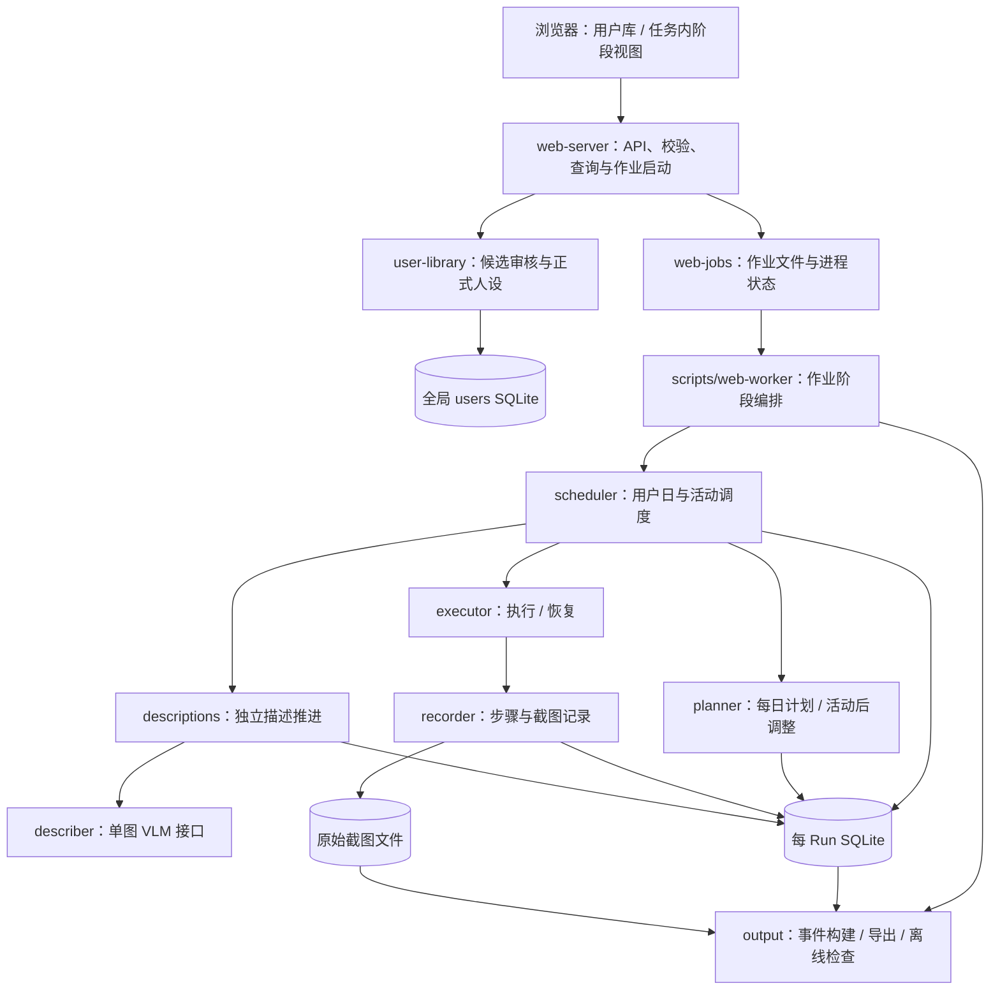
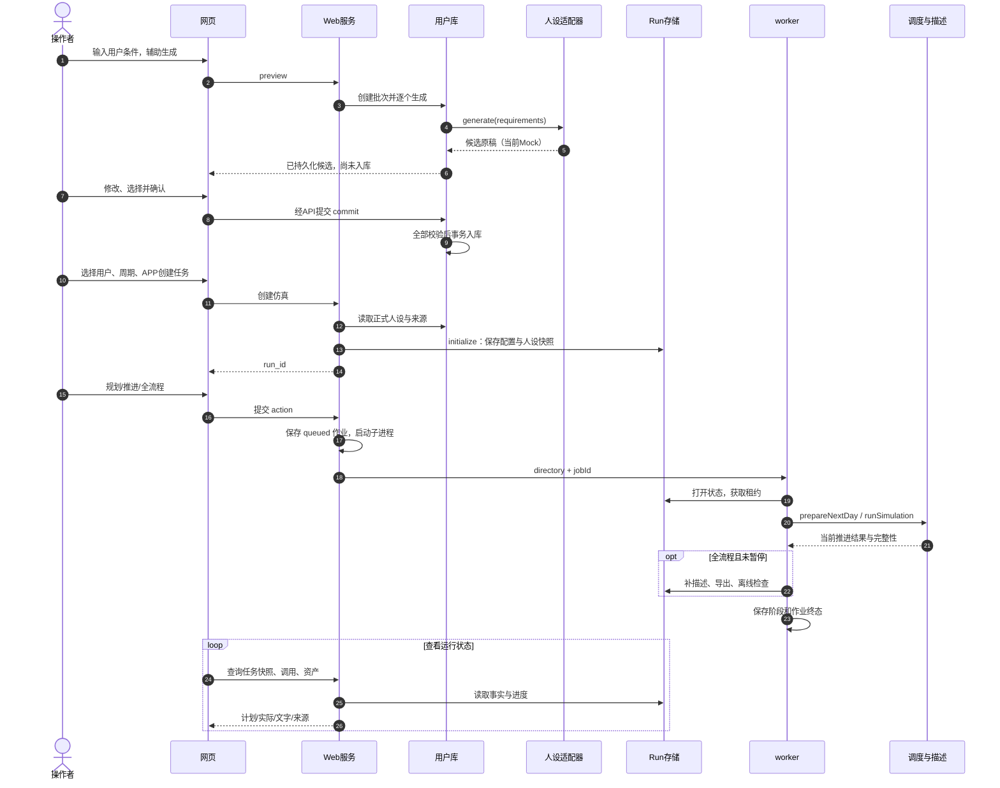
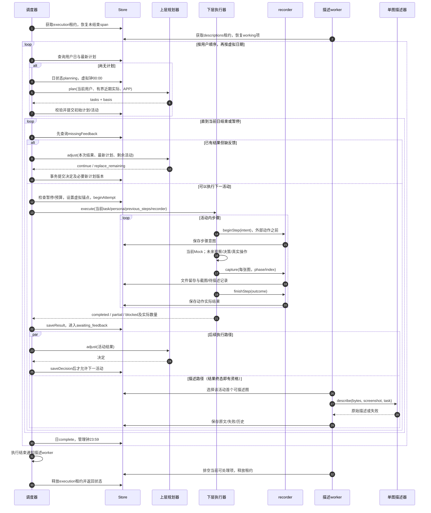
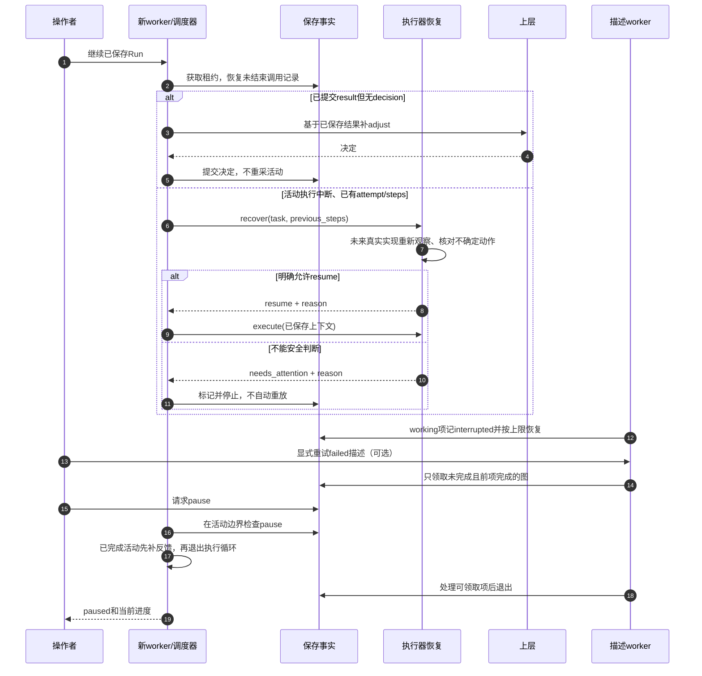
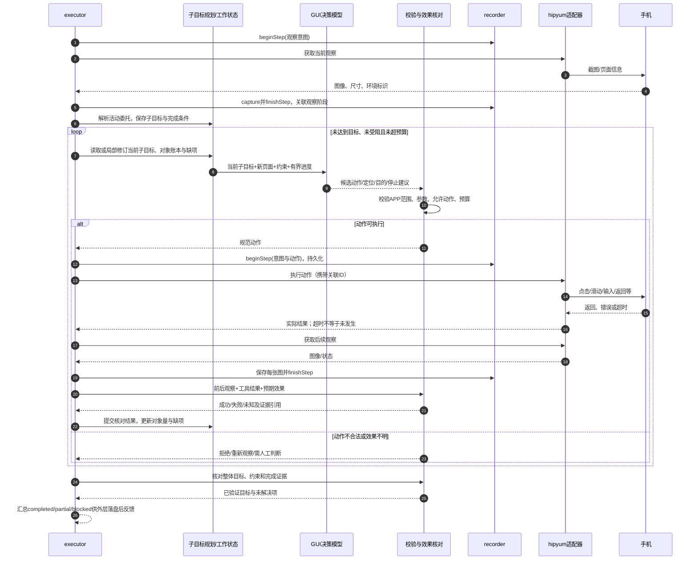
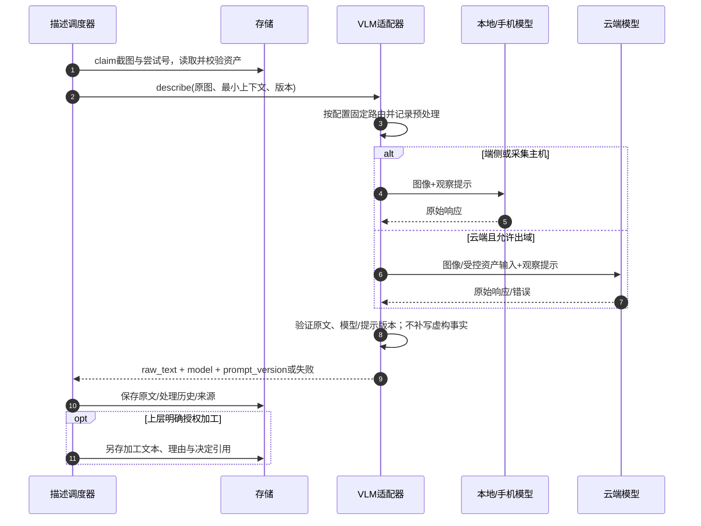
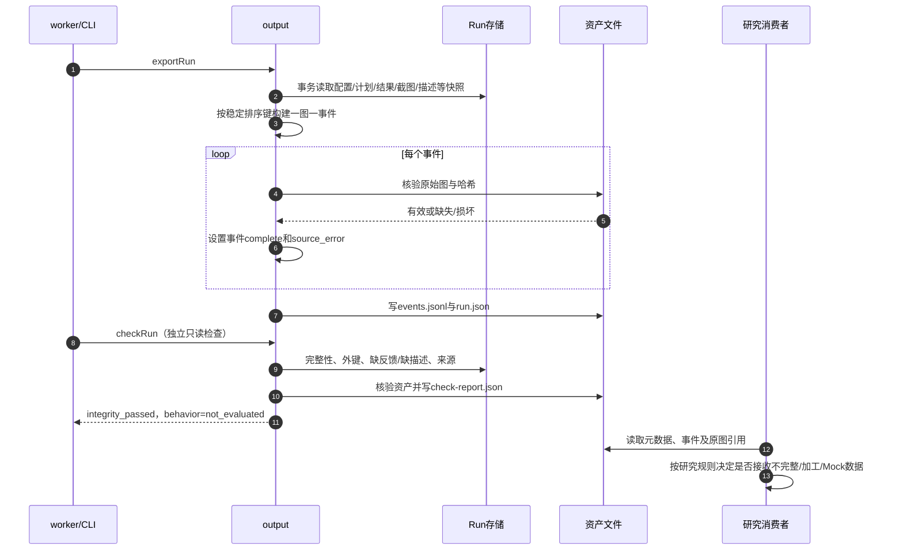

# 用户行为序列仿真器：模块、数据与运行时序详细设计

版本：v0.5 · 2026-10-19。当前实现依据 src 与 scripts；需求状态见 [需求澄清](REQUIREMENTS_CLARIFICATION.md)。本文将“现有运行结构”和“未来建议”分开。模块是逻辑职责，不表示要拆成独立微服务。本次重点扩充第 8 节的下层执行设计，完整专题见 [下层执行 Agent](LOWER_EXECUTION_DESIGN.md)。

## 1. 部署与调用结构

当前是浏览器、本地 Web 服务、子进程 worker、SQLite 与文件资产。用户库独立于每个 Run；执行和描述在同一 worker 内异步重叠，也可单独运行描述命令。没有消息中间件、远程调度集群或完整真实手机 Agent。

图中 P/E/V 及人设生成接口当前装配 Mock。S、R、数据库、作业管理、排序和导出为实际运行逻辑。图中箭头表达依赖；适配器通过调用上下文或 recorder 返回，不直接获得任意数据库写权限。

## 2. 模块清单与职责契约

### 2.1 产品与接入层

| 模块 / 源码 | 输入 → 输出 | 负责什么 | 不负责什么 |
|---|---|---|---|
| 任务工作台 web/workspace.mjs | 用户选择、任务配置、推进操作 → API 请求、状态视图 | 任务作用域、阶段入口、筛选和调用详情 | 筛选不改变执行顺序；页面不编造运行状态 |
| 用户创建 web/user-creator.mjs | 辅助/手动模式、条件 → 候选审核与确认 | 引导条件输入、编辑、勾选、提交 | 不把候选直接作为正式用户，不伪造模型调用 |
| API src/web-server.mjs | HTTP 请求 → 校验结果、快照、作业 ID | 本地访问边界、参数验证、用户快照、启动 worker、查询文件 | 不在请求处理中自行规划全天活动 |
| 人设输入 src/persona-input.mjs | 条件/人设 → 规范化数据或错误 | 可选城市、职业、兴趣、年龄等校验 | 不实现人口统计分布采样保证 |
| APP 目录 src/app-catalog.mjs | APP 选择 → 能力元数据 | 给规划范围与 UI 展示提供统一 ID | 列入目录不表示真机兼容认证 |
| 用户库 src/user-library.mjs | 条件、生成适配器、确认值 → 批次/候选/正式用户 | 保存生成调用原稿，审核入库，人工来源 | 不维护 Run 内虚拟进度，不回写历史任务人设 |

### 2.2 作业与调度层

| 模块 / 源码 | 输入 → 输出 | 负责什么 | 故障边界 |
|---|---|---|---|
| 作业管理 src/web-jobs.mjs + API startJob | Run、action → web-job.json、PID | 排队/运行/阶段状态，原子替换元数据文件 | 作业文件是控制面，业务恢复以 SQLite 为准 |
| worker scripts/web-worker.mjs | directory、jobId → 阶段结果 | 打开 Run、装配适配器、执行 plan/execute/describe/export/check | 捕获失败并记录阶段；进程强停可能来不及写最终状态 |
| 调度器 src/scheduler.mjs | 已保存进度、适配器、推进预算 → advancement | 用户优先循环、按需规划、先补反馈、派发活动、推进日期 | 不决定行为内容；下层不授权恢复就停止 |
| 运行入口 src/runner.mjs | 调用参数 → 调度调用 | 提供稳定入口，隔离外部调用与内部拆分 | 不是额外调度系统 |
| 契约 src/contracts.mjs | 配置、计划、结果、适配器 → 规范值/错误 | 用户/日期/APP边界、正工作量、计划顺序、结果状态校验 | 结构合法不证明模型内容自然或动作真实成功 |
| 调用记录 src/tracing.mjs | 调用元数据、函数 → 返回值/错误和 span | 调用开始、结束、错误、父子关联 | span 成功不取代业务事实事务 |

### 2.3 内容与数据层

| 模块 / 源码 | 输入 → 输出 | 负责什么 | 边界 |
|---|---|---|---|
| 人设适配器 personas.generate | user_id、requirements → 固定 persona | 补全简单人设 | 不预编全年生活经历 |
| 上层 planner.plan / adjust | 当前人设、APP、日计划、有限近期实际、本次结果 → 计划/决定 | 每日行为选择、每项活动后判断 | 不操作手机，不编造实际成功 |
| 下层 executor.execute / recover | task、persona、attempt、previous_steps、recorder → 实际结果/恢复判断 | 理解页面、选对象/动作、判断进度和停止 | hipyum 本身不提供上述完整职责 |
| Mock src/adapters/mock.mjs / daily-content.mjs | 同一契约 → 模板内容、模拟动作和图像 | 可重复工程夹具及故障演练 | 无真实模型/设备/APP，不能用于行为结论 |
| 记录器 store 方法包装 | 步骤意图、每张图、动作结果 → IDs、事实 | 动作前写意图，每张图留存，动作后写结果 | 不从动作成功推断活动全部完成 |
| 描述调度 src/descriptions.mjs | 待描述截图 → 原文/失败记录 | 独立租约、顺序选择、有限重试、恢复 | 不重采手机活动、不改计划 |
| 单图 describer.describe | screenshot、bytes、attempt_number、task → raw_text/model/prompt_version | 图转文字 | 不提取长期偏好；未来须限制任务上下文诱导 |
| 存储 src/store.mjs | 校验后的领域写入 → SQLite/资产 | 事务、关联、计划版本、状态、租约、恢复事实 | 本机每 Run 租约，不等于跨 Run 设备锁 |
| 输出 src/output.mjs | 保存事实 → events.jsonl/run.json/check-report.json | 稳定排序、资产核验、完整标记、只读检查 | 不自动重规划；自然性当前 not_evaluated |

## 3. 数据归属与持久化边界

| 数据组 | 主要实体 | 唯一写入职责与关联 |
|---|---|---|
| 用户库 | batches / generation_calls / profiles | user-library；生成调用输出原稿不可被审核覆盖，profiles 保存确认值与来源 |
| Run 初始化 | 配置 / users | initialize；复制确认人设快照，后续不依赖用户库可变状态 |
| 计划 | plans / activities | saveInitialPlan、saveDecision；user/date/version、previous_id，活动绑定用户 |
| 执行 | attempts / steps / screenshots / results | beginAttempt、beginStep、capture、finishStep、saveResult；截图必须归属步骤、尝试、用户与活动 |
| 反馈 | decisions | saveDecision；每活动只允许一份已提交决定，替换剩余计划与决定同事务 |
| 描述 | descriptions / description_history | 描述 worker；每图当前状态与每次处理历史分开 |
| 加工 | processed_texts | recordProcessedText；关联截图、用户、授权决定和理由；原文保留 |
| 控制与观测 | schedule_days / virtual_clocks / run_controls / leases / call_spans / audit | 管理层与存储；管理时间不作为虚构行为事件 |

关键事务：①候选确认先验证整批再原子入库；②初始计划与活动关联一起保存；③调整决定、新计划版本及旧 pending 活动 superseded 一起提交；④实际结果与执行终态提交；⑤描述终态、原文与处理历史一起提交。不要在数据库事务里长期等待外部模型或手机请求。

截图文件与 SQLite 无共同事务。当前先写临时文件并 flush，再 rename，最后登记数据库引用；有利于进程崩溃恢复，但不宣称断电级原子性，可能出现无引用文件，需要审计/清理策略。导出前核验引用与哈希。

## 4. 总体时序：从创建用户到输出数据

用户生成调用归属用户库；任务只复制来源，不把之前的人设调用伪装成当前任务的新调用。plan_next 只准备首个未完成用户日，不执行手机活动；next_activity 在执行一项活动并完成反馈后退出；next_day 推进一个用户日。pipeline 才继续显式描述、导出与检查阶段。

## 5. 核心时序：每日规划、执行、反馈与异步描述

重要语义：反馈决定阻塞下一活动，但不阻塞描述启动；描述失败也不要求把已终态活动改为 pending。当前一个描述 worker 串行处理可领取图，不是每个活动一个并发线程。活动内前图不 complete，后图不能领取；一个活动失败不会阻止其他活动的可领取图。失败项需显式补跑且受次数上限约束。

## 6. 状态机、暂停与恢复

日状态由 planning→planned→running→complete 推进；虚拟钟另带 planning/planned/executing/awaiting_feedback/ready/day_complete/finished 等管理阶段。活动从 pending 进入 executing，再成为 completed/partial/blocked；不确定恢复可进入 needs_attention；被新计划替代的未执行活动为 superseded。描述独立从 pending→working→complete 或 failed；恢复时将中断的 working 记入历史并按次数回到 pending 或 failed。

本机租约防止同一 Run 同类 worker 重入，不能解决不同 Run 共用同一真机。真实接入需增加 device_id/account_session 资源锁。当前 beginAttempt 复用已有尝试，不是无限自动创建新尝试的重试引擎。外部模型返回但决定未落盘时可能再次调用模型；数据库唯一提交不代表外部服务恰好调用一次。

## 7. 上下层接口与计划调整细节

plan 上下文：user_id、persona、virtual_date、virtual_timezone、apps、generation_requirements、recent_actual、plan。recent_actual 来自实际结果，默认仅最近 5 项。adjust 额外包含 activity、latest_result、remaining_tasks。

task 最低字段：activity_id、user_id、virtual_date、virtual_start、app_id、goal、workload.object_count、end_condition。时间应属于当天，APP 必须在给定范围内，任务有序、ID 不重复。

当前调整只支持 continue 和 replace_remaining。后者保留所有非 pending 活动，将新剩余列表与固定部分合并为新版本，淘汰被移除的 pending 活动；禁止改写已执行记录、复活历史任务、安排在当前活动之前。业务期望的补充/收尾可通过新剩余活动表达，但没有独立补采决策枚举，不能把它描述为完整策略引擎。

执行结果至少包含 status、completed_count、summary、end_reason、real_started_at、real_finished_at。completed 必须达到目标；partial 与 blocked 可以是流水线有效终态。序列完整性不是目标达成率。

## 8. 未来手机 Agent：推荐内部结构与时序

以下是待评审方案，不是现有真机实现。推荐“活动级滚动规划、单步观察执行、基于证据更新进度”，再逐步加入可复用操作技能。保持 executor 外部契约；内部的子目标分解和效果核对属于下层执行职责，不新增一层用户行为规划 Agent。工具适配返回实际结果，不能由规划模型自己宣称成功。

### 8.1 活动委托与模块职责

上层给出目标、工作量、硬约束、软偏好、完成证据和允许的自主范围。下层可选择搜索表达、导航和候选对象；若必须放宽硬约束或改变活动目的，则返回 partial/blocked，交上层在活动终态后决定。当前 task 尚无全部扩展字段，具体契约待接入评审，不宣称已支持。

| 内部模块 | 核心职责 | 输出与边界 |
|---|---|---|
| 委托解析与滚动规划 | 明确约束，生成少量子目标、依赖和结束条件 | 只局部修订受影响子目标，不重排每日计划 |
| 观察与定位 | 理解页面，识别对象及当前可操作元素 | 定位绑定 observation_id、尺寸与方向；旧页面坐标失效 |
| 动作决策与校验 | 结合人设、当前子目标及进度选择动作 | 模型选择对象，程序校验范围、参数与预算 |
| 工具与记录 | 调用 hipyum，保存意图、每张图和实际返回 | 超时不等于操作未发生，所有采集均留存 |
| 证据核对与进度 | 核对预期效果，对象去重，更新已知/缺失/未知 | 不把点击数或截图数作为真实对象量 |
| 恢复与结束 | 检查停滞、不确定副作用与终态证据 | 安全继续、局部回退或需关注；不通用重放 |

首版可由同一个模型分角色调用，程序维护持久化工作状态，不要求独立多 Agent 服务。常规步骤用程序快速检查，在子目标完成、停滞和效果不明时加强视觉核对。工作状态保存子目标、对象账本、缺失字段、截图证据、动作状态、失败路径与预算；它服务当前活动，不承担长期偏好提取。

### 8.2 活动到动作的完整闭环

### 8.3 完成证据、复杂任务与恢复

以“比较三家餐厅”为例，下层可以分解为搜索候选、逐家查看、补足价格/位置/评价、比较并结束。返回列表后重新定位；重复打开同一对象不重复计数；某家缺信息就补看或换候选；找不到足够候选时返回实际完成量。子目标可以包含分支、遍历与局部回退，不预编整段点击脚本。

完成主张必须关联原始观察和工具结果。点击成功不等于收藏成功，打开详情不等于信息齐全，页面出现不证明人类认真读完。程序检查关联、数量与去重，视觉模型核对语义；同模型的核对不能保证独立正确，应抽样人工验证。对象身份或效果不明时保留 unknown，不直接计入已完成。

恢复时重点处理“已发出但不知道是否成功”的动作。例如收藏超时后再次点击可能取消收藏，应先重新观察与核对状态，再决定继续、局部回退或 needs_attention。动作前意图、发送状态、后续观察与效果判定应关联保存。新增工作状态、子目标与证据主张的表/字段尚未实现；当前 beginStep/capture/finishStep 和 recover 继续作为接入边界。

实际工具截图是动作前还是动作后、是否自动截图、多图返回、超时返回和请求幂等能力，要由 hipyum 文档确定。初始观察也应有合法步骤关联，不得写无步骤截图。当前外层只在活动终态后调整；执行中 ask_upper 对话不是本次自动新增能力。

### 8.4 操作技能复用、视觉分工与验证

不建议先建设固定全年行为脚本库。它会把上层自主行为压缩为模板抽样，难以证明自然性。可以分三类按需引入：①APP 能力目录（已有，规定能做什么）；②操作技能/页面文档（可选，帮助下层完成如何做）；③研究场景/评测用例（用于验收，不直接规定日程）。

技能接口建议含 app/version、适用观察、前置条件、目标、允许动作、结束证据、失败回退、来源和版本；技能只提供候选操作，模型仍核对当前页面。先以无技能的最小闭环建立基线；重复导航成本高时再加入技能并做成功率、步骤数、恢复能力的对照实验。

优先积累搜索、筛选、进入详情、查看评价、返回列表等短技能，可由人工示范和成功轨迹提出候选，经复核后启用。技能执行仍保存每步和每张图。页面不匹配或效果不符即退出；共享技能不夹带其他用户的内容与偏好。AppAgentX 的重复轨迹抽象可作参考，不作为必须实现自学习的要求。

实时视觉承担当前页面理解、定位与效果核对，处于执行关键路径；活动结束后的存档 VLM 负责有序逐图描述，继续独立推进。两者可共享服务，但区分调用 purpose、提示与输出，不自动用实时决策文本冒充最终原始描述。

真实验证先做单对象搜索浏览，再做多对象比较、筛选与允许的状态变更，随后注入动作发送前后/核验前中断，最后比较有无技能。除成功率，还记录误报完成、证据覆盖、对象重复计数、停滞、恢复副作用、时延和费用。阈值待实测。完整模块契约、状态表、例子与试验方案见 [下层执行专题](LOWER_EXECUTION_DESIGN.md)。

参考方向：AndroidWorld 用于任务与环境评测；OpenAutoGLM 展示模型决策与设备动作工具分离；AppAgent 展示探索/示范形成操作文档的路线。它们不能证明 hipyum 已兼容或长周期行为已自然。官方参考：[AndroidWorld](https://github.com/google-research/android_world)、[OpenAutoGLM](https://github.com/zai-org/Open-AutoGLM)、[AppAgent](https://github.com/TencentQQGYLab/AppAgent)、[AppAgentX](https://appagentx.github.io/)。这些仅为技术路线参考，不是依赖清单。

## 9. 未来 VLM：部署与调用边界

图转文继续走 describer 接口，不进入手机执行的关键路径。端侧可以指手机本机，也可以指采集主机本地，需分别测量；云端指远端推理服务。推荐先根据数据出域约束选可运行基线，再对同批截图测准确性、漏字、幻觉、时延、吞吐、内存与费用，而不是先固定端云答案。

建议新增 provenance：部署位置、服务/模型版本、预处理/缩放/裁剪版本、图像哈希、提示版本、请求 ID、时延；当前这些字段未全部标准化。当前接口会传整个 task，真实接入建议只传解释图像必要信息，避免把计划目标诱导成“已完成事实”。模型看见的是页面；“用户喜欢某对象”不是仅凭一次页面可直接下的结论。

本地优点是数据留本地及减少传输，限制是设备资源和模型能力；云端便于模型替换但需要传输、费用和出域政策。混合回退是可选方案，必须记录路由和回退原因，不能悄悄更换模型后混作同质数据。可参考 [Qwen3-VL](https://github.com/QwenLM/Qwen3-VL)、[LiteRT-LM](https://developers.google.com/edge/litert-lm/overview)、[AI Edge Gallery](https://github.com/google-ai-edge/gallery) 的官方项目；具体支持与设备性能接入时重新验证。

## 10. 输出、检查与消费者时序

导出是快照，不是动态订阅；运行后继续推进需要重新导出。资产路径是引用，迁移时需保留目录关系。checkRun 不调用 planner、executor 或补跑，发现问题只报告；不能把 integrity_passed 当作行为质量合格。

## 11. 已实现与缺口矩阵

| 领域 | 已有 | 接入/验证缺口 |
|---|---|---|
| 用户创建 | 条件、候选审核、来源、快照 | 真实生成人设、条件满足与用户差异实验 |
| 规划 | 接口、上下文边界、版本、每活动反馈 | 真实模型、自然性、局部调整策略与输出纠错 |
| 手机执行 | execute/recover/recorder、恢复阻断 | 真实观察—决策循环、hipyum、对象计数、副作用恢复 |
| 描述 | 有序独立队列、原文、失败补跑 | VLM、端云部署、质量与吞吐、标准化来源字段 |
| 控制 | 用户日调度、暂停、租约、trace | 跨Run设备锁、账号环境、生产访问控制 |
| 数据 | 计划实际分离、排序、导出、完整性检查 | 下游格式定稿、加工规则、行为评估方法 |

## 12. 技术评审应重点讨论什么

第一轮只收敛 hipyum、首 APP、模型服务与下层决策方案，做一用户一天真实闭环。重点观察结果摘要是否足够支撑上层反馈、对象计数是否可靠、恢复能否判定副作用、VLM 是否把任务要求当作事实。随后少量跨日和多用户试验，再决定技能库、端云混合、账号隔离及长周期资源治理。

本轮文档依据当前源码核对了调用顺序与字段；没有修改程序，也没有新增真实接入验证。历史 Mock 测试证据在 WORKSPACE_V03.md；它证明特定工程路径，不证明上述未来实现。介绍时应先讲第4、5节时序，再用第2、3节解释模块与数据归属，最后讲第8、9、11节未来接入与缺口。
