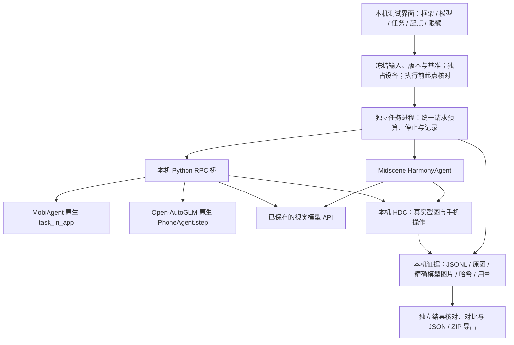

# 用户行为序列仿真系统：当前方案与真机测试方案

更新：2026-10-21。用于阶段汇报；工程证据、真实任务和后续计划分别列示。

## 1. 可以汇报的结论

已构建本机真机测试工作台，接通三个框架的执行入口，支持选择模型、自定义任务、保存起点、执行留证、结果核对和导出。Midscene 与外部视觉模型已完成一个真实鸿蒙手机任务，说明“看图—决策—操作—再观察”链路可运行。完整任务能力、稳定性和不同组合的优劣仍需同条件评估，不能由一个成功样本推定。

用户现已要求暂停手机测试，将手机用于日常使用。暂停状态持久保存，服务重启后仍禁止拍起点、复位、启动任务与整批评估；查看和编辑界面可继续。暂停后新增真实模型请求 **0**、设备命令 **0**。最终框架选择仍为 **未定**。

| 本轮要求 | 交付状态 | 依据与边界 |
|---|---|---|
| 多框架部署 | **完成本机安装及离线入口验证** | 三框架可选；两套 Python 原生循环完成替身响应/动作契约检查；不能写成三框架均已真机通过 |
| 测试界面开发 | **完成本轮软件功能** | 浏览器核对、JSON/ZIP 导出、图像哈希检查；70/70 离线回归通过。剩余设备适配见第 7 节 |
| 真实最小任务 | **已有一个成功样本，整体验证部分完成** | Midscene × qwen3.8-flash；助手独立核对通过，用户审核待定 |
| 组合效果与性能比较 | **待执行，当前受手机暂停限制** | 五题 × 九组合计划 45 次；正式矩阵已执行 0 次，无排名 |

## 2. 目前实现的方案

系统分成现有行为仿真工作台和新增真机评估工作台。前者已有用户库、时间调度、持久化、追踪和 Mock 内容闭环；后者专门验证下层手机 Agent。当前没有把真机测试伪装成全年行为仿真，也没有接入长期记忆提取/检索引擎。

- **框架保持自己的决策循环与动作解析。** 公共层负责设备运输、请求限额、记录、停止和判定入口；没有用一套自写循环冒充三个框架。
- **模型服务与框架独立配置。** 现有三个服务是 qwen3.8-flash、qwen3.7-plus、deepseek-v4.1-flash-1017，共形成九种待测组合。文档声明的图片支持与实际框架动作协议兼容是两项检查；未实测组合不标成功。
- **执行结束与任务通过分开。** 框架自报完成只表示原生循环结束；“通过/部分完成/失败/受阻/无法确定”必须另存依据。通过审核必须引用真实截图，记录审核者是助手还是用户。
- **每个请求、每个动作可追踪。** 请求前、动作前先落盘，保存输入、环境/源码版本、模型响应、动作参数、真实截图、耗时与服务返回用量。SDK 一个动作可能对应多条物理输入，两者分别计数。
- **本机留存与外部推理分清。** 账户密文、模型凭据、运行库和原图不进 Git，也未上传远程仓库；调用外部模型时会发送任务及模型图片。后续管线会依据可见控件遮盖部分序列号/IMEI/手机号，原图仍只留本机。该策略不是全量隐私识别；新增策略仅离线验证，尚未真机复测。

## 3. 部署结果及选型建议

| 框架 | 固定版本 | 已部署的执行方式 | 实际验证范围 |
|---|---|---|---|
| [Midscene](https://github.com/web-infra-dev/midscene) | @midscene/harmony **1.16.0** | 本机 Node HarmonyAgent，原生规划/解析，共享 HDC 运输与记录 | SDK 契约检查；实际真机一题成功、另一次历史试验部分完成 |
| [MobiAgent](https://github.com/IPADS-SAI/MobiAgent) | **4ee794021bb34a8de4d00c52ca8fa6f0065a45ff** | 原生 task_in_app，e2e / qwen_json；从已准备起点执行 | 已安装、导入通过，原生循环完成点击、输入、滑动、返回、结束的离线契约；真实 GUI 未执行 |
| [Open-AutoGLM](https://github.com/zai-org/Open-AutoGLM) | **86f55382982fb054e8fc98ca80609dff8a2cdc3c** | 原生 PhoneAgent.step、提示、模型响应解析与 ActionHandler，通过本机 RPC 运输 | 已安装、导入通过，同类原生循环离线契约通过；真实 GUI 未执行 |

MobiAgent 本次关闭经验和个人记忆，不运行外层自动选 APP/启动/停止调度，避免改写人工准备的起点。其可选经验检索模块的一个提前导入在桥接载入时移除，磁盘上的上游源码未改。Open-AutoGLM 使用现有通用模型服务进行待测协议适配，没有部署专用模型权重，不能称为原作者模型成绩的复现。以上属于明确记录的测试变体。

本机 Node **24.19.0**；局部 Python **3.12.14**；openai **2.9.0**、httpx **0.28.1**、Pillow **12.3.0**、hmdriver2 **1.4.4**、uiautomator2 **3.4.1**、opencv-python-headless **5.0.0.93**。未下载模型权重、未启用向量库/云端记忆。环境与依赖留在忽略的局部运行目录，尚未打包为另一台电脑可直接运行的交付包。

**建议继续将 Midscene 作为首轮验证入口**：它贴合现有 Node 工程，且已有该设备上的完整任务证据。MobiAgent 保持同级候选，Open-AutoGLM 作为基线；最终选择应根据同起点实测数据决定。当前没有证据宣布任一框架总体最好。

部署检查见 [deployment.json](evidence/20261021-phone-lab/deployment.json)；两套 Python 原生契约见 [native-contracts.json](evidence/20261021-phone-lab/native-contracts.json)。其中替身响应与设备 RPC 只证明部署及接口可用，**不作为真实 GUI 通过**。

## 4. 真实证据与已知限制

设备基线：HOP-AL10，API26；HDC **3.2.0f**；设置 APP **7.0.0.330**；原图 **2584×1828**。系统全名字段为 OpenHarmony-7.0.0.38，产品软件字段为 7.0.0.36(SP25C00E24R4P1log)，保留原字段，不擅自合并为同一个版本号。

| 独立运行 | 结果 | 模型用量与性能 | 结果依据 |
|---|---|---|---|
| 历史隔离首题：Midscene × qwen3.7-plus | **部分完成，GUI 未通过** | 4 次图片请求、4 滚动；41.918 秒；输入 29,819 / 输出 741，共 30,560 tokens；0 重试 | 模型持续查找列表底部，未打开关于本机；第 5 次在网络发送前被本地预算拒绝 |
| 网页端到端验收：Midscene × qwen3.8-flash | **助手核对通过，用户审核待定** | 10 次图片请求；8 个 SDK 动作、17 条物理输入；113.409 秒；输入 107,573 / 输出 2,474，共 **110,047 tokens**；0 重试 | 从设置的星闪和蓝牙起点自主滚动、点击顶部设备卡；真实终图显示 HOP-AL10、HarmonyOS 7.0.0、软件版本 7.0.0.36 SP25，与环境核对一致 |

网页成功运行 ID：`phone_7af90ebf-6d3b-4327-a5b4-ee32da443a37`。时间为 Agent 执行段，不含起点准备、环境预检与最终证据整理。48 条图像资产哈希已核对，10 条请求/10 条响应记录一致，JSON 和约 7.05 MB ZIP 导出返回 HTTP200。脱敏摘要见 [ui-real-task-summary.json](evidence/20261021-phone-lab/ui-real-task-summary.json)。原始输入、环境、动作、截图、模型原文和结果在本机 `.data/.phone-lab/runs/<运行ID>/`。

上述两次的任务修订、提示、预算和图片处理不同，**不能合并成公平比较，更不能计算 50% 成功率或模型排名**。当前界面保留该网页成功记录，但不将其并入后续正式矩阵。新隐私预处理和完善后的源码快照策略，亦不能反向视为已经用于历史成功运行。

服务返回的实际 tokens 可核对，费用、Credits 和未返回的推理用量仍未知。单题成功已消耗约 11 万 tokens，说明长上下文/连续图像的成本需要实测管理，不能只看输出上限或公开单价。

## 5. 首批五个完整手机任务

| 用例 | 固定起点 | 完整目标与通过依据 | 当前设备准备情况 |
|---|---|---|---|
| HM-SYS-001 rev2：关于本机 | 设置列表顶部，右侧星闪和蓝牙，未进入关于页面 | 自主进入关于页面；终图读出型号和 HarmonyOS 版本；不改设置 | 已有实际起点和成功样本；正式矩阵仍需重新核对 |
| HM-CALC-001：计算器 | 标准模式，表达式空、显示 0，固定方向 | 通过 UI 计算 (128+37)×6，终图为 **990** | 待核对本机显示控件及清空复位；不能把数字键 0 当清空证据 |
| HM-STOR-001：存储 | 与系统首题相同页面，但独立保存该用例基准 | 自主进入存储，读取已用/总容量及应用占用；不清理或删除 | 设置复位路线已有证据，该题独立基准与终态待取得 |
| HM-TB-001：淘宝 | 同一登录账号，空搜索输入已聚焦、键盘可见，无弹窗 | 搜索“折叠手机支架”，进入普通商品详情，读标题及展示价；不加购/收藏/交易 | 待核对实际包名、版本、输入、键盘与搜索页复位 |
| HM-XHS-001：小红书 | 同一登录账号，空搜索输入已聚焦、键盘可见，无弹窗 | 搜索“杭州旅游”，读普通图文笔记标题、作者、一条可见建议；不互动/发布 | 同上，需本机适配；大众点评作为后续替换候选 |

五题定义已冻结在 [PHONE_LAB_CASES_20261021.json](reference/PHONE_LAB_CASES_20261021.json)。这是项目自有的五题最小集，与历史 14 条公开/派生/长活动定义分别管理，没有用新五题覆盖旧集。

## 6. 评估方法与指标

1. **先准备五题基准。** 由测试者手动摆好或按已验证的复位路线进入起点，保存原图、设备/系统/APP 版本、方向、控件断言。缺少可靠控件映射就阻断，先补适配。
2. **冻结同一题的起点条件。** 整批开始时固定基准 ID/比较键，不把每次复位的结果递推成新基准。每组合执行前重新复位、拍图、核对；不一致时不发模型请求。日期/状态栏时间、蓝牙邻居和搜索建议不要求逐像素一致；指定查询、空输入、聚焦、版本和方向须一致。动态搜索结果记录实际对象和时刻，不声称结果内容完全相同。
3. **顺序交错执行九组合。** 同一题依次跑三框架 × 三服务，再下一题。第一轮共 **45 次任务评估**；每次默认 **最多 15 请求**，整批没有总请求硬上限。一个 45 次的首轮在每次都用满 15 请求时是 675 请求，这只是计算边界，不是实际消耗或新的整批限制。
4. **统一工程限制。** 默认每次 40 个 SDK 动作、600 秒执行段、每请求最多 512 输出 tokens；最多 2 图/2 MiB 序列化请求/90,000 文本字符；0 自动重试。物理输入另记且最多为 SDK 动作上限的四倍；不自动换服务。输入字符/字节限制并不等于精确输入 token 上限。复杂任务可在界面明确调整限制，但不同限制分组统计。
5. **独立判定、记录失败。** 保留通过、部分完成、未通过、受阻、无法确定和待审核。预算/时间耗尽也保留实际尝试；起点前置阻断不冒充模型失败，也不计为成功。助手初判保留用户审核入口。

每组合记录：完整任务通过数/实际执行数、已判数及待判数、部分完成原因、首次完成耗时、SDK/物理动作数、真实请求数、输入/输出/可得缓存 tokens、停止原因、起点不一致率、工具错误和未知效果。样本足够时再报告中位数/P95及每成功任务消耗；首轮每题每组合仅一次属于探索，不提供统计置信结论。结果必须展示分母，不能排除失败后只统计成功耗时。

## 7. 恢复测试前最少缺失条件

- 手机重新可用、USB 调试连接且解锁；**由用户明确恢复测试**。本轮不自动解除暂停。
- 为计算器、存储、淘宝、小红书取得真实基准，确认两个 APP 的包名/版本、中文输入、焦点/键盘及复位路线；目前代码是待实测的设备适配，未知控件默认不放行。
- 先给 MobiAgent 和 Open-AutoGLM 各跑一个受限任务，验证真实坐标、输入及模型动作协议，再扩大到五题九组合；其余模型组合也不能只凭 HTTP200 放行成绩。
- 执行后审核实际终图；最终框架选型与整合到主仿真流程另行根据数据决定。

现有 HDC、框架安装、Python、模型凭据、测试界面已就绪，不需要重新索取华为密码或商业 APP 登录凭据。供应商套餐使用范围此前已向用户说明，用户指定继续使用现有服务；这不代表获得供应商许可，也没有采取客户端伪装或检测规避。

## 8. 汇报口述稿（约两分钟）

目前完成的是手机 Agent 的可运行验证平台。上层系统已有用户和任务管理、时间调度与持久化；新增真机工作台把下层框架、模型服务、设备操作和证据记录接在一起。我们已经安装 Midscene、MobiAgent 和 Open-AutoGLM，界面可选择框架与模型，也能手动摆好手机起点、输入自定义任务，查看每次模型请求、动作、截图和消耗。

真实能力已有一个明确证据：Midscene 配合 qwen3.8-flash，自主从设置进入关于本机，并读出真实型号和系统版本。该任务用了十次模型请求、约一百一十三秒和十一万 tokens。助手已按终图核对通过，用户审核仍待进行。早先另一次试验未完成，也保留了完整失败记录。两次条件不同，暂不做排名或总体成功率。

下一阶段用五个完整任务比较九种框架模型组合，包括系统信息、计算器、存储、淘宝商品和小红书笔记。每题固定起点，每组合执行前都重新复位核对，默认单次最多十五次请求；任务结果和工程结束状态分开判定。现在手机供日常使用，真机和模型评估已暂停，离线软件回归七十项通过。恢复后优先补齐四题的设备起点，再验证两个 Python 框架的真实协议，最后开展正式对比并决定选型。

建议汇报顺序：目标与边界 → 当前架构 → 三框架部署 → 一个真实成功及失败证据 → 五题同起点评测 → 缺失条件与下一步。演示优先展示[本机测试界面](http://127.0.0.1:4317/phone-lab)的暂停状态、组合配置和已有记录，避免展示含序列号/IMEI的原图给无关人员。
