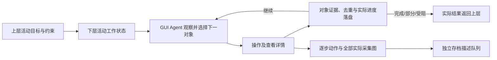

# 三个重点 GUI 框架的实现与真实使用取舍

日期：2026-10-20。重点是 Midscene、Open-AutoGLM、MobiAgent；其他框架在末尾对照。依据官方接口、公开执行代码与当前仓库核对，优缺点中的工程推断明确标注；不是三套框架的真机实测排名。候选全景及公开分数见[选型资料](V04_GUI_FRAMEWORK_SELECTION.md)。

补充核对：用户质疑 Midscene 是否只有原子 API。已核对本机安装的 1.16.0：`aiAct` 有规划执行循环，也有单次执行内的历史、子目标与短期记忆；它们不能等同于跨调用/跨进程的业务状态。详见第 8 节。此前“当前项目增量接入成本最有利”的判断仅能作为工程衔接假设，不能当作完整长活动 Agent 的总成本结论。

## 1. 当前项目事实

仓库已有[单活动验证台](V04_GUI_LAB.md)。Midscene 1.16.0 已在 `integrations/midscene` 隔离安装；`probe.mjs` 使用真实 SDK 的动作入口和假的 HDC 验证记录顺序，不运行模型决策。MobiAgent、Open-AutoGLM 在候选目录中仍标为源码比较阶段。当前三者均没有本项目真实模型 + 鸿蒙手机的闭环效果数据。

因此，验证台选择不同候选后跑通 Mock，不代表跑了三种不同决策算法；夹具用例不能用于比较它们的实际任务成功率。

## 2. 实现机制

### Midscene：通过 SDK 组合规划、定位、查询与设备动作

简化循环：活动目标 + 页面截图 → 规划并定位 → 设备动作 → 新观察 → 继续或结束；按需调用查询和断言。

官方 `aiAct` 默认可在一次规划请求中同时产生下一步和定位信息；`deepThink=true` 时更强调任务拆分，并把规划与定位分成不同调用。不能固定描述为每步都调用两个或三个模型。`aiQuery`、`aiAssert` 提供结构化读取与条件判断，但业务目标仍需要明确表达，不能仅凭一个调用返回就认定完成。[API](https://midscenejs.com/reference/)

设备层的接口包括截图、画面尺寸、动作空间和可选前后钩子；动作名称、描述与参数供规划使用。鸿蒙侧由 `HarmonyAgent` 配合 `HarmonyDevice`，通过 HDC 操作，提供独立 Playground 和报告。[设备接口](https://midscenejs.com/integrate-with-any-interface)、[鸿蒙指南](https://midscenejs.com/platforms/harmonyos)

模型可采用一个默认视觉模型，也可按 Planning、Locate、Insight 分工；增加角色不是必须项。[模型组织](https://midscenejs.com/model-selection)

**使用优势（工程判断）**：与现有 Node 工程便于衔接；业务可以写“做什么、读取什么、核对什么”，不必重写所有手机循环；不同模型及设备实现有明确替换位置，调试入口比较完整。

**使用代价与缺口**：一次高层 `aiAct` 可以包含多步操作，外层只记录函数调用会漏掉内部动作。需要在设备截图和动作入口记录；DeepThink、定位与核对可能增加调用数和时延。报告、查询和断言不能代替对象去重与研究数据契约。取消规划循环也不证明已经发送的手机命令没有发生。

本项目已有 `instrumentGuiDevice`，包装 `actionSpace().call` 与 `screenshotBase64`，而不替换 SDK 的规划。当前验证粒度为一个 SDK 动作；例如输入动作内部可能有多个 HDC 命令，尚未证明逐条覆盖。把所有底层命令都独立记录是否必要，应按数据用途决定，不能以现有包装冒充已经做到。

### Open-AutoGLM：专用动作协议驱动的单步视觉循环

公开 `PhoneAgent` 基本循环是：获取截图和当前 APP → 构造上下文 → 请求模型 → 解析动作 → ActionHandler 执行 → 检查结束标记。`run` 自动循环，`step` 提供单步入口。配套模型承担页面理解与下一步决策；不是没有规划，而是所查看的基础循环未单列一个持续维护的业务子任务管理器。[执行源码](https://github.com/zai-org/Open-AutoGLM/blob/main/phone_agent/agent.py)

源码在请求后移除该条上下文中的图像，再保留文本响应；这指模型上下文管理，不表示项目应该删除已采集原图。动作结果有 success 与 finished；模型异常也会返回 finished，动作解析失败可转为 finish。因此 finished 只能说明该循环结束，不能直接映射为业务 completed。

设备工厂对 ADB/HDC 提供截图、点击、输入、滑动等实现选择。这个替换位置有助于改造，但目前工厂包含全局状态，不能未经核对就在一个进程里混用不同设备类型或把它当跨 Run 设备锁。[设备工厂](https://github.com/zai-org/Open-AutoGLM/blob/main/phone_agent/device_factory.py)

**使用优势（工程判断）**：执行链直接，较易定位看图、动作协议与设备控制哪一层出错；适合单步调试和建立基本对照，官方已有鸿蒙 HDC 路径。

**使用代价与缺口**：不能把任意兼容服务接入后默认其动作输出可解析；外层只在 `step` 返回后记录，会晚于实际动作发送，需要在处理器/设备层插入记录。对象量、条件核对、停止原因、上下文持久化及未知副作用恢复仍需补齐。一次模型决策循环较简洁，不等于总耗时或费用一定最低，重复与错误可能消耗更多步骤。

### MobiAgent：可分工的决策与定位，以及可选经验复用

其经典组织为 Planner 形成任务计划、Decider 根据观察决定语义动作、Grounder 定位目标，再由设备层执行。AgentRR 另外研究历史计划和动作的复用，MobiFlow 用里程碑及依赖关系核对任务轨迹。[论文](https://arxiv.org/html/2509.00531v1)

当前 runner 文档还提供端到端 `--e2e` 路线，跳过独立 Grounder 调用；服务可按角色配置。因此不能拿早期三模型结构代表所有当前运行方式。用户偏好、经验改写等功能可选，不因选择框架就必须全部部署。[runner 文档](https://github.com/IPADS-SAI/MobiAgent/blob/main/runner/README.md)

执行代码存在模型响应校验/重试与按协议处理的逻辑。它有助于处理格式问题，但格式正确不保证操作正确；模型请求重试也不同于可以安全重发手机动作。[执行代码](https://github.com/IPADS-SAI/MobiAgent/blob/main/runner/mobiagent/mobiagent.py)

**使用优势（工程判断）**：便于区分任务拆解、语义动作和坐标定位的错误；对中文常用 APP 及轨迹验证的材料与本项目接近；可以逐步试验分工、端到端及重复任务加速。

**使用代价与缺口**：不同模块有提示、协议、模型和依赖，组合验证与维护比最小循环更多；按角色远程调用还可能增加时延。存在服务端点配置不等于已经找到可调用的 MobiMind 托管 API。经验命中和偏好记忆可能改变行为及用户上下文，若启用，要额外记录来源并验证隔离。MobiFlow 的离线验证也不会自动成为执行时的纠错反馈，需显式接入。

## 3. 用于真实项目时的对比

| 维度 | Midscene | Open-AutoGLM | MobiAgent |
|---|---|---|---|
| 与 Node/网页工程衔接 | SDK 语言一致；仍建议独立运行边界 | 通常通过 Python worker/本机服务 | 同为 Python，另外核对选用模块与服务 |
| 任务规划组织 | 默认规划/定位可合并；可切分和分配角色 | 专用模型在逐步决策中完成；基础循环较少显式业务状态 | 经典规划/决策/定位分工；当前有端到端选项 |
| 替换外部模型 | 有明确模型家族适配；实际型号仍需验证 | 重点匹配专用动作协议 | 按角色/协议核对，非只换 URL |
| 调试观察 | Playground、报告、查询与断言 | step 返回与循环代码易跟踪 | 模块日志便于分辨角色错误，但配置也更多 |
| 数据采集改造 | 包装截图与动作空间；防止高层调用掩盖内部操作 | 在 ActionHandler/设备调用前后插入 recorder | 统一设备、模型与复用分支的记录，防止旁路漏图 |
| 行为/经验库 | 不要求先建业务行为库 | 基本循环不要求技能库 | 经验/动作复用是特色，但可按需要选用 |
| 鸿蒙条件 | 明确 NEXT/HDC；6/7 待真机验证 | 官方 HDC；6/7 待真机验证 | Harmony 分支；具体实现与6/7待真机验证 |
| 真实恢复 | API 取消、报告与内部状态不等于项目级恢复 | 内存上下文与 reset 不等于持久化恢复 | 工作记忆/经验保存不等于准确恢复未知副作用 |

成本与成功率暂不填主观星级。需要同设备、同批活动、相同初始条件、明确型号/预算和重复次数，记录业务成功、误报完成、总耗时、全部模型调用与费用后比较。

## 4. 相同任务会暴露什么差异

以“在美食 APP 查看两家满足城市和预算条件的不同餐厅”为讨论例，不表示已验证具体 APP。

- Midscene 可用高层目标执行，再读取详情并断言条件；需要决定哪些业务条件由 Agent 完成、哪些由独立程序核对，内部每步仍留证据。
- Open-AutoGLM 会逐步按观察操作；我们需要另存已确认餐厅与证据，不能只数打开次数，也不能由最后一句完成摘要证明有两家。
- MobiAgent 可将任务分解到搜索、筛选、查看对象等；分工有利于诊断，但仍需核对它是否实际取得条件和不同对象。若启用经验复用，列表、城市或筛选状态变化时必须重新核对。

三者共同需要保存实际对象 ID/标题、约束依据、图像与步骤关联、未知字段和结束原因。独立核对可先用程序规则与人工复核，不要求马上添加一个核验模型。

## 5. 其他高分框架的实现方向

- [Mobilerun](https://github.com/droidrun/mobilerun)：将手机原生工具、截图和无障碍树供 Agent 使用，可采用推理/管理执行模式；结构信息有利于定位，但 Android/iOS 的 Portal 能力不能直接移到 NEXT。
- [ARTEMIS](https://github.com/google/artemis)：分别提供响应式观察执行与规划/核对模式，融合无障碍层级、OCR 与视觉；适合参考动作前检查和调试报告，但辅助服务与设备接口迁移需要评估。
- [Minitap mobile-use](https://github.com/minitap-ai/mobile-use)：重点是角色分工、输入核对、循环检测；可以借鉴执行验证，不应因为满分报告就假设鸿蒙可直接部署。
- [FinalRun](https://github.com/droid-ash/finalrun-agent)：以测试用例、执行和通过/失败报告为中心；对本项目测试入口有参考价值，行为生成需求及鸿蒙设备层仍需适配。
- UI-Venus、MAI-UI、UI-TARS 主要还需比较配套模型与动作协议；不将开放模型权重自动视为已经具备完整项目运行管理、采集与恢复功能。

## 6. 建议与下一步决策依据

若重点是尽快获得可调试、可替换模型的工程底座，建议优先验证 **Midscene**；若重点是规划/定位分工、中文常用 APP 与经验复用研究，建议深入比较 **MobiAgent**；若需要简洁可解释的专用模型对照，保留 **Open-AutoGLM**。这是适配判断，不是实测能力排名，最终由用户决定。

三者都需要基础动作定义（点按、输入、滑动等），但不因此必须建设“搜索餐厅”等高级技能库，更不能把下层经验库当上层每日行为生成器。先记录基础循环和失败类型，再决定经验复用是否值得引入。

先比较原生 HDC 路径，再按 hipyum 实际契约核对替换成本；不同时让两个运行控制同一设备。不将“自动回到正常页面”与“恢复未完成的持久化活动”混为一谈。

本轮新增实现比较文档，没有改动运行代码或重跑既有测试。源码、SDK 接口、离线替身验证和真实模型/设备测试分别标注；当前真实效果、费用与恢复仍待验证。

## 7. 按实际接入目标重新判断：PC/服务器下层 Agent 与百对象活动

用户进一步明确评估目标：框架作为部署在 PC 或服务器上的下层 GUI Agent，接收现有系统每日活动，操作真实鸿蒙手机；任务复杂程度参考方案图的餐厅条件/评价/收藏等用例，也包括在淘宝和京东搜索并浏览 100 个手机详情。这里按总量 100 的讨论例分析，最终数量分配、商品去重定义与查看范围尚未定稿，不把示例解释固定为用户要求。

### 7.1 开箱成本要分两种

| 候选 | 跑通第一项真机活动 | 接入本系统并支持长活动 | 当前判断性质 |
|---|---|---|---|
| Midscene | 配置已适配视觉模型、HDC、设备与 APP；当前已有隔离 SDK，仍无真实闭环 | 复用 Node、设备包装及记录方向；补活动工作状态、业务核对、暂停/恢复与 worker 边界 | **语言与设备接口衔接较有利**；完整长活动 Agent 的总改造成本仍需对照验证 |
| Open-AutoGLM | 若有可用配套模型 API，基础循环与 HDC 路径较直接，适合快速基线 | 增加 Python worker、动作前记录、对象进度、独立核对及持久化恢复 | **第一项演示可能很省事，完整采集适配仍有工作**；需实际核对 |
| MobiAgent | 先选择最小 runner、端到端或分工配置；核对实际远程模型及协议 | Python 桥接，统一各模块和可选复用分支的记录；已有模块仍需映射项目契约 | **配置与适配变量较多**；可选功能不应全算必装成本，也不能以模块丰富断言效果更强 |
| Mobilerun / ARTEMIS / Minitap 等 Android 高分组合 | 目标平台上的示例和工具可参考 | 当前主要额外成本是 NEXT 设备控制与结构信息能力的替换、重测 | 暂不列为鸿蒙最低接入成本主选；成绩不直接迁移 |

这些是结合源码/接口与现有工程的相对判断，没有以未经实施的“几天完工”或虚构工时报价替代实际工作量。

### 7.2 执行能力分别看推理复杂度与持续执行

方案图的条件筛选、评价核对、缺项补看与多对象比较，主要考察理解、定位、约束保持及正确核对。百对象活动还突出列表位置变化、重复商品、长时间调用、账号/网络异常及恢复能力。

Midscene 可使用高层活动、查询和断言组织执行；MobiAgent 的任务分工便于研究复杂推理；Open-AutoGLM 可由单步循环连续执行。**目前没有本项目证据证明谁能稳定完成 100 个，也没有理由把多模块架构自动排在单模型循环前面。**

Midscene 有规划循环限额，Open-AutoGLM 的 `run` 有最大步数；限额可配置，但步数增加不自动带来长任务可靠性。循环次数也不一定等于原子动作数或模型请求数。工程上应同时管理对象量、动作、时间和调用预算，不只修改一个参数。

### 7.3 百对象活动所需的最少状态

建议仍由上层生成完整活动要求，下层内部按可核对的对象或小批次执行；每完成一个对象落盘，再接着处理。不把 100 个固定拆成 100 项每日计划，也不把当天活动顺序交给程序重排。

程序核对进度、预算与证据，Agent 根据目标和页面决定对象及操作，上层决定每日活动和活动后调整。下层内部批次边界是工程执行单位，不能自行改掉用户要求的浏览深度或筛选条件。

每个对象至少关联：APP、可获得的商品标识/链接或可见身份依据、详情页面证据、开始/完成状态、已经核实与未知字段、动作/截图索引及实际时间。不能获得可靠标识时保留去重不确定性，不用标题相同就武断认定同一商品。

“100 个手机”最终还需逐步明确：两 APP 合计或各自数量；按商品链接、商家商品、型号或 SKU 去重；跨 APP 同型号怎样计数；打开首屏即算还是要看参数、规格或评价。这些定义影响耗时和验收，但不改变先核实设备、记录与恢复的必要性。

模型上下文只带当前子目标、有限近期轨迹、已完成数量和相关去重信息；完整原图与历史仍单独保存。中断后先核对当前手机页面与未闭合动作，再决定续接，不直接重发最后一条操作。全部活动结束后仍由既有存档流程推进，不等待逐图 VLM 才操作下一个对象。

### 7.4 PC 与服务器部署

建议将框架作为独立 worker 运行，现有调度器通过统一执行契约派发活动、接收状态和结果，保持 Node 主系统与数据库。若手机连接采集 PC，可将设备 worker 放在该 PC；服务器负责调度与持久化服务时，通过明确的任务通道与 worker 通信。服务器直接连接手机时，也可就地运行 worker。

外部模型承担推理时，不要求先在 PC/服务器部署模型权重；选用的本地 OCR、解析或经验模块另行核对资源。无论运行位置，同一设备只允许一个活动实际控制。独立 worker 有助于故障隔离，但不自动提供正确恢复。

### 7.5 本场景下的推荐与比较方法

建议优先 **Midscene + 现有活动状态/记录/核对适配**，以 **Open-AutoGLM** 作同任务基线；若复杂活动中出现持续的规划/定位问题，再依据失败证据比较 **MobiAgent** 的分工收益。这是推荐的验证顺序，用户仍保留最终框架决策，不因当前已装 SDK 就锁定 Midscene。

v0.4 先验证短活动，随后逐级增加对象量，最终覆盖百对象压力活动；例如 2→10→30→100 只是样本分级建议，不是预定成功指标。把冷启动、模型/动作耗时、重试、人工干预、真实完成率和误报完成、证据完整性、断点恢复、每个有效对象的成本一起比较。不能由短任务通过推出百对象完成能力，也不凭模块数量预测最高能力。

## 8. 对“Midscene 只有原子 API，循环和记忆全要自建”的核对

### 8.1 结论与比较遗漏

这个说法需要拆开：**只提供原子 API 不成立；具备单任务循环不等于具备本项目所需的完整持久化活动 Agent。** 我们此前虽提到恢复等缺口，但没有把循环、短期工作记忆、跨调用状态、经验复用和进程恢复独立列出，成本比较不够完整。Node 语言一致、SDK 已安装只能减少衔接工作，不能单独证明整体接入最省事。

官方[基本概念](https://midscenejs.com/basics)区分：`aiTap` 等即时操作只处理一个指定动作；`aiAct` 根据最新页面持续规划和执行多步任务。只使用原子操作时需要调用方编排，使用 `aiAct` 则不必从零重写这层循环。这里确认的是观察—规划—执行—再观察能力，不以名称强行宣称实现了某个固定论文版本的 ReAct 算法。

### 8.2 本机安装包中的实际证据

版本来自 `integrations/midscene/node_modules/@midscene/harmony/package.json`，为 1.16.0；本轮只读代码，没有调用模型或手机。

- core 的 `dist/es/agent/agent.mjs`：`aiAct` 解析模型与规划选项，随后调用 `taskExecutor.action`，不是仅转发一个点击操作。
- core 的 `dist/es/agent/tasks.mjs`：`runAction` 创建 `new ConversationHistory()`，执行 `while(true)` 规划循环，并依据 `shouldContinuePlanning` 等条件结束；存在规划次数与取消边界。
- `dist/es/ai-model/workflows/planning/conversation-history.mjs`：包含消息、子目标、历史日志与 `memories`，以及追加记忆、更新子目标、限制历史图像及裁剪消息的实现。

core 包实际位于 `integrations/midscene/node_modules/.pnpm/@midscene+core@1.16.0/node_modules/@midscene/core`。上述是已安装版本的源码证据，**没有证明不同模型适配器会以同样方式充分使用所有字段，也没有证明长任务效果**。

尤其重要：所查看的 `runAction` 每次新建 ConversationHistory。两次独立 `aiAct` 调用不能默认继承上一调用的全部工作记忆。开发者可以显式注入上下文或管理外部状态，但这是需要核对和适配的工作。

### 8.3 重新按状态层次比较

| 能力 | Midscene | Open-AutoGLM | MobiAgent |
|---|---|---|---|
| 原子动作与设备工具 | 有 | 有 | 有 |
| 单项目标观察/决策/执行循环 | `aiAct` 已有，不需从零重写 | `run/step` 已有 | runner 已有 |
| 执行内工作记忆 | 当前版本有历史、子目标、短期记忆结构，具体使用依适配器/模式 | 基本循环保留上下文和文本历史，不单列完整业务子目标结构 | 经典规划/决策/定位分工及工作状态，具体依 runner |
| 两次独立调用的业务衔接 | 不能默认继承全部 `aiAct` 历史，需要外部状态/上下文 | `step` 可延续对象内上下文；`run` 会重置，非持久化恢复 | 不能将多任务支持自动等同于跨进程恢复，需核对选定入口 |
| 跨任务经验/技能复用 | 有计划缓存；缓存不等于已完成商品台账或用户长期记忆 | 所查看的基本循环未提供完整经验学习库 | AgentRR、经验等是已有研究/可选模块，可复用性值得测 |
| 用户偏好记忆 | 本项目需明确实现/注入边界 | 本项目需明确实现/注入边界 | 有可选偏好模块，但不等于本项目隔离和研究数据要求已满足 |
| 百对象去重、可靠完成量、进程中断恢复 | 均不能由以上能力直接推出；三者都需要对接项目状态和真实副作用处理，但具体补齐工作可能不同 | 同左 | 同左 |

Midscene 的[计划缓存](https://midscenejs.com/caching)用于复用执行计划等，不能作为“已经浏览第 37 个商品”的依据。Open-AutoGLM 的对象内上下文、MobiAgent 的经验库也都需要与业务完成事实区分。

### 8.4 对本项目推荐的修正

保留 Midscene 为首轮候选，理由是现成闭环、NEXT 工具接口与 Node 衔接；**不再仅凭这些理由认定它是完整长任务 Agent 的最低总成本方案**。MobiAgent 应在同等优先的详细核对中，比较其既有计划/进度/经验模块能实际节省多少工作；不能只把它当“后续失败再考虑”的选项。

下一轮比较应以“长活动执行状态是否能直接复用”为独立门槛：同任务内保持子目标与对象进度、两次调用续接、中断后恢复、截图动作完整记录。分别记清框架已有、项目复用、需新增和未验证项，再由用户决定最终组合。无需重建已有日调度器，也不能把整个活动 Agent 缺口都笼统称为通用 recorder 适配。

## 9. 对比内容纳入 v0.4 验收用例

2026-10-20，用户要求测试用例包含本对话的全部比较内容。已整理[15 个维度、31 项统一验收用例](V04_FRAMEWORK_TEST_CASES.md)，逐项映射本文章节，并接入验证台的「框架对比验收清单」。每项给出方法、通过依据、证据、候选关注点与现有 Mock 的局部参考。

以第 8.4 节的最新修正为准：Midscene 与 MobiAgent 同等优先深入比较，Open-AutoGLM 作基线；不沿用“只等 Midscene 失败才比较 MobiAgent”的旧顺序。用例特别拆分已有单任务循环、执行内记忆、两次独立调用续接、跨任务经验与进程恢复，不笼统归类为“有记忆”。

31 项是真实框架验收定义，尚未实测，不是新增 31 项自动化通过结果；7 类 Mock 与 SDK Tap 替身验证不替代它们。开箱成本、百对象任务、可选模块和其他高分路线均已纳入；不会因清单齐全自动跑批量模型请求。入口与本轮验证见[预览说明](V04_GUI_LAB.md)。
