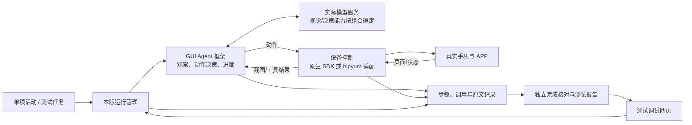

# v0.4 需求与方案讨论：GUI Agent 部署、真机控制与测试

2026-10-20，头脑风暴讨论稿。依据[整体与 GUI 方案](ARCHITECTURE_FIGURES.md)、[下层执行设计](LOWER_EXECUTION_DESIGN.md)和[版本计划](VERSION_PLAN.md)。这是本版范围与选型建议，不表示已经安装、选定框架或通过真机验收。

本轮补充已确认：手机为鸿蒙 NEXT，拟用鸿蒙 6 或 7；具体型号/系统构建未定，可连接 Windows、开启开发者模式并允许调试。首测包含系统 APP 与部分常用 APP。用户要求扩大开源框架、测试集与公开分数比较，提供建议后由用户最终决策，详见[框架与评测选型资料](V04_GUI_FRAMEWORK_SELECTION.md)。

模型边界已确认：测试手机截图可以发送外部模型服务，先比较外部服务方案；具体供应商、型号与试验预算未定。用户暂不提供账号，要求保留配置界面，后续自行填写。

## 1. 对 v0.4 的理解

用户列举的 GUI 框架选择、大模型接入、手机操作框架/SDK 接入、真实手机操控、测试集选择/构建与测试，覆盖了本版主体。这里的 GUI 框架指手机 GUI Agent 的执行框架；网页测试调试界面是本版另一项交付。

建议将目标描述为：**在指定手机与 APP 上，给定一项明确活动，所选框架能够调用模型逐步操作，保存完整观察与动作证据，给出可核对的实际结果，并能在网页中测试和调试。**

除“部署可运行”，还要回答能否接入本项目、活动是否真正完成、失败后可否定位和停止、输出是否适合行为数据采集。框架、模型、控制 SDK 与设备/APP 是一组组合选择，不是各自挑一个项目后就自然兼容。

## 2. 已确认、建议与未定事项

| 状态 | 内容 |
|---|---|
| 已确认 | 下层 Agent 的开源框架选型和验证优先；每版独立测试用例和测试调试界面随版设计/交付；复用现有工程，不重建已有用户库与调度 |
| 已确认的职责边界 | 程序管理运行进度，上层规划每日活动和活动后调整，下层只解决当前活动如何操作；计划/实际、虚拟/真实时间、原文/加工分别保存 |
| 本轮确认的路线安排 | 手机控制暂不限定 hipyum 或框架原生 SDK，先比较两条路线，再依据实际条件收敛 |
| 已确认的设备与测试范围 | 鸿蒙 NEXT，拟用鸿蒙 6 或 7；可连接 Windows 并允许调试；首测包括系统 APP 与部分常用 APP |
| 本稿工程建议 | 一条主验证组合，按系统 APP 与常用 APP 两类选少量代表活动逐步验证；必要时增加对照候选，不要求先安装全部项目 |
| 已确认的模型边界 | 测试手机截图允许发送外部模型服务，先比较外部服务方案 |
| 仍待明确 | 具体手机型号/系统构建与实际连接、首批 APP 和账号/允许任务、实际文本/视觉模型服务及账号、hipyum 文档与能力、试验预算；逐项确认 |

先做框架资料/源码与兼容性核对，缺设备或模型时仍可准备最少 runner 和明确标注的夹具；真实要求保持未验证。模型接入不等于必须本机部署权重，执行主机、推理服务和手机的部署位置分别决定。

## 3. 在用户列举内容上需要补齐的需求

| 需求面 | 需要补清楚什么 | 原因及本版边界 |
|---|---|---|
| 单活动输入 | 目标、APP、必要人设/偏好、硬约束、目标数量、完成依据和运行预算 | 有目标和约束才能比较框架；不要求本版先完成真实每日规划 |
| 观察与定位 | 截图/可选 UI 信息、画面时间与 ID、尺寸/方向/缩放、键盘与弹窗 | 模型坐标与设备坐标要一致，页面变化后不能沿用旧定位 |
| 实际进度与完成核对 | 已核实对象、证据、未知/缺项、完成/部分完成/受阻、结束原因 | 工具调用成功、框架 finished、达到最大步数均不能直接当业务成功 |
| 可控制的执行循环 | 观察→决策→动作前校验与记录→发送→取结果/新观察→核对→继续/结束 | 优先用框架现有能力，检查是否能插入记录与控制；不要求六个模块对应六个独立服务 |
| 运行与异常控制 | 无进展/步骤/耗时上限、停止边界、模型/工具超时、设备断连、未知副作用 | 首版至少能安全停止并保留原因；不必承诺所有中断都能自动恢复，效果不明时不可盲目重发 |
| 记录与来源 | 任务/尝试/步骤、每张实际采集图、动作意图/返回、实际可得的模型请求响应、版本与时间 | 本项目要采集行为序列，最终一句“完成”或屏幕录像不足以替代逐步证据 |
| 环境与可重复性 | 框架/模型/提示/SDK/APP 版本、账号、城市/语言、起始页面、网络和测试顺序 | 商业 APP 内容与推荐状态会变化；重跑不一定遇到同一页面，需要记录差异 |
| 设备和数据归属 | 运行唯一标识、设备独占、任务/用户上下文隔离、测试数据副本 | 同一手机不应被多个控制者同时操作；独立数据库不等于独立账号环境 |
| 结果评测 | 预先约定完成标准、独立于执行摘要的核对、失败分类与成本记录 | 让框架自己声称成功不足以评估它；小样本不输出未经支持的成功率结论 |
| 测试调试入口 | 能选组合/活动、检查环境、运行/停止、查看步骤与证据、比较结果 | 与 runner 共用实际执行链路；页面具体布局随 v0.4 实现，不提前设计后续版本 |

硬约束不由下层为完成目标而放宽。缺信息记录未知；重复进入同一对象不能重复计数。初版完成核对可采用程序检查 + 人工证据复核，模型辅助核对的独立性与误报率另行验证。

## 4. 组合选型与控制路线

### 4.1 GUI 框架、模型、控制工具应联合验证

检查四个问题：能否理解当前观察；能否输出框架支持的动作/定位；动作能否映射到真实控制工具；动作前后与终态是否能被本项目记录和核对。服务接口兼容不等于图像能力、提示/动作格式与行为能力兼容。

两种模型组织都保留为候选：

- 端到端视觉模型，根据活动与当前页面提出下一动作；先验证一条简单基线。
- 文字规划/进度与视觉定位/核对分工，适用于已有服务确实需要分工的情况；需要额外处理语义传递、坐标和调用成本。

先使用框架文档支持且实际可用的一组组合跑通，再逐项替换模型或控制工具，记录变化。内网 DeepSeek、外网 GLM/Qwen 等既有部署方向仍须核对实际型号、图像输入与动作格式；不凭模型名称预定角色或声称兼容。

候选依据：

- [Open-AutoGLM 官方源码](https://github.com/zai-org/Open-AutoGLM/blob/main/phone_agent/agent.py)提供单步接口，基本循环使用截图、模型与动作处理器；是否满足动作前记录、完整图像、设备替换和恢复要求，仍需实际适配验证。
- [Mobile-Agent 官方项目](https://github.com/X-PLUG/MobileAgent)包含不同版本与配套模型；比较时固定具体目录/版本，不能把整个项目家族的能力视为同一实现。
- [Midscene 官方自定义接口](https://midscenejs.com/integrate-with-any-interface)列出截图、尺寸、动作空间及动作前后钩子，值得检查与现有记录协议的对接成本；具备接口不代表 hipyum 已兼容。
- [AppAgentX 作者项目](https://appagentx.github.io/)作为经验/操作复用路线参考；本版是否需要引入相关依赖由实际任务和改造量决定，不先要求建设行为库。

以上为公开结构核对，不是选型排名或实测结论。若候选使用 Python，可评估独立 worker/本机服务桥接；主项目 Node、SQLite 与网页不因此整体重写。依赖和部署启动方式随实际选型交付。

### 4.2 原生 SDK 与 hipyum 两条路线

| 路线 | 主要验证什么 | 需要澄清的代价/限制 |
|---|---|---|
| 框架原生设备控制 | 原生模型/动作闭环、真实手机兼容、现成调试与记录接口 | 是否与项目设备平台一致、能否插入 recorder、环境安装和后续维护成本；不能由此宣称 hipyum 适配完成 |
| GUI 框架 + hipyum 适配 | 截图、动作、坐标、输入和返回语义是否能对应，动作前后是否可完整记录 | 文档与实际能力、时序与超时、要替换多少框架内部代码，以及是否丢失框架已有能力 |

当前先比较，不要求完整实现两套。依据设备平台、现有接口和主候选代码选一条主验证路径。一个设备在同一时段由一个运行控制；即便原生 SDK 和 hipyum 均可用，也不让二者同时驱动它。

## 5. 总体流程与现有仿真器的关系

图是职责划分，不表示新增多套微服务或要求每轮额外调用一个核验模型。框架已有的观察、规划和操作能力优先复用，缺少的记录、控制和判断由最小适配补齐。

在完整系统中，活动来自上层每日计划；v0.4 先用手工/固定任务输入做独立活动验证。下层内部对子任务的规划不接管每日行为选择，框架内工作记忆不扩成下游长期记忆引擎。向现有仿真调度正式派发与跨版本恢复的集成主要仍属于 v0.5。

沿用现有 `execute/recover` 与 `beginStep/capture/finishStep` 的契约方向，复用步骤/资产/Trace 的语义；真实输出不能借旧 Run 的 `mode=mock` 隐藏来源。现有工程还有只允许 Mock 的配置/装配约束，实验适配需明确处理，不可只换 URL 后改标题称已接入。

本版的实时看图/定位是 GUI 操作的关键路径。后续存档 VLM 是逐图生成研究观察文字的独立队列，仍不阻塞后续活动；不把这两种视觉用途混成同一个完成条件。

## 6. 测试集与测试方法

建议按问题选择测试材料，而不是先完整部署一套庞大 benchmark。当前只讨论 v0.4 的测试范围，具体用例随本版实现。

| 测试层 | 要解决的问题 | 可用材料及边界 |
|---|---|---|
| 模型/工具接口与故障夹具 | 截图、坐标、中文输入、动作映射、格式错误、超时、停止是否正确 | 自建少量确定性夹具；可以 Mock，但不用于宣称真实任务效果 |
| 离线观察/动作诊断 | 错误来自看图、定位还是动作选择 | [AndroidControl](https://github.com/google-research/google-research/tree/master/android_control)、[AITW](https://github.com/google-research/google-research/tree/master/android_in_the_wild)提供轨迹/观察材料；离线动作匹配不等于真机端到端完成 |
| 受控在线任务 | 相同初始条件下能否执行并核对结果 | [AndroidWorld](https://github.com/google-research/android_world)是可复现的 Android 模拟器评测环境，可选合适任务参考；它不直接证明目标商业 APP 或真机兼容 |
| 目标 APP 真机活动 | 是否完成项目真正要采集的行为 | 选择一个 APP 自建少量活动，记录起始环境、目标/约束、完成依据及实际页面；单对象、多对象条件、无结果和中断逐步覆盖 |

公开数据通常还需核对下载、许可、设备与动作格式；不默认把它们全部接入或用于模型训练。真机 APP 动态内容难以完全复现，比较框架时应记录模型/设备/账号条件、试验顺序与页面差异。

候选例子仅用于讨论，不是首 APP 或需求定稿：新闻中搜索主题并打开不同文章；美食 APP 中查看符合城市/预算条件的不同餐厅。出现页面或完成点击只能证明可观察操作，不能推断模拟了人类认真阅读或形成了某种偏好。

测试至少分别报告：实际完成及部分/受阻、误报完成、对象重复计数、定位/工具/模型错误、循环停滞、步骤/调用数、时延、可得的费用、证据完整性和人工复核工作量。阈值与样本数在试验前确定，单次成功不作为主路线整体效果结论。

## 7. v0.4 范围建议

**建议的本版验收底线**：收敛并部署一条可运行组合；接真实模型和手机做基础活动；落实活动输入、动作/截图证据、最低完成核对和有界停止；交付独立测试用例、可用调试界面、样本与比较报告。这是本稿提出的范围建议，待逐步讨论收敛，不将建议自动升级为用户已确认要求。

**按条件选做**：第二候选的同任务对照、少量公开评测任务、UI 树或 OCR 辅助、模型分工对照。这些都服务于回答选型问题，不变成 v0.4 全部必做平台。

**后续再扩展**：与每日调度的完整集成、更复杂的持久化子任务/自动恢复、自动技能积累、存档 VLM 全流程、年度规模与多设备集群。未知副作用的最小停止/关注能力当前就需要，完善的自动恢复可以后续迭代。

本版成功意味着：在已说明的手机、APP、模型和任务范围内，有一条可启动、可操作、可核验的实际链路，并知道其局限和接入现有系统的工作量。只有 Mock、资料比较或轨迹回放时，保留 preview/未实测状态。

## 8. 接下来逐步收敛的问题

已收敛：原生 SDK 与 hipyum 先比较，不预设必经 hipyum；目标为鸿蒙 NEXT，拟用鸿蒙 6 或 7，可连接电脑并调试；系统 APP 与常用 APP 都纳入首测范围。

按用户要求逐步确认。截图外发已允许；用户暂不提供账号，已交付[模型服务配置界面](MODEL_SERVICE_SETTINGS.md)，后续通过页面填写服务地址、模型与密钥，当前不再索取账号。配置保存不等于真实接通。具体设备构建、首批 APP/活动及 hipyum 接口在相应试验准备时逐项核对。hipyum 文档用于核对该路线，不作为开展所有候选资料研究的前置阻塞；框架、公开测试资料、分数与外部服务组合比较见[选型资料](V04_GUI_FRAMEWORK_SELECTION.md)。

基于这些条件，再选主候选与对照，落实本版最少用例和界面功能；对关键取舍逐项讨论，不一次冻结全部下层架构。
