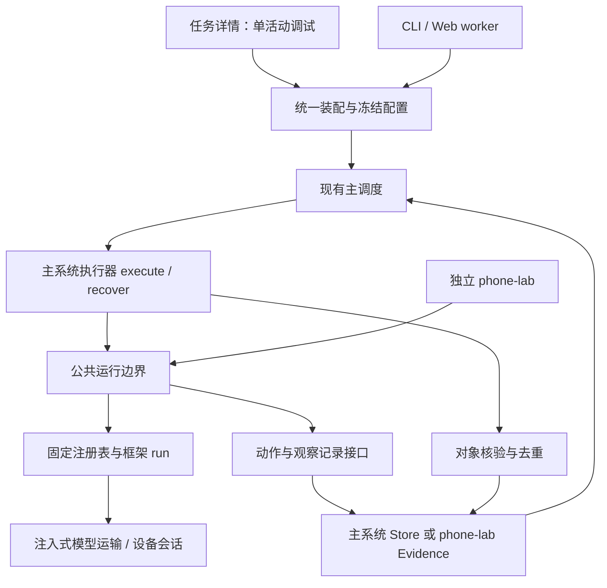
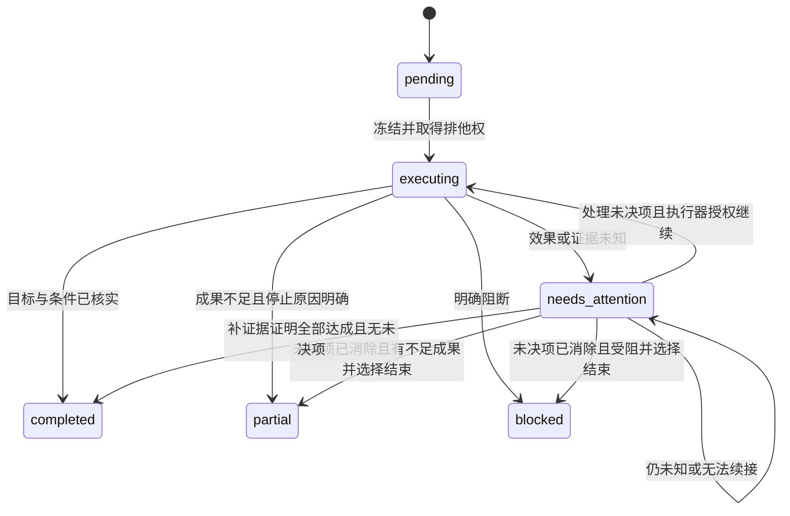

# v0.5 概要设计：主调度与下层执行桥接

> **暂停采用，未进入概要设计阶段。** 本文件在头脑风暴充分收敛之前由助手提前生成。用户随后要求按逐轮讨论、需求核对、概要设计的顺序重新推进；当前仅允许整理并核对[需求修订2](V05_REQUIREMENTS_CLARIFICATION.md)。以下旧正文未按最新商品浏览与自动恢复结论修订，保留用于历史追溯，不作为当前设计基线或实施指令。需求确认并进入设计后再重新整理。

日期：2026-10-25。修订：讨论稿1，目标设计，尚未实现。需求依据：[需求澄清](V05_REQUIREMENTS_CLARIFICATION.md)；方案取舍：[头脑风暴](V05_BRAINSTORM.md)。工程基线：`3a2672d`／`codex/v04-handoff-20261025`，工作分支`codex/v05-single-activity`。

## 1. 现状与需要改变的位置

| 现有入口 | 代码事实 | v0.5设计影响 |
|---|---|---|
| `src/runner.mjs` | 仅重导出scheduler入口 | 保留稳定入口，不把适配器逻辑塞进runner |
| `src/scheduler.mjs` | 执行器已具execute/recover；结果提交后才反馈；maxActivities可限制数量 | 保留顺序，增加单活动目标校验、关注状态和混合来源支持 |
| `src/contracts.mjs` | 只接受mode=mock；所有模块provenance必须同mode；TERMINAL仅completed/partial/blocked | 兼容旧配置，增加模块级来源；needs_attention独立于业务终态 |
| Web／CLI／worker | `src/web-server.mjs`、`src/cli.mjs`、`scripts/web-worker.mjs`直接构造Mock | 改为公共装配工厂，描述／检查／导出不初始化执行资源 |
| `src/store.mjs` | schema=2；每活动唯一attempt；步骤只有意图／完成；saveResult要求所有步骤完成 | 增量迁移；增加工作状态和动作效果，避免将未知步骤强行完成 |
| `src/phone-lab.mjs` | 独立文件式运行记录；设备锁记录当前父进程PID；暂停文件独立 | 抽取共用设备锁／暂停检查；补充worker存活与退出处理 |
| `scripts/phone-lab-worker.mjs` | 运输、保护、设备、证据与收尾在worker内；ended不是业务通过 | 抽取公共运行边界；主系统单独按证据形成结果 |
| `src/phone-framework-registry.mjs`及两种adapter | 固定三框架；异步run(context)；无统一原生checkpoint/recover接口 | 复用run，不假定跨进程原生会话续接 |
| `src/output.mjs`、`web/workspace.mjs` | 多处基于整个Run的mock标记；导出一图一事件 | 按模块／资产来源展示，新增工作状态与对象依据，保留事件排序 |

上述是只读源码核对，不是缺陷修复声明。已有v10动作保护只做过离线验证，不能当作本次新桥接的真机验证。

## 2. 总体结构与所有权



主调度拥有活动顺序、结果提交及反馈；执行器拥有恢复决策；公共边界拥有执行期资源、暂停、限额和动作保护；框架拥有原生决策循环；Store拥有主系统持久化；phone-lab继续拥有测试运行和矩阵。主系统不调用phone-lab的“创建测试”API来代替执行器。

公共运行边界使用依赖注入，不导入时自动创建设备或解密凭据。纯离线场景注入固定回复、合成图、逻辑设备ID和虚拟时钟；实际原生循环的离线测试与纯替身测试分开。

## 3. 统一装配与配置冻结

建议新增装配工厂`src/runtime-assembly.mjs`，名称可在详细设计中调整。它负责解析来源、白名单校验和创建适配器包，所有主执行入口复用它。

建议新配置增加`runtime`，旧的`mode:mock`且无runtime时仍按原有纯Mock解释。新配置采用明确的编排模式，例如`mode:hybrid`，并对四角色分别校验provenance，而非把全部模块伪装成real。具体枚举需随代码与导出版本一起落实。

| 配置项 | 设计含义 |
|---|---|
| runtime.revision | 新装配契约版本 |
| personas／planner／describer | 本轮固定为现有Mock或手工已确认快照；不设置真实四角色绑定 |
| executor.source | mock／offline_fixture／phone_framework；最后一种实际执行继续暂停 |
| executor.framework_id | 仅注册表三种ID；禁止网页传入任意模块路径 |
| executor.model_ref | 本机服务引用，或离线fixture引用；离线不得读取真实密钥 |
| executor.tool_ref | fixture工具或现有HDC工具来源；保留设备与账号会话标识 |
| limits／verification_policy | 本活动有界执行和对象核验的冻结规则 |

冻结分两步：Run初始化固定角色装配策略；活动开始前固定该活动的完整输入。快照包括任务及计划版本／哈希、框架／adapter版本与实际参与源文件哈希、模型非密钥配置与可用的凭据修订号、工具协议、设备／账号会话引用、限额、核验／去重／提示规则版本。发现失配时拒绝恢复，不能按当前下拉框重建旧执行器。

密钥值不参与公开快照、日志或导出，不把普通密钥哈希当作公开凭据版本。当前未有凭据修订字段时，需增加本地非敏感修订标识；旧记录无法核对时保守阻断真实恢复。离线fixture完全不依赖该字段。

服务配置和运行快照分离：保存服务不调用模型；默认推荐只帮助首次选择。现有浏览器phone-lab选择不能被当成主任务的已冻结配置。

## 4. 执行器与公共运行边界

主系统保留`execute(context)`／`recover(context)`外形，扩展context提供冻结快照、工作状态、取消信号和记录接口。建议execute区分两种返回：

```text
{ kind: 'result', result: {status: completed|partial|blocked, completed_count, ...} }
{ kind: 'needs_attention', progress: {...}, unresolved: [...], reason: ... }
```

旧Mock仍返回原始result，通过兼容分支识别，不要求改写历史数据。recover仍返回`resume`或`needs_attention`，可附受支持的checkpoint与依据；只有显式resume才能再次调用execute。

公共运行边界建议从phone-lab-worker抽出，复用session、计量transport、权限／重复／坐标保护、超时、取消与deferCleanup。它向框架继续提供现有run(context)，通过记录端口适配到主系统或phone-lab，避免复制一套保护逻辑。原始回复、解析、模型输入图、框架动作与物理输入保持可关联且分别计数。

保留`recorder.beginStep/capture/finishStep`，补充动作发送边界、返回／拒绝／未知、核验以及检查点的持久事件。finishStep表示步骤收束，outcome明确区分工具返回和业务核实；不得靠调用finishStep抹去未知效果。对无法确定归属的框架观察，增加明确的observation步骤；每张真正观察图仍保存一次并保留相位与序号。去重资产字节可以复用文件，但不能丢掉某次观察事件。

公共边界收尾顺序：阻止新输入→等待已发送操作结束或确认不确定→在允许的执行段内做必要最终观察→保存结果／关注状态→清理框架和子进程→确认不再有控制者后释放设备锁。当前暂停状态下不进行任何真实最终截图或设备探测。

框架finish只写原生退出信息；result由证据核验投影生成。核验器是按活动规则工作的接口，离线使用显式ID和固定检查结果；本版不暗含一个新的真实VLM。没有真实APP核验规则时，不能从自然语言总结推导对象ID、完成量或通过结论。

## 5. 数据与一致性设计

建议schema从2增量迁移到下一版本（暂定3），迁移必须兼容1／2。开发验证先在临时库与旧版合成库副本进行，不打开现有私人库触发迁移。正式使用前按正常停服备份规则执行，不删除.data或.runtime。

| 实体／投影 | 最小字段与约束 | 作用 |
|---|---|---|
| execution_snapshots | activity／user／attempt关联、版本、输入哈希、各模块来源、限额 | 冻结与恢复校验 |
| execution_events | attempt、连续序号、事件ID、step／action关联、类型、原始payload引用、时间 | 追加式事实记录；重复ID同内容幂等、异内容拒绝 |
| activity_work_state | attempt唯一、revision、phase、checkpoint、verified_count、unresolved、stop_reason | 可重建的当前状态；needs_attention在此保留进度 |
| activity_objects | 用户／活动作用域、可靠identity_key、核验状态、规则版本 | 活动内唯一对象；不同用户或活动不合并 |
| object_evidence | 对象、条件结论、step／screenshot／event引用、来源 | 同对象可有多份证据，重复观察不重复计数 |
| effect_reviews（建议项） | 未决动作、意见、依据、操作者、revision、被替代记录 | 保留人工复核历史与版本冲突控制 |

现有activities、attempts、steps、screenshots、results、decisions继续使用。暂不扩成无限attempt重试模型；一个活动唯一attempt保持可控，进程重启是同attempt的恢复。终态后不得把新框架重跑写回旧attempt。

数量是台账投影：可靠身份且所需条件／完成证据齐备的对象计一次。台账对象唯一约束与事件幂等共同防止重复保存；不能仅靠UI隐藏重复项。候选身份不进入可靠identity_key唯一集合，保留为未核实记录。

终态事务同时提交：结果、活动／attempt状态、工作投影最终版本及审计。已知被拒绝／未发生的步骤可以以明确outcome收束；未决步骤禁止提交普通终态。关注状态事务保存工作投影和未决动作，允许steps尚未收束，且不写普通results行，避免现有missingFeedback逻辑提前反馈。

截图沿用文件写入／flush／rename后登记数据库；两者不是真正跨资源原子事务。数据库登记失败时停止执行，留下的孤立资产不作为成功证据；恢复核对登记、哈希和事件连续性，不能默默跳过缺图。结果事务失败则不进入反馈；重启重算同一台账并幂等提交，不重新执行活动。

存储完全不可写时，只能停止输入并报告未能持久化，不能声称needs_attention已成功保存。通过已有未收束意图、锁状态或最小独立故障记录辅助下次识别；任何辅助写入也可能失败，因此恢复缺证据时保守阻断。

## 6. 动作状态与恢复

建议动作事实序列为：intended→dispatch_started→returned／rejected／unknown→verified。returned表示工具返回，verified才表达可核查效果；对象完成还需要对象规则核验。



| 中断位置 | 恢复原则 |
|---|---|
| 意图持久化前 | 未进入工具调用；可从保存的前一检查点评估继续 |
| 意图已保存、没有返回 | 无法仅据日志证明未发送；除非可靠地记录了发送前拒绝，否则先关注 |
| dispatch_started之后、工具超时或进程退出 | 效果未知；不自动重发 |
| 工具返回、后续观察失败或尚未核验 | 不自动计完成；恢复观察需要执行权限和预算，否则关注 |
| 对象已核实、结果尚未提交 | 从已持久台账投影结果，不重新打开或计数对象 |
| 结果已提交、反馈未提交 | 仅补反馈，不进入执行器 |

无原生checkpoint的框架不具备默认安全续接能力。只有桥接层能证明下一次调用不会重跑不确定动作、且状态与原生循环兼容时，才允许resume；否则明确交付needs_attention。不得把“重新执行原prompt”包装成恢复。

人工处理仍为待确认交互：提交意见使用expected_revision防并发覆盖；意见是追加事实，不删除原始unknown事件。事件投影应区分“曾经未知”和“后来有依据解决”，让审计可追溯。意见保存零动作；继续按钮还要独立检查暂停、进程、锁、快照和执行器能力。仍未知时可以停留或归档待处理，但不得提交伪终态。

## 7. 设备排他与进程边界

复用同一安装目录的现有固定设备锁命名空间；主Run内execution lease不能代替设备锁。提取共用模块后，phone-lab、起点采集、复位、主执行和已有视频准备入口使用同一仲裁规则。本版不扩大视频共存能力，也不启动视频。

建议锁记录增加device_key、随机token、owner类型、run／activity／attempt、host、控制进程与worker身份。进程身份应包含可核对的启动标识，PID单独存在有复用风险。采用排他创建取得锁；更新与释放必须核对token，旧owner不能删新owner的锁。

父进程持有锁后启动worker时，必须完成所有权登记／交接握手，worker取得有效token后才允许设备输入。父进程崩溃而worker仍活时，禁止按父PID失活回收；worker失联应停止新动作并退出。每次控制输入核对有效所有权，释放前确认worker及其可控制子进程已退出。TTL或一次心跳超时不能证明设备已空闲。

锁损坏、所有权不明或无法确认子进程退出时，保留阻断并要求处理，不自动删除后接管。实施时需要真实子进程＋替身设备的故障用例验证，不能只测试内存互斥。设备锁可回收与业务可恢复是不同判断：即使全部进程已死，旧活动的未知副作用仍需处理。

本设计覆盖同一安装下受控入口的跨Run排他；多份独立安装、多个主机对同一设备的分布式仲裁不在本版验收范围，不能声称已解决。账号会话引用与设备锁分开保存，排他不等于多虚拟用户真实账号隔离。

## 8. 有界执行与阶段状态

步数、框架动作、物理输入、模型请求、无进展、总耗时独立计量。无进展按没有新增已核实对象或有效检查点推进定义，不能用截图哈希变化／调用返回当作进展。具体APP的中间检查点须有规则，不让反复打开同一对象重置上限。

离线阈值由夹具显式给定并冻结，超时使用注入时钟。真实预算尚未授权；15请求等历史矩阵数值不自动成为v0.5运行默认。自动重试保持0，所有框架内部请求走统一计量运输。unknown usage、费用与实际耗时分开，不能记为0。

UI／API显示execution、feedback、description、export及job各阶段。导出成功仅表示产物生成，dataset_complete仍检查执行、反馈、描述与证据，不等同于每项活动达标。需要关注的执行阻止上层反馈和后续活动，已有截图仍可由独立描述队列按序处理。

## 9. 单活动调试入口与接口建议

在现有任务详情增加子视图，不增主导航。页面分为当前活动与组合、执行过程、对象与结果、阶段状态；工程用例区独立标记为offline_fixture。

| 操作 | 设计行为 |
|---|---|
| 查看／保存配置 | 零模型、零设备操作；展示来源与失配提示 |
| 运行当前一个活动 | 展示并校验当前调度目标，最多推进1项；禁止筛选导致跳序 |
| 停止 | 请求停止新动作；已发送操作仍可能返回，展示停止中和最终未知项 |
| 查看对象证据 | 目标／已核实／重复／未核实、各条件、关联步骤与原始回复 |
| 工程用例 | 在临时测试Run注入故障，输出实际断言和证据，不污染用户Run |
| 人工复核／继续（待确认） | 保存意见与执行分离，版本冲突和仍未知可见 |
| 补描述／导出 | 沿用独立阶段操作，不初始化执行资源 |

建议复用现有`/api/runs/:run/jobs`的next_activity操作并增加expected_activity_id／snapshot_revision检查；增加只读活动execution详情接口；人工意见另设带revision的写接口。具体路径与CLI参数属于详细设计，不是已经存在的API。所有读取都核对Run／user／activity归属，前端状态不能作为执行授权依据。

调试页必须显示“上层Mock／下层离线夹具／描述Mock”等逐模块来源，不能只显示“真实运行”。新增结果对象可链接现有截图和调用详情，phone-lab历史结果仍在原入口。

## 10. 实施拆分与验证门槛

| 阶段 | 拟改动范围 | 必须验证 | 需求对应 |
|---|---|---|---|
| A 装配与兼容 | contracts、runtime-assembly、CLI／Web／worker | 纯Mock和三框架选择路径、冻结失配、入口零副作用 | R01–R04、R13；T01–T03、T15 |
| B 运行边界与排他 | 公共session/transport边界、phone-lab接入、设备锁 | 多进程争用／父worker异常、原始证据不漏、两条链保护一致 | R05–R06、R09；T04、T05、T08 |
| C 台账与恢复 | Store迁移、执行器桥接、对象核验、工作快照 | 2／1、重复／未知身份、发送窗口中断、存储失败、反馈幂等 | R07–R10；T06–T10、T12、T13 |
| D 界面与导出 | 任务内调试、阶段来源、output、独立夹具入口 | 实际GUI入口、补描述零重采、不完整导出、旧格式兼容 | R11–R14；T11、T14–T16 |
| E 人工处理（范围待确认） | 复核记录与安全继续／结束 | 重复请求、过期版本、未知项阻断、无自动动作 | R15；T17 |
| F 集成交接 | 全量回归、已安装原生离线契约、文档与本地提交 | 分开报告工程／原生／界面／真实未测，不继承历史成绩 | 全部 |

每阶段源码／测试／文档变更验证后提交本地Git；进行中保存点标WIP，不推送。依赖缺失单列跳过，未做GUI验证就明确写未做；不为文档轮次重复跑无关全量测试。真实单活动验收继续等待用户恢复及Q03／Q04落实。

## 11. 主要风险与详细设计待落实项

- 公共抽取改变两条链的动作次数和证据时序：保持单一派发位置，新增对照夹具，不能在SDK和桥接层各发送一次。
- 当前没有可靠的通用对象识别器：先检验工程台账，不承诺真实APP计数质量；真实口径确定后补专门规则与效果评测。
- 原生框架状态未必可序列化：安全恢复宁可显式关注，不伪装续接；跨进程重建能力按框架逐项说明。
- 设备所有权交接、PID身份和失联停止需详细设计及进程测试，不能通过新增一个文件锁函数就宣布全局排他完成。
- schema迁移和模块级来源会影响查询、导出和界面：先验证旧版合成库迁移；旧事实无新证据时保持历史来源，不补造对象台账。

本轮只完成设计材料与文档核对，未实现上述模块、接口、表或界面，未运行本版17类用例，未进行PowerPoint、手机GUI或真实模型验证。
