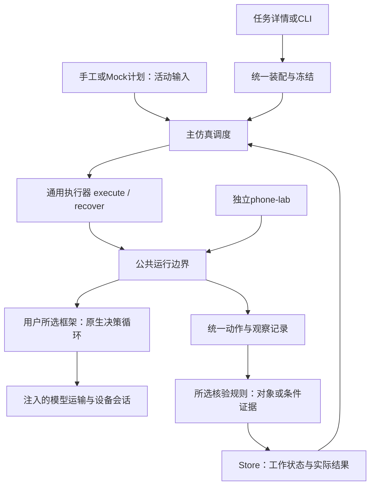
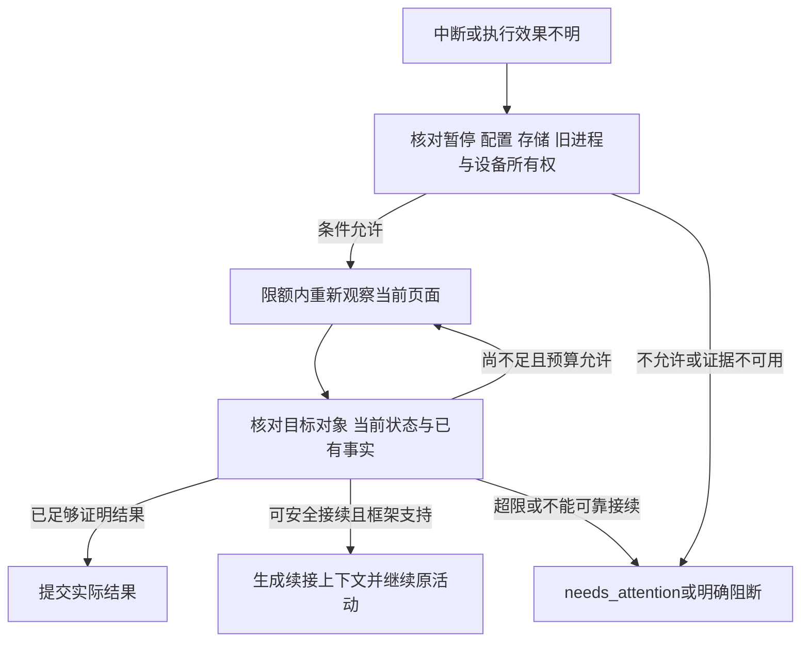

# v0.5 概要设计：下层执行能力接入整体流程

日期：2026-10-25。修订2，**待用户核对，尚未实现**。依据[已确认需求修订3](V05_REQUIREMENTS_CLARIFICATION.md)及[头脑风暴B01–B10](V05_BRAINSTORM.md)。用户已明确进入设计，并在版本计划复核时强调活动不固化；本稿替代此前暂停采用的设计修订1，旧稿保留在Git历史。

代码基线为`codex/v04-handoff-20261025`（`3a2672d`），工作分支`codex/v05-single-activity`。以下模块、数据、接口和阈值均为拟议方案；用户确认设计并授权实施后再改代码。手机、真实模型、视频和旧队列继续暂停。本稿没有执行工程用例、原生框架契约或GUI验收。

## 1. 版本边界与设计目标

v0.5将下层实现的部分能力接入主仿真流程：接收一个当前可执行活动，通过所选框架操作，记录实际结果，再交回现有调度。上层内容仍可手工／Mock，存档描述仍可Mock。v0.6接真实上层，v0.7接存档VLM形成完整闭环；见[版本计划](VERSION_PLAN.md)。

活动的APP、目标、条件、工作量和结束要求从计划／任务输入。商品浏览是首个验收案例，其“桌面→APP→搜索→详情”是可观察的验收流程，生产执行器不保存这套固定点击脚本。最终运行活动由上层产生；通用契约不等于本版已支持所有APP和活动。

优先复用现有调度、Store、三种原生框架和动作保护，不另建一套主调度。设计分为：通用活动与执行桥接、案例核验规则、公共执行保护三部分。固定回复与固定页面序列仅置于明确标识的离线夹具。

## 2. 现有实现与改动位置

| 现有位置 | 当前事实 | 拟议改动 |
|---|---|---|
| src/runner.mjs、src/scheduler.mjs | runner重导出scheduler；已有execute/recover、结果后反馈、单活动数量限制 | 保留稳定入口与顺序，增加工作状态、自动恢复和明确的目标活动校验 |
| src/contracts.mjs | 仅mode=mock，四角色provenance必须同模式，业务终态三种 | 兼容旧配置；支持模块来源和不同完成口径，关注状态独立于业务终态 |
| Web／CLI／scripts/web-worker.mjs | 各入口直接构造createMockAdapters | 统一装配，按操作需要懒创建资源；查看／导出／补描述不创建手机执行器资源 |
| src/store.mjs | schema=2，每活动唯一attempt；步骤为意图／完成；未知状态主要是活动标记 | 增量保存冻结输入、工作状态、证据台账、恢复与人工处理记录 |
| scripts/phone-lab-worker.mjs | 运输、权限、重复／坐标保护、设备和收尾集中在worker内 | 抽取公共运行边界供主系统和phone-lab分别调用 |
| src/phone-framework-registry.mjs、integrations/adapters | 固定注册表与run(context)，没有统一原生恢复接口 | 保留run，增加按框架声明和验证的续接能力，不假定原生会话可序列化 |
| src/phone-lab.mjs | 独立测试记录和父进程PID文件锁 | 共用设备仲裁与暂停检查，补充worker存活／退出交接 |
| src/phone-action-effects.mjs | 未知动作保留在投影中，不自动重放 | 新协议增加有证据的效果解决事件与恢复投影，保留原始unknown事实 |
| src/output.mjs、web/workspace.mjs | 多处按整Run的mock字段决定来源 | 按模块／图像／判定来源展示，补工作状态和案例证据，保留原有排序 |

此表来自源码只读核对，未修改上述实现。旧v10保护及历史真实矩阵不是新桥接与新恢复策略的验证成绩。

## 3. 总体结构与责任

主调度拥有顺序、结果提交后反馈和单活动推进；通用执行器拥有活动生命周期、恢复判定与核验结果汇总；框架拥有观察后的动作决策；公共边界拥有资源、动作记录、限额与停止；核验规则拥有该类活动的完成口径；Store拥有事实与幂等提交。phone-lab继续拥有自己的任务、矩阵与审核，不变成主调度。

主系统不通过“创建phone-lab测试并轮询结果”代替执行器。公共层接受记录端口，分别写主Store或PhoneEvidence，避免两套运行所有权混在一起。

## 4. 通用活动输入与装配

建议保留现有activity_id、user_id、virtual_date、virtual_start、app_id、goal、workload、end_condition和constraints，增加明确的完成规则引用与执行配置引用。目标条件应保留原文及结构化表达，结构化值不能篡改原始要求。

| 输入分组 | 内容与边界 |
|---|---|
| 身份与时间 | Run／用户／计划版本／活动、虚拟时间；沿用原有隔离和顺序校验 |
| 活动目标 | 目标APP与goal、条件、禁止事项、工作量单位／目标量、结束要求；来自上层，不从案例名称反推 |
| 完成规则 | 核验与身份规则ID／版本、需要的证据字段；仅选固定白名单，不接收网页代码／任意模块路径 |
| 执行组合 | 框架ID、模型服务或离线fixture引用、工具来源、设备与账号会话引用 |
| 运行约束 | 请求／动作／物理输入／时间／无进展／恢复上限、重试策略与来源 |

旧workload.object_count按原对象口径兼容。新契约应明确工作量单位，完成口径可为唯一对象计数或有限条件核验：查看指定信息等非商品活动不被强制包装成商品。结果中的实际量带单位；条件型任务保留条件达成情况，不伪造商品数量。旧字段在旧运行继续原义，新结果校验随契约版本区分；准确字段名在实施时统一。

建议新增src/runtime-assembly.mjs作为Web／worker／CLI共同入口。纯Mock旧Run无新增runtime配置时维持原行为；新组合按角色声明来源，例如上层mock、执行offline_fixture或phone_framework、描述mock，不能靠整Run一个real标志遮盖混合来源。查看操作只解析元数据；执行前才按来源创建会话，离线不解密真实凭据、不创建设备／网络资源。

Run固定角色装配策略；活动开始前冻结完整输入、计划版本、框架／adapter版本及实际源文件哈希、模型非密钥配置、工具／提示／核验协议与限额。恢复比较同一快照，失配显式阻断，不静默改组合。凭据只保存本地引用与非敏感修订标识，不能导出密钥值或公开密钥摘要；旧配置无法核对时保守处理真实恢复。

## 5. 一次活动的执行流程

1. 主调度核对前序结果／反馈，选择当前活动；任务页传入expected_activity_id和输入版本防止执行对象已变化。一次调试最多执行一项，不能按筛选跳序。
2. 统一装配校验能力与输入，冻结活动；不支持的框架、APP能力或完成规则显式受阻，不回退商品流程或Mock。
3. 取得Run执行租约及设备排他，检查暂停和环境条件，再创建执行资源。首个离线夹具起点为手机桌面；后续真实执行需核对起点，不隐式重置APP。恢复从当前页面开始，不重复回桌面。
4. 执行器调用注册框架，框架按目标与当前观察决策。每次动作经过保护与持久意图，实际观察和原始回复全部可追溯。
5. 每个核验点调用对应规则，保存新事实并更新对象／条件进度。重复或信息不足不增加完成量，商品信息不足继续寻找。
6. 达标立即收束；触限或受阻按实际量收束。中断或效果不明先进入自动核对与有界恢复，无法可靠继续才转needs_attention。
7. 事务提交结果／活动状态，再做一次Mock上层反馈。关注状态保存工作快照，阻断后续手机活动，不写普通终态反馈。已有图的描述可独立推进。

execute(context)建议返回result或needs_attention两类，result只含completed／partial／blocked；recover(context)返回安全继续的checkpoint、可直接提交的已核实结果，或needs_attention。旧Mock直接返回result的形式由兼容分支接受，不改历史记录。

保留recorder.beginStep/capture/finishStep，扩展动作发送边界、返回／拒绝／未知、核验与检查点记录。finishStep表示该步已收束，outcome必须写清工具结果和业务核验；不能将工具返回视为商品完成。与任何动作无关的观察以独立observation步骤容纳。每次观察事件保留，即使图像字节复用同一资产，也不丢掉观察次数和次序。

## 6. 商品案例规则与非商品扩展

建议固定规则注册表，先有商品浏览规则及一个最小非商品离线规则以验证契约。通用执行器调用verify(task, observations, priorProgress)，不检查goal是否包含“双肩包”之类关键词，不直接编排商品操作。核验规则只给出候选、证据与进度，不替代框架选择点击或搜索动作。

商品规则建议归一身份为app／店铺／商品主ID组合，同店同商品不同规格归为同一对象，跨店同款分别记录。具体平台若有可靠的全局商品ID，也须按冻结规则处理店铺和变体；不能根据任意URL变化生成新身份。字段不足则保存候选，不计完成量。

每个候选保存：原始身份线索、归一身份及规则版本、详情页证据、各条件的pass／fail／unknown、来源图／步骤／字段、重复关联。只有可靠身份、详情观察和必要条件均有依据时才计入一次。已知不合格为rejected，信息不足为unverified，重复观察关联既有对象。目标2实际1的案例必须投影为1和partial，数量不取框架总结。

离线核验由合成页面字段与明确ID提供。未来真实字段提取可使用现有布局、页面可见字段或框架观察输出，但必须保存字段来源并经过对应规则核验；模型声称完成、标题相似或置信度不能单独替代完成证据。自动核验结论与助手初判／用户审核分别保存，不能称用户已审核通过。当前不暗含新增真实VLM或任意APP通用识别能力。

T18的非商品夹具可表达“打开指定应用，核对一项指定信息”，使用自己的有限条件规则，输出条件证据；它不经过商品搜索和商品去重规则。这只证明活动契约可变化，不证明真实非商品任务已实现。新增实际活动仍需规则、能力和证据验证，不能靠增加一个活动名称宣称支持。

## 7. 自动核对与有界恢复

新增执行阶段recovering，作为中间状态。动作事实建议为intended→dispatch_started→returned／rejected／unknown→verified或有依据的resolved。缺少returned不能证明未发送；重建checkpoint也不等于重发原动作。

恢复观察不发先前的业务动作。它仍可能产生采集成本或页面影响，必须有证据和预算；不能承诺截图绝对无副作用。当前真实暂停仍禁止观察设备，只有离线注入会话可执行本轮恢复验证。

| 中断位置 | 自动处理与边界 |
|---|---|
| 持久意图前且工具未进入 | 从上一可靠checkpoint继续评估，不新增已发生事实 |
| 意图后、发送窗口内无返回 | 先观察和核对，不推断未发送，不直接重发 |
| 返回后、观察／核验前 | 根据新图和保存事实核验；能确认详情与条件时更新进度 |
| 对象已核实、结果前 | 从台账投影和幂等提交结果，不再次打开或计数 |
| 结果后、反馈前 | 仅补反馈，不进入手机执行 |
| 日志／图像关键部分丢失或存储不可写 | 停止新动作；不能补造证据，无法安全恢复时关注并报告缺口 |

框架续接能力按注册项声明并验证：同进程可继续、可从checkpoint重建，或仅可观察核对。现在三框架只有run(context)，尚无统一原生续接能力证据。实施必须补continuation钩子与离线契约；默认不能声称可重建。续接上下文保留当前页面、原目标、剩余工作量、已核实身份与未决事实，不从头重跑原prompt。无法安全重建时，自动观察仍可解决结果核验；仍需新动作且无法续接才人工兜底。

恢复策略在执行器及新协议投影中实现。当前actionEffects会保留unknown集合，不能只在外面catch后再次run；须增加带action_id、证据和revision的效果解决事件，在新协议中消除当前未决项，同时保留“曾经未知”的原始记录。公共抽取先保留phone-lab既有运行政策，自动恢复先由主系统新执行协议启用；phone-lab若采用新政策须单列协议与验证。旧phone-lab历史不回写，新协议改动单独标版本并回归。

## 8. 限额、进展与停止

请求、框架动作、物理输入、无进展、耗时和恢复次数分别计量；恢复消耗同时计入原活动总额度，重启／人工继续不自动清零。HTTP自动重试保持0，恢复中的新观察／决策是显式计量步骤。未返回usage和费用保持unknown。

以下仅为**离线用例建议值**，可按故障场景覆盖，不是用户已选定的真实预算或全局默认：

| 项目 | 离线建议 | 规则 |
|---|---|---|
| 单活动工作量 | 商品主例目标2，另设不同目标与非商品条件例 | 由夹具输入，执行器不得默认写死2 |
| 模型交互／框架动作／物理输入 | 20／40／80 | 全部替身计数；真实HTTP请求和设备命令均为0 |
| 活动总耗时 | 120秒，注入时钟 | 累计使用与deadline持久化，恢复不重置 |
| 连续无进展 | 5个核验轮次 | 重复对象、单纯换图或返回成功不重置 |
| 自动恢复 | 最多2轮且15秒内，同时受总额度约束 | 若无剩余额度则不追加观察，保留未决项 |

进展为新增已核实对象／条件，或首次到达有证据的有效检查点；同一检查点循环不反复算进展。恢复只为核实状态，不用于绕过活动到期继续搜新商品。达标为completed，有确定不足成果为partial，零成果受阻为blocked；未决执行状态优先needs_attention。硬性禁止事项违反单独标明，不能授予completed。

非商品活动按自己的完成条件和单位判定；实现若暂不支持其口径，应明确能力缺失并受阻，不填入虚构商品计数。真实上限与准入配置继续待用户恢复真实执行时确定。

## 9. 持久化与一致性

建议从schema=2增量迁移至下一版本，暂定3，保留旧表和一活动唯一attempt约束；进程重启继续同attempt，不实现隐式无限重试。迁移先在临时合成旧库验证，不打开私人运行库触发自动迁移；正式迁移先正常停服并备份。

| 拟议实体 | 最小内容与约束 |
|---|---|
| execution_snapshots | 活动／用户／attempt、完整冻结输入、规则与来源、非密钥配置、版本／哈希 |
| execution_events | attempt内连续序号、唯一事件ID、step／action关联、事实类型、原文／图引用和时间；追加式保存 |
| activity_work_state | revision、executing／recovering／needs_attention等phase、checkpoint、累计预算、实际进度、未决项和停止原因 |
| activity_objects／object_evidence | 商品等对象的可靠身份、条件、来源与重复关联；用户／活动范围唯一；信息不足候选不伪造可靠身份 |
| completion_evidence | 非对象条件核验及完成依据，避免商品实体成为所有活动的强制入口 |
| effect_reviews | action、三态意见、依据、操作者、版本和被替代记录；意见历史保留 |

事件是事实，当前工作状态是可重建投影；同ID同内容幂等，同ID异内容拒绝。商品唯一约束与证据关联防止重复计数，普通界面去重不能代替存储约束。

终态事务同时保存result、活动／attempt状态、最终工作投影和审计，再允许反馈。关注事务保存工作状态及未决项，不强行finish未知步骤、不写普通终态results，避免missingFeedback提前触发。已被可靠解决的步骤记录明确outcome，结果前再验证没有未决动作。状态修改采用expected_revision防并发覆盖。

图像沿用先写文件／flush／rename、再登记数据库，不能跨文件与SQLite承诺原子性。登记失败停止后续动作；孤立资产不是已登记证据。重启核对哈希、关联和事件连续性，结果事务失败从既有事实重算，不重采。全部存储不可写时停止并报告未保存成功，下次无法证明完整状态则保守关注。

## 10. 设备排他与资源收尾

Run内execution lease管理调度并发，设备锁管理同一安装下所有Run／Web／CLI／phone-lab输入。抽取共用仲裁模块，使用现有固定锁命名空间；离线用临时锁与逻辑设备，不写生产设备锁或解除暂停文件。

锁记录token、device_key、owner、Run／activity／attempt、host及父／worker进程身份。以排他创建取得锁；注册worker并完成交接握手后才能输入，每次输入验证有效token。父进程失活但worker或可控子进程仍活时不自动接管，单纯TTL／心跳过期不视为设备空闲；PID须配合启动身份核对，损坏锁或身份不明保留阻断。

停止后先禁止新输入，再等待在途操作完成或记录未知，保存最后允许范围内的观察与状态，清理框架和控制子进程，确认不再有控制者后按token释放锁。锁可释放与旧活动可安全恢复分别判断。暂停后不为收尾额外发真实截图／探测。账号会话单独引用，设备排他不证明虚拟用户真实账号环境隔离。

本版覆盖同一安装下受控入口；多份安装／多主机的分布式设备仲裁不在验收范围。视频能力不扩展、不启动，既有视频准备入口若共享设备须遵守仲裁。

## 11. 人工兜底、调试界面与接口

人工入口在needs_attention后出现，展示自动核对次数、停止原因、当前图、原动作、已核实进度与未决事实。可逐动作标记已发生／未发生／仍未知并写依据；保存意见零设备／模型动作，用户结论优先且版本冲突拒绝。

“继续”独立检查暂停、配置、旧控制者、设备锁、存储、预算和执行器续接能力，然后从当前状态恢复；不按标记直接重发原动作。“结束”停止本次调试：未决项仍存在则活动继续needs_attention，已核实数量保留；未决项解决后按事实投影终态。意见可解决动作效果，不能绕过缺失商品证据或配置失配。

保持用户库／仿真任务／系统设置三个主入口。在任务详情增加单活动调试子视图，显示输入目标和来源、当前观察与动作、对象或条件进度、自动恢复与人工历史、执行／反馈／描述／导出／作业各阶段。商品规则显示规格／店铺／重复；其他活动按自己的证据字段显示，通用页不强制出现商品搜索表单。

| 拟议操作 | 行为 |
|---|---|
| 保存／查看配置 | 只校验和展示，零执行资源副作用 |
| 执行当前一项 | 复用现有jobs的next_activity，加活动ID和快照版本检查 |
| 查看执行详情 | 返回冻结输入、步骤／图／原始回复、工作状态、恢复、对象／条件证据 |
| 请求停止 | 展示停止中，在途动作不伪装已撤回 |
| 复核／继续／结束 | 分离写意见与执行命令，均校验归属和版本 |
| 工程用例 | 临时测试Run选择夹具与注入点，标明offline_fixture，不污染用户Run |
| 补描述／导出 | 只消费已保存记录，不初始化手机执行资源 |

具体路由与CLI参数在实施时统一，表中不是现有API声明。所有操作按Run／用户／活动核对归属。导出保留事件顺序，增加模块来源、工作量单位、对象／条件证据、恢复和人工历史；needs_attention、缺图／缺描述与不完整状态明确，dataset_complete不代表所有业务目标达标。

## 12. 实施拆分与需求追踪

以下是设计核对后拟采用的实施顺序，**当前不开始实现**。

| 阶段 | 范围与门槛 | 需求 | 验收场景 |
|---|---|---|---|
| A 通用输入与装配 | 模块来源、冻结、旧Mock兼容；商品参数变化与非商品契约均能进入同一执行器 | R01、R02、R03、R04、R13、R16 | T01、T02、T03、T15、T18 |
| B 公共保护与进程边界 | 共用运行记录／运输／设备保护；争用和父worker故障下不双重输入，phone-lab保持可用 | R05、R06、R09、R13 | T04、T05、T08、T15 |
| C 完成证据与结果 | 商品身份／条件／去重及一般条件核验、事务与导出来源 | R07、R08、R14、R16 | T06、T07、T12、T16、T18 |
| D 自动恢复与人工兜底 | 发送窗口故障、自动解决unknown事件、框架续接能力、三态复核／显式继续结束 | R08、R09、R10、R15 | T08、T09、T10、T12、T17 |
| E 主流程与调试交付 | 单活动结果后反馈、阶段来源、补描述零重采、实际GUI入口与原生离线契约 | R04、R11、R12、R13、R14 | T03、T11、T13、T14、T15、T16 |

全部T01–T18是待实现验收定义，不能计为测试通过。分别报告纯替身集成、安装依赖下的原生框架契约、实际网页操作、真实手机效果；依赖缺失明确跳过，HTTP200不当作GUI入口验证。源码／测试／文档每轮验证后本地提交，进行中标WIP，不配置远程、不推送。

## 13. 重点取舍与限制

- 推荐抽取公共运行边界并桥接主执行器，保留原生循环；避免两套调度所有权、保护逻辑复制和双重派发。
- 活动目标与核验规则分开，固定案例只在夹具；接口通用性通过T18检验，实际APP支持逐项取得证据。
- 自动核对优先，安全续接按框架能力证明；不能把观察后重跑原prompt称为恢复，也不能把所有信息缺失都转人工。
- 商品身份提取、真实APP、正式案例参数与真实预算尚待落实。离线建议阈值和模块／数据命名为工程建议，未获用户单独确认。
- 本轮只有需求状态和概要设计文档；未实现迁移、续接钩子、新投影、界面或通用核验组件，真实设备／模型仍暂停。

当前唯一下一步：用户核对本概要设计，尤其是通用活动边界、自动恢复方式及实施范围。确认并明确进入实施后再编写代码。
