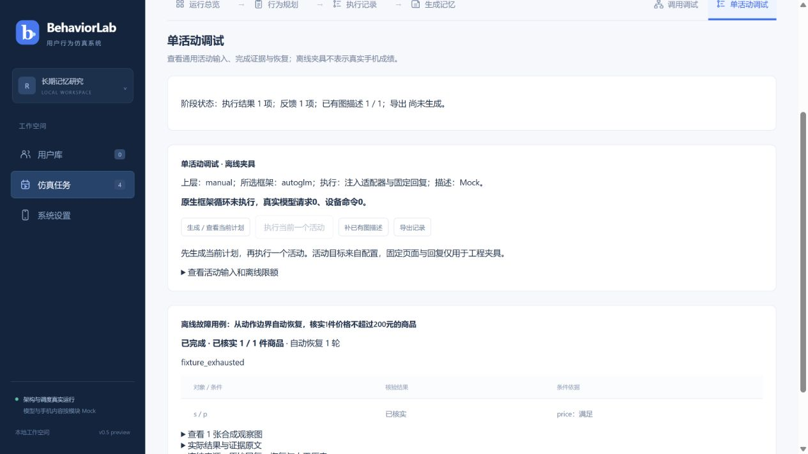
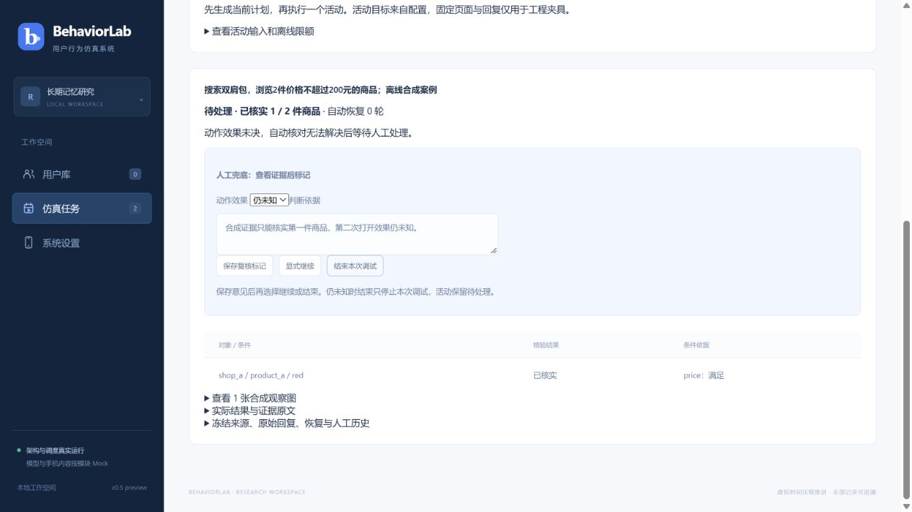
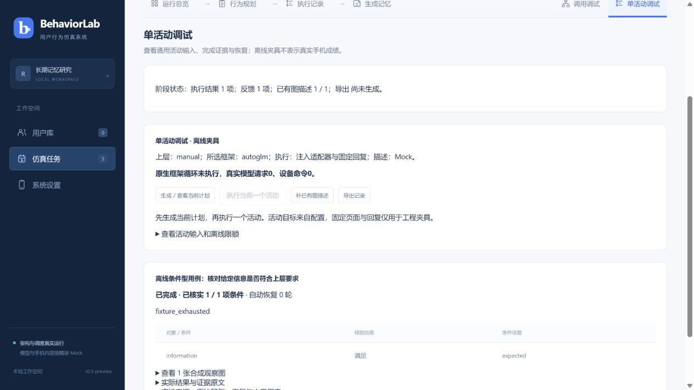

# v0.5-preview.1 使用说明与例子教程

适用源码：`0.5.0-preview.1`，实现提交`285593a`，分支`codex/v05-single-activity`。本文基于已实现入口编写；版本仍在开发，真实主系统框架会话桥接／安全续接尚未完成。当前Windows部署ZIP为旧preview.9，不能用它复现本教程的新入口。

## 1. 这个版本可以怎样使用

本版适合验证“上层给活动→主调度派发→下层记录实际量与证据→反馈→图像描述→导出”的离线流程，并练习动作效果未知时的自动恢复与人工兜底。

| 使用方式 | 当前行为 |
|---|---|
| v0.5离线工程用例 | 手工输入的活动、固定回复、合成观察图、注入动作；真实模型请求与设备命令均为0 |
| 原有普通Mock仿真 | 用户库、计划、执行／描述队列及导出继续可用；生成内容为Mock |
| 独立phone-lab历史能力 | 保留原有工作台与历史轨迹；本教程不启动手机、视频、探针或旧队列 |

在离线入口选择Midscene、MobiAgent或Open-AutoGLM，验证的是注册选择与主流程装配。此入口不会运行三个框架的真实模型／手机循环，因而不能据此比较框架成功率、速度或费用。无须填写API Key或连接手机。

商品浏览是第一个案例。APP、目标、条件和数量来自活动配置；后面的非商品案例演示同一调度入口可以核验不同完成条件。当前没有证明任意真实APP都可执行。

## 2. 启动一个独立演示环境

打开PowerShell，进入当前源码目录，确认Node.js为24：

```powershell
Set-Location 'D:\work\Memory\UserBehaGene\dev'
node --version
node src/web-server.mjs --port 4391 --data .build/v05-tutorial-web
```

保持窗口打开，在浏览器访问[离线演示入口](http://127.0.0.1:4391)。演示数据保存在仓库内的`.build/v05-tutorial-web`，已有4317服务和私人数据无需重启或迁移。该目录由Git忽略；再次用相同命令启动会保留之前创建的演示案例。

若`node`命令不可用，先将已安装的Node 24加入PATH，或用其可执行文件的完整路径代替`node`。本教程无需配置Python或框架SDK。端口4391被占用时可改为4392，并相应修改浏览器地址。

结束时回到这个PowerShell窗口按`Ctrl+C`。它关闭本次服务，保留演示数据。不要删除历史`.data`或`.runtime`来重置案例。

## 3. 先认识操作顺序和结果

进入“仿真任务”，找到“v0.5 离线工程用例”面板。选择框架和场景，点击“创建离线案例”。网页会创建独立任务并进入“单活动调试”。每次创建生成新的Run；选择会在该浏览器中保留，修改选择只影响之后创建的案例。

在新任务中按顺序操作：

1. 点击“生成／查看当前计划”，等待作业结束，出现活动卡片。
2. 点击“执行当前一个活动”，等待执行结束；每次最多推进一个活动。
3. 查看实际／目标、证据分类和自动恢复轮次。
4. 按需展开“查看…张合成观察图”“实际结果与证据原文”“冻结来源、原始回复、恢复与人工历史”。
5. 需要导出时点击“导出记录”。描述未完成或失败时先用“补已有图描述”；它只处理已保存图像，不重新采集活动。

| 活动状态 | 怎样理解 |
|---|---|
| completed／已完成 | 已核实量达到目标，或指定条件已满足 |
| partial／部分完成 | 有已核实成果，但少于目标，且没有未决动作效果 |
| blocked／受阻 | 没有可计入的成果，执行已按原因结束 |
| needs_attention／待处理 | 仍有无法安全解决的问题；保留已知进度，等待复核，不当作普通终态推进 |

任务顶部的“已完成”或作业结束，表示流程阶段完成，不保证每个活动达标。`dataset_complete:true`表示规划、终态、反馈、图像描述和证据完整性等已满足导出条件；一个业务结果为partial的活动，也可以形成完整的数据集。

## 4. 例子一：目标2件，实际只核实1件

选择场景“商品：2目标／1实际／重复与条件”，框架可选Midscene；创建、生成计划、执行一项。

活动要求搜索“双肩包”，浏览2件价格不超过200元的商品。合成轨迹从手机首页开始，包含启动APP、搜索和详情观察。表中的页面是预先提供的工程数据，实际手机没有被操作。

| 观察到的商品 | 判断 | 计数变化 |
|---|---|---|
| 店铺A／商品A／红色，159元 | 身份明确、详情及条件满足 | 0→1 |
| 店铺A／同一商品A／蓝色，159元 | 同商品不同规格，重复 | 保持1 |
| 店铺B／商品B，249元 | 不满足价格上限 | 保持1 |
| 店铺C／商品C，没有价格 | 条件未知，待核实 | 保持1 |

预期看到“部分完成 · 已核实1／2件商品”，结果`status:partial`、`completed_count:1`。合成轨迹已耗尽，结束原因为`fixture_exhausted`。未知价格不会自动当作合格；普通商品信息不足也不会立即要求人工复核。

展开证据原文可以核对被拒绝、重复及待核实对象。展开合成图可以查看桌面与详情观察；动作与固定原始回复在执行历史中保存，并非每条动作都产生一张新观察图。

## 5. 例子二：先自动恢复，不要求人介入

选择“未知效果经自动观察解决”，创建新案例后生成计划并执行一项。

这是从动作边界开始的故障子例：打开商品动作的返回效果为未知，后续合成观察提供明确的效果解决记录和符合条件的详情。系统保存原来的未知事实，再追加恢复证据，接续执行，不重新派发原动作。

预期：已核实1／1件、活动已完成、自动恢复1轮、没有人工复核要求。它验证恢复流程，不能证明框架已具备真实手机会话续接能力。



## 6. 例子三：自动核对无法解决，人工兜底

选择“自动核对无法解决，转人工”，创建、生成计划、执行一项。

此例先核实1件商品，再遇到“打开下一件”动作效果未知，夹具没有提供能够解决它的恢复观察。预期进入待处理，保留1／2件，出现“人工兜底：查看证据后标记”。此时尚未生成普通活动结果和上层反馈。

先演练最保守的一条分支：

1. 展开合成图、原始回复及恢复历史，查看现有证据。
2. “动作效果”选择“仍未知”。
3. “判断依据”填写：`合成证据只能核实第一件商品，第二次打开效果仍未知。`
4. 点击“保存复核标记”。应提示“复核意见已保存，没有触发动作”。
5. 点击“结束本次调试”。活动仍为待处理，已知1件保留，不会伪造partial终态；未决情况下不能显式继续。

“已发生／未发生”只代表对该动作效果的判断，并不等于又完成了一件商品。即使标记已发生，仍需商品身份与条件证据才能增加计数。

若要单独演练已知效果分支，创建另一个同场景案例，在判断依据中明确写“离线工程用例：注入已发生判定，仅验证结束分支”，保存“已发生”后点击“结束本次调试”。预期以已有1件生成partial并补本活动反馈；不执行后续活动。这是人为注入的测试判定，不能作为真实证据。不要为让案例变绿而把不确定的实际动作标成已发生。

“显式继续”在效果已解决后接续剩余夹具，不重放旧动作。这个内置案例的未知动作已经位于轨迹末尾，因此继续后也只有已核实1件，预期为partial；想看到继续后新增成果，需要在新配置中提供后续合格观察。

复核意见写入历史后会有新版本。遇到“Execution revision conflict”时刷新详情、核对最新意见再操作，避免用另一个窗口的过期状态覆盖新记录。已保存意见持久化；尚未保存的判断依据只是当前页面草稿，不应依赖刷新后仍保留。



## 7. 例子四：换成非商品活动

选择“非商品：核对指定信息”，创建、生成计划、执行一项。

这个案例把APP标识改为`fixture_information`，目标为核对指定信息，完成规则为`information == expected`；没有商品搜索或商品计数要求。

预期：已核实1／1项条件，证据表显示`information`满足`expected`，活动已完成，自动恢复0轮。它说明目标和完成单位可以来自上层输入，不必修改调度器或把活动固定成购物；依然只是合成契约演示。



## 8. 命令行教程：执行、补描述、导出和检查

命令行适合复现固定配置和查看文件。它与网页使用同一装配实现，但CLI当前没有人工复核命令；人工兜底建议用网页新建案例练习。网页数据根目录与下面CLI单Run目录分别管理，CLI数据不会自动出现在另一个数据根目录的网页列表里。

在仓库目录新开PowerShell，用一个尚未初始化的数据目录执行：

```powershell
Set-Location 'D:\work\Memory\UserBehaGene\dev'
node src/cli.mjs init --config examples/offline-single-activity.json --data .build/v05-tutorial-cli
node src/cli.mjs run --data .build/v05-tutorial-cli --no-descriptions
node src/cli.mjs status --data .build/v05-tutorial-cli
node src/cli.mjs describe --data .build/v05-tutorial-cli
node src/cli.mjs export --data .build/v05-tutorial-cli
node src/cli.mjs check --data .build/v05-tutorial-cli
```

`init`只初始化一个新Run，不执行活动；`run`会生成所需计划、执行当前一项并完成正常反馈。这里故意加`--no-descriptions`，让你观察“执行完成但图像尚未描述”的独立阶段；随后`describe`只处理已有图。默认不加此选项时，run同时处理描述。

预期最终活动结果为partial、实际1件；导出`dataset_complete:true`，检查`integrity_passed:true`。这个检查验证数据完整性，没有给自主行为或自然性打分。

导出文件在`.build/v05-tutorial-cli/export`：

| 文件 | 内容 |
|---|---|
| run.json | 输入配置、活动结果、反馈、执行快照、工作状态与恢复／人工历史等 |
| events.jsonl | 逐图事件、动作、结果及描述关联，一行一个JSON |
| check-report.json | 完整性问题与检查结论，由check生成 |

这些文件引用Run的`assets`，没有把图像打进一个独立包。复制或备份时保留整个Run目录及其中`state.sqlite`和`assets`；仅复制export目录不足以保存全部原始证据。网页“导出记录”也生成在所选网页数据根目录的对应Run下，不等于自动下载完整ZIP。

重复`run`会恢复保存状态，已完成的活动不会重新采集。对相同目录重复`init`会提示已初始化；重做一次实验请换新目录，不覆盖或删除旧Run。描述失败时用：

```powershell
node src/cli.mjs describe --data .build/v05-tutorial-cli --retry-failed
```

它仍只补已有图，并遵守描述尝试次数上限。修改输入文件不会自动修改已初始化Run。

## 9. 修改一个参数，得到两件合格商品

下面演示“输入改变→核验结果改变”。保留原始例子，生成新的配置文件；将价格上限从200改为300，保持目标2件。不要只改goal文字，执行核验读取的是`completion.conditions`。

```powershell
Set-Location 'D:\work\Memory\UserBehaGene\dev'
New-Item -ItemType Directory -Force -Path .build | Out-Null
$tutorialConfig = Get-Content examples/offline-single-activity.json -Raw -Encoding utf8 | ConvertFrom-Json
$tutorialConfig.run_id = 'offline_price300'
$tutorialConfig.activities[0].goal = '搜索双肩包，浏览2件价格不超过300元的商品；离线合成案例'
$tutorialConfig.activities[0].completion.conditions[0].value = 300
$tutorialJsonPath = Join-Path (Get-Location) '.build/offline-price300.json'
[IO.File]::WriteAllText($tutorialJsonPath, ($tutorialConfig | ConvertTo-Json -Depth 30), [Text.UTF8Encoding]::new($false))
node src/cli.mjs init --config .build/offline-price300.json --data .build/v05-price300-cli
node src/cli.mjs run --data .build/v05-price300-cli
node src/cli.mjs export --data .build/v05-price300-cli
node src/cli.mjs check --data .build/v05-price300-cli
```

预期店铺A／商品A计1件，同商品蓝色仍不重复；店铺B／商品B的249元现在满足条件，累计2件，活动为completed。达到目标后停止，不需要继续验证轨迹里的所有候选对象。

同理可以在初始化前把`runtime.executor.framework_id`改成`mobiagent`或`autoglm`。它改变注册分支及来源记录，仍是夹具执行。修改关键词时应同步目标和夹具里的搜索参数；只改自然语言不会让固定轨迹自动生成新页面。修改APP时应同步`apps`及活动的`app_id`。不支持的来源、错误ID或非法限额会被拒绝，不会静默改用真实模型或另一框架。

已初始化的Run冻结了输入与代码来源。修改配置／源码后做新实验，使用新Run和新目录；源码变更时重启独立演示服务。出现来源失配不要直接改库或删除锁来强行恢复。

## 10. 常见现象

| 现象 | 解释与处理 |
|---|---|
| 找不到v0.5面板 | 确认使用当前源码启动的4391，旧4317或preview.9部署包没有新入口 |
| 执行按钮不可用 | 先生成计划，等待作业结束；待处理状态需先走复核流程 |
| 图像像数据卡片而非手机页面 | 当前是明确标识的合成观察图，属于预期 |
| Run显示已完成，但商品只有1／2 | 查看活动卡片的partial；流程终止不等于业务目标全部达成 |
| 未知效果结束后仍待处理 | 预期行为，保留未解决的事实，不伪造普通终态 |
| integrity检查未通过 | 查看check-report.json的issues；补描述只修描述问题，未决动作要按复核流程处理 |
| Data directory already initialized | 使用新目录，或对已有目录执行run／status；不重复init |
| Execution sources changed／source mismatch | 核对版本并重启演示服务；新代码用新案例，不强行改写冻结来源 |
| 设备／执行锁提示占用 | 先确认其他作业是否仍在运行；无法确认所有权时保留阻塞，不直接删锁抢占 |

本教程不要求重新跑154项工程回归。需要了解验证范围、schema迁移、原生循环证据及尚未实现部分时，阅读[首轮离线实现记录](V05_OFFLINE_IMPLEMENTATION.md)；后续开发任务见[NEXT_TASK](NEXT_TASK.md)。
